# bevy_elements

> ⚠️ **Vibe Coded** — written by an AI agent working from a human's direction. It is used in a shipping game and covered by tests, but it has had no line-by-line human audit. Read it before you trust it.

**Living environments for Bevy 0.20.** A sun and moon placed by real ephemerides, the bright-star sky, a seeded climate that schedules hourly weather, a GPU wind field, volumetric clouds that shade the ground, rain and snow, lightning and thunder, distance and ground fog, and exposure that keeps night looking like night. Simulation runs in compute shaders; gameplay asks the `Environment` system parameter and is answered from a throttled async readback.


*The `weather_tour` example forcing `WeatherPreset::ALL` in turn, one preset for 20 s, with the clock unpaused and running at 1× from 10.00 h: 262 frames, 512 × 288, 34 s of playback over 210 s of game time, the hour finishing at 10.06. The stills for each system are in the sections below, and `weather_tour` is listed under [Examples](#examples).*

## What is in it

| Plugin | Module | What it does |
|---|---|---|
| `ClimatePlugin` | `climate` | `Climate` presets, seasons, a seeded hourly weather scheduler, `WeatherDirector` to force and release weather, `SurfaceWeathering` (wetness, snow cover), `ClimateHistory` (the last days' temperatures, humidity and precipitation) |
| `CelestialPlugin` | `celestial` | `WorldClock`, `GeoLocation`, Meeus-accuracy sun and moon (`astro`), sun and moon `DirectionalLight`s for Bevy's atmosphere, the bright-star sky, a shaded moon disc, exposure |
| `WindPlugin` | `wind` | A camera-centred stable-fluids wind field on the GPU, curl-noise turbulence, travelling gusts, a public WGSL import |
| `FogPlugin` | `fog` | Distance fog from the weather's visibility and a camera-following ground-fog volume written by compute |
| `CloudPlugin` | `clouds` | Volumetric clouds ray-marched in compute from a weather map that follows `Weather` (cover, type, precipitation), lit with the sun colour from Bevy's atmosphere and composited before tonemapping; a cloud shadow map (`CloudShadows`) that dims the sun and shades the ground; rainbows (`RainbowSettings`) where a shower stands opposite a low sun |
| `LightningPlugin` | `lightning` | Seeded Poisson strikes from `Weather::storminess`, Reed & Wyvill bolts as additive ribbons, a flash `PointLight`, `LightningFlash`, and `Thunder` delayed by distance / 343 s |
| `PrecipitationPlugin` | `precipitation` | Rain and snow as a GPU particle set in a 60 m box around the camera (Marshall–Palmer drop sizes and fall speeds, wind-field advection, `PrecipitationBlocker` roofs, ground splashes), drawn soft-faded against the depth prepass; the far-field shafts and haze are part of `FogPlugin`'s density kernel |
| `TerrainPlugin` | `terrain` | A heightfield `Terrain` (procedural presets, a height map or level ground) generated on the GPU into per-cell layers, drawn with a CDLOD patch pool and a slope/sediment layer-blending material — the rock wears its own material (a succession of bedded layers, each of its own colour, a palette of different rock, two families of joints, fractures, a grain and a relief of its own) and breaks into irregular fragments of many sizes — the pieces a rock mass is made of, each a flat facet with its own tone and a dark joint at its edge and the ground's turf, soil and sand wear theirs, with patches of bare earth at a scale of tens of metres and a palette of dry and fresh grass over the turf, so the ground is a meadow and not one green — and the scree at the rock's foot is a scatter of stones of many sizes with turf between them, not a band of mixed colour — or shaded on your own mesh with `GroundExtension`; `Environment::terrain_height`; the wind solid mask and precipitation use its height |
| `WeatheredPlugin` | `weathered` | `WeatheredMaterial` for any mesh: wet surfaces darken and gloss, rain streaks down walls, up-facing faces whiten under snow with `bevy_flora`'s curve, cloud shadows; one shared `ElementsGlobals` storage buffer, a per-material `exposure` for shelter |
| `HydrologyPlugin` | `hydrology` | Flooding, rivers and lakes as one shallow-water field on the terrain grid (Mei et al. 2007 virtual pipes with a depth-dependent pipe area and Manning friction), `WaterSource` and `WaterSink`, rain split into rain and snow per cell, hydraulic erosion with flux-form sediment transport, thermal erosion, `ErodeTerrain` bakes, and `Environment::water_depth` / `water_velocity` |
| `WaterPlugin` | `hydrology` | Draws the hydrology's water over the terrain (`WaterSettings`): a second CDLOD patch pool displaced to bedrock + sediment + water, a per-channel Beer–Lambert *absorb* pass (`AlphaMode::Multiply`, thickness from the depth prepass with Snell's refraction) and a *surface* pass (`AlphaMode::Add`: Fresnel reflection of the sky and sun, silt body colour, foam), flow-mapped ripples (Vlachos 2010, two phases) from the simulated velocity, and the sun's path through the water to the bed; the pool also draws for `TerrainRender::External` |
| `GroundCoverPlugin` | `cover` | Snow and wetness maps on the terrain grid: snow accumulates at each cell's own rain–snow split and shelter, densifies, drifts with the wind, smooths and melts into hydrology's water (degree-day, Hock 2003), wetness follows rain and evaporation; the terrain and ground materials shade snow, wet darkening and gloss, and puddles with ripples; `SurfaceWeathering` becomes the map's mean around the camera; `Environment::snow_depth` and `wetness` |
| `RocksPlugin` | `rocks` | Boulders and stones on the terrain as meshes, with silhouettes and cast shadows: sized by Golombek's exponential rock-abundance law, angular talus blocks below cliffs (in heaps), rounded rocks in patches over the meadow and more on steep hillsides, none on sand or on the cliffs; each seated on the surface the CDLOD patches draw and drawn to a distance in proportion to its size, shrinking away at the end of its range; `WeatheredMaterial` with a stone grain, so the rocks take snow, rain and cloud shadows; `RockSettings`, `ScatteredRock` (for a game's colliders) and `RockStats` |
| `DustPlugin` | `dust` | Wind-blown sand on the terrain's `sediment` layer: a capacity `k u² (u − u_t)` from the 10 m wind with Venturi speed-up and 15° lee shadow (Paris et al. 2019), a line scan that relaxes the flux over the saturation length and moves the bed by the flux divergence (conserving sand exactly), then hydrology's thermal kernels avalanche it at 34°; runs only while the wind can exceed 8 m/s. `Weather::dust` also fills 40 % of the precipitation particle buffer with tan sprites (`kind = 2`) and tints the ground fog |
| `TrailsPlugin` | `trails` | Footprints, ruts and tracks: `Imprint` components press a centimetre field that follows the focus to their Bekker–Wong sinkage (CRREL's compaction limit in snow) with a rim of the displaced material, sweeping the path between frames; new snow fills it, wind smooths it, sand and mud slump; on the crate's terrain or a game's own ground (`TrailGround`); the terrain and ground materials and `WeatheredMaterial::with_trails()` draw it per pixel with parallax occlusion mapping and a soft self-shadow; `Environment::trail_depth`; `TrailState` for custom shaders |
| `PathsPlugin` | `paths` | Roads and paths laid across the terrain: a `PathNetwork` of `Path`s — a polyline, a half width, a `PathKind` (earth, gravel, stone or a packed snow track) and a rut depth — rasterised once into an **8-bit coverage distance field** over the terrain (`rgba8unorm`, its alpha a per-texel grain), which the terrain material reads per fragment: the turf gives way to bare, compacted earth with its own grain and a dish cross-section whose verge catches a grazing sun, snow cleared where traffic runs, and the ruts pressed along the route's wheel lines; the block is compiled only into a terrain whose network has routes, so a terrain without paths pays nothing; `PathState` for custom shaders |
| `WavesPlugin` | `waves` | Ripples and wakes: `WaterContact` ellipsoids press the hydrology's water with the pressure head of their column and their entry's impact; a dispersive capillary-gravity wave field in three camera-following cascades (iWave with a kernel fitted to Airy's dispersion) reflects off the shores, slows in the shallows, follows the current, breaks into foam; drawn by the water's passes; `WaveState` for custom shaders |
| `VoxelPlugin` (feature `isomesh`) | `voxel` | Snow on `bevy_isomesh` voxel volumes: `VoxelGround` on a `VoxelVolume` scans the column tops into an external `Terrain` the snow, wetness and hydrology maps run on, and `SnowyField` adds the snow depth back as a slab over the tops, swapped per column when it moves half a voxel, remeshing only the chunks that changed; tunnels stay clear; erosion is off for voxel ground. `VoxelSnow` puts the same slab on any number of volumes over a game's own ground, with no terrain |
| `ElementsFloraPlugin` (feature `flora`) | `flora` | Drives `bevy_flora`'s wind, gusts, season and wetness, and `FloraGround` from the terrain's height snapshot |

`ElementsPlugins` adds every plugin above except `ElementsFloraPlugin`, and adds `VoxelPlugin` with the feature `isomesh`. Each is public on its own, so `ElementsPlugins.build().disable::<FogPlugin>()` works.

## Install

```toml
[dependencies]
bevy_elements = "0.7"
# Snow on bevy_isomesh voxel volumes:
# bevy_elements = { version = "0.7", features = ["isomesh"] }
```

## Quick start

```rust,no_run
use bevy::prelude::*;
use bevy_elements::*;

fn main() {
    App::new()
        .add_plugins((DefaultPlugins, ElementsPlugins))
        .insert_resource(
            WorldClock::new(CivilDate::new(2026, 6, 21))
                .at_hour(7.0)
                .with_time_scale(120.0),
        )
        .insert_resource(Climate::temperate())
        .add_systems(Startup, setup)
        .run();
}

fn setup(mut commands: Commands) {
    // The environment follows and renders for the `ElementsCamera`.
    commands.spawn((
        Camera3d::default(),
        ElementsCamera::default(),
        Transform::from_xyz(0.0, 160.0, 0.0).looking_at(Vec3::new(100.0, 100.0, 0.0), Vec3::Y),
    ));
    // 2 km of rolling hills, centred on the origin.
    commands.spawn(Terrain::procedural(ProceduralTerrain::hills(42)));
}
```

## Contents

Everything past here is reference. The API is in five groups:

- [Putting it in a scene](#putting-it-in-a-scene) — [frame order](#frame-order), [the camera](#the-camera) (keeping your own look, a focus and isometric cameras, world units)
- [Sky, weather and light](#sky-weather-and-light) — [clock, sun, moon and stars](#clock-sun-moon-and-stars), [climate, seasons and weather](#climate-seasons-and-weather), [wind](#wind), [fog](#fog), [clouds](#clouds), [precipitation](#precipitation), [lightning](#lightning)
- [Terrain and ground](#terrain-and-ground) — [terrain](#terrain), [ground cover](#ground-cover), [rocks](#rocks), [dust storms](#dust-storms), [paths and roads](#paths-and-roads), [trails](#trails)
- [Rivers, lakes and waves](#rivers-lakes-and-waves) — [hydrology and erosion](#hydrology-and-erosion), [water](#water), [waves](#waves)
- [Surfaces, materials and voxel snow](#surfaces-materials-and-voxel-snow) — [weathered materials](#weathered-materials), [snow on voxel volumes](#snow-on-voxel-volumes)

And: [gameplay queries](#gameplay-queries) · [plays well with](#plays-well-with) · [performance](#performance) · [platforms](#platforms) · [what it deliberately does not do](#what-it-deliberately-does-not-do) · [compatibility](#compatibility) · [research](#research) · [examples](#examples) · [license](#license)

## Putting it in a scene

### Frame order

Everything runs in `Update` in the chained sets `ElementsSystems::{Clock, Weather, Celestial, Simulation, Readback}`. Systems that write `WorldClock`, `WeatherDirector` or settings run `.before(ElementsSystems::Clock)`; systems that read `Environment` run `.after(ElementsSystems::Readback)`.

### The camera

`ElementsCamera` marks the camera the environment follows. Adding it inserts, where absent: `AtmosphereSettings`, `AtmosphereEnvironmentMapLight`, `DepthPrepass`, `VolumetricFog`, `DistanceFog`, and a zero per-camera `AmbientLight` (sky light comes from the atmosphere's environment map), and it spawns one Earth `Atmosphere` if there is none. It sets `Msaa::Off` (the depth prepass and the precipitation pass read the depth texture single-sampled). A camera that kept Bevy's default clear colour is cleared every frame to the night sky's own faint glow at its exposure (the space behind the atmosphere); one that set its own `ClearColorConfig` keeps it. With `auto_exposure` (the default) the camera's `Exposure` follows the sun, sky and moon: illuminance-metered like Ghost of Tsushima, mapped with Ward's contrast-based scale factor over Larson et al.'s rod-and-cone thresholds, so a moonlit scene stays dark instead of being exposed up to daylight; around sunset it is capped by the sky toward the sun, so the golden hour and the twilight glow keep their colour instead of turning white. `ElementsQuality` (`Low`, `Medium`, `High`, `Ultra`) sets every resolution and step count.

#### Keeping your own look

Each part of that dressing is a flag on `ElementsCamera`, all on by default: `atmosphere` (Bevy's sky; without it the cloud layer is not drawn on the camera, but the cloud shadows still fall), `distance_fog`, `volumetric_fog`, `ambient` and `msaa_off`, besides `auto_exposure`. A flag that is off inserts nothing and leaves your own component alone (the crate stops driving your `DistanceFog` or `AmbientLight`); turning one off at runtime removes only what the crate inserted, so a game can toggle the physical sky in its options. `ElementsCamera::bare()` turns them all off (keep `msaa_off` on for the rain and snow, which the precipitation pass draws single-sampled). `CelestialSettings { lights, sky }` stops `CelestialPlugin` spawning and driving the sun and moon lights, and the moon disc and stars; `SunState` stays current either way, so the ground still dries in the sun. Mark your own key light `Sun`: the crate then never touches it, the rain and snow are lit by it (and by your camera's `AmbientLight`), and the cloud shadows fall along it. `docs/research/integration.md`; the `isometric` example with `ELEMENTS_LOOK=game`.

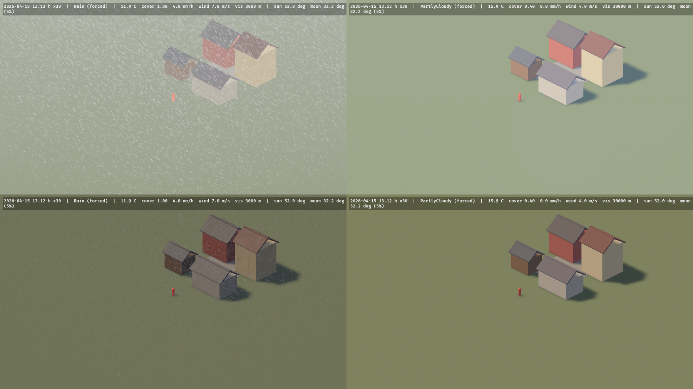

#### A focus, and isometric cameras

The camera-relative domains (the rain and snow box, the wind window and its gusts, the ground fog, the strikes and the thunder distance, the cloud weather and shadow maps, the trails and waves windows, the surface weathering's mean) centre on the camera. Put `ElementsFocus` on the camera to centre them on something else: `ElementsFocus::Entity(player)` follows that entity's transform, `ElementsFocus::Point(p)` a point you move yourself. A third-person camera puts it on the character; an isometric or top-down game, whose camera stands far back from what it shows, on the player or on the point the camera looks at.

Orthographic cameras (`Projection::Orthographic`) work: the clouds are marched along the view's parallel rays, starting on the plane through the focus (so the camera's stand-off is not air and a camera high above a low deck is not inside it: looking down, the clouds show as their shadows), and the bolt keeps two pixels of core at every distance. For an orthographic followed camera the crate also adapts what Bevy measures from the camera's translation: the distance fog becomes linear from the nearest ground the view shows (`orthographic_fog_falloff`), the sun and moon shadows one cascade around the focus, the rain box grows to cover the view's footprint (up to 240 m across) and its drops are drawn without the distance fade (a drop is a twentieth of a pixel at a strategy zoom), the ground-fog volume is off (every orthographic ray would cross the whole layer at one slant), and the terrain's patches are selected and morphed about the focus (without one, about where the view's ray first meets the ground) in every view, so the ground on screen is drawn at full detail on the height map's own samples and a figure standing on `Environment::terrain_height` stands on what is drawn. A perspective camera is unchanged. `docs/research/view-anchor.md`, `docs/research/orthographic-lod.md`; the `isometric` example, and `terrain_tour`'s `ELEMENTS_ORTHO` and `ELEMENTS_PINS`.

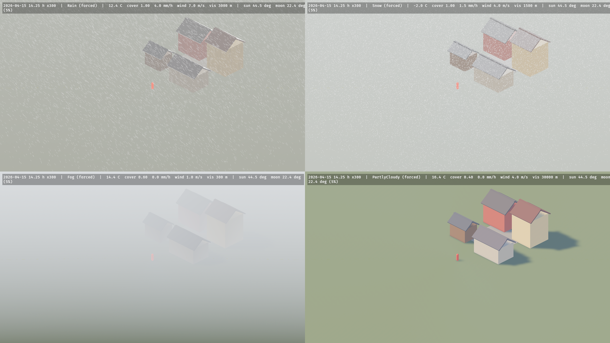


#### World units

The crate works in metres. A game whose world unit is something else inserts `ElementsUnits { units_per_metre: 3.2808 }` (feet; 100.0 for centimetres) and the weather is sized for its world: the rain box, the wind cells, fog, clouds and the sky's aerial perspective, lightning and its light, shadow cascades, the terrain and water. Positions the crate reads and gives back are world units (`Transform`s, `ElementsFocus::Point`, the `Environment` query positions and `terrain_height`, strike, thunder, flash and gust positions); lengths, depths and speeds stay SI (`Thunder::distance_m`, `Terrain` extents and heights, blocker, contact and imprint half extents under their transforms, `wind_at` in m/s). A scene built in feet renders as the same scene in metres (`docs/research/units.md`); `ELEMENTS_UNITS=3.2808` runs an example in feet, which reproduces it exactly where its world is the crate's (`terrain_tour`, `quickstart`), while an example's own props keep their metre sizes.

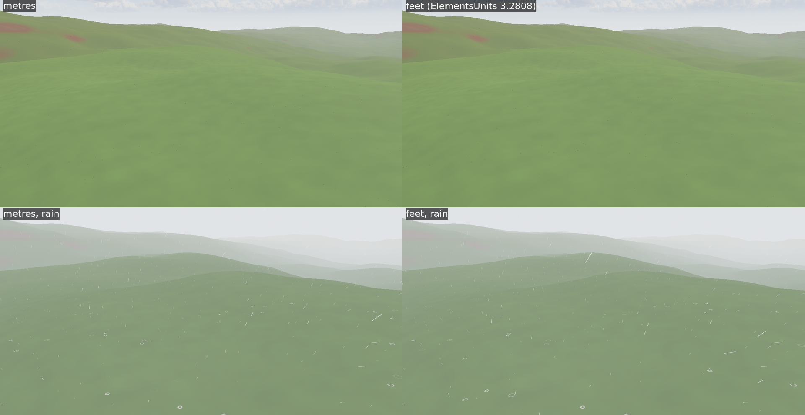

## Sky, weather and light

### Clock, sun, moon and stars


`WorldClock` holds the local date and hour and advances by `Time<Virtual>` × `time_scale`; `GeoLocation` places the observer. `SunState` has the sun's and moon's directions, true altitudes, the synodic phase and the lit fraction. The `astro` module exposes the ephemeris functions (Meeus ch. 7–48: sidereal time, nutation, the sun at 0.01°, the moon from a 51 + 34-term series, phase, refraction, the USNO total-illuminance factor), each tested against the book's worked examples and the SPA reference case. Stars are the 8404 Yale Bright Star Catalogue stars to V = 6.5, precessed to the date, coloured from B−V; the moon is a Lommel–Seeliger-shaded disc from NASA's LROC map. See [`src/celestial/PROVENANCE.md`](src/celestial/PROVENANCE.md).

 

### Climate, seasons and weather

`Climate` (`temperate`, `alpine`, `desert`, `tropical`, `tundra`) drives an hourly Markov scheduler over ten `WeatherPreset`s, seeded and frozen by a golden test, with temperature from annual and diurnal harmonics and a −6.5 °C/km lapse rate. `Weather` is the blended state every domain reads (cover, precipitation, temperature, humidity, wind, gustiness, visibility, storminess, dust). `WeatherDirector::force(preset, transition)` overrides it and `release(transition)` hands it back to the scheduler, which kept stepping meanwhile. `SeasonState` carries meteorological seasons and 0–1 autumn, leaf-fall and blossom curves; `SurfaceWeathering` the wetness, snow cover and snow depth of exposed ground. Messages: `WeatherChanged`, `SeasonChanged`.

**A snow season.** The rain–snow split follows the temperature alone (all snow at −1 °C, all rain at 2 °C), so a cold autumn night snows whatever a game's calendar says. `Climate::snow_season = Some(SnowSeason { first: (11, 14), last: (3, 31) })` gives the dates (local calendar, inclusive, wrapping the year) between which snow may fall: outside them the scheduler never picks Snow or Blizzard and all precipitation falls as rain (`Weather::snow_possible` is 0, and `Weather::snow_fraction` and the cover and hydrology kernels all scale by it), changing phase over the hour before the first day and after the last. A forced Snow or Blizzard still snows; snow already lying melts as usual. Inside the season nothing changes. `docs/research/snow-season.md`; `weathered_town` with `ELEMENTS_CALENDAR=november`.

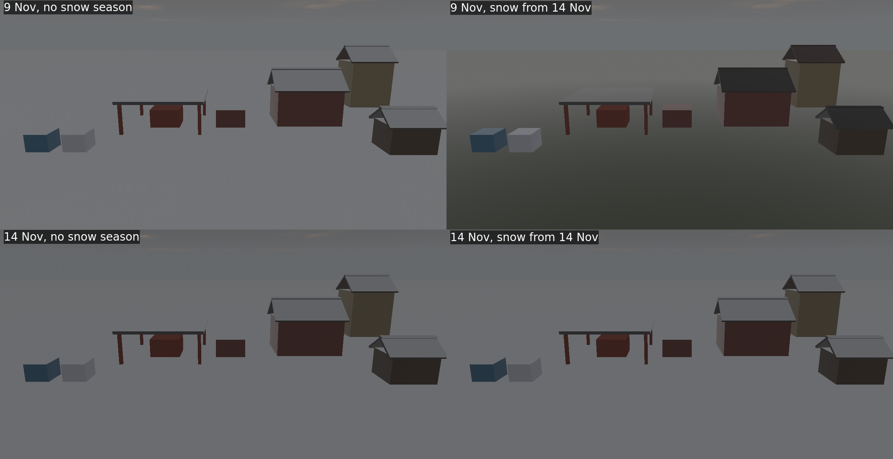


**The last few days.** `ClimateHistory` records each local calendar day as the clock runs through it, from the `Weather` every system reads: the mean, minimum and maximum temperature (TG, TN, TX), the mean relative humidity, the precipitation total (RR, liquid-water equivalent, snow included), the snowfall, and how many of its hours were observed. `Environment::recent_days(n)` returns the completed days of the last `n` (today excluded; `ClimateHistory::today()` has it so far) and `recent_climate(n)` sums them up with climatology's daily indices: a **wet day** has at least 1 mm of precipitation (`WET_DAY_MM`), a **frost day** a minimum below 0 °C and an **icing day** a maximum below it (`FREEZING_C`; the ETCCDI's definitions), with the hour-weighted means, the extremes and the totals. A window of 0 is empty, a longer window than the record is the record, and a summary of no days is `None`. The record keeps 31 days (insert `ClimateHistory::with_capacity(n)` first for more); a clock step of up to a day is recorded with that frame's weather, a longer jump leaves the days between unrecorded, and a clock moved back forgets the days from its new date on. The weather of a past hour cannot be recomputed, so the record is part of a save (below). `docs/research/climate-history.md`.

```rust
# use bevy::prelude::*;
# use bevy_elements::*;
fn stores(env: Environment) {
    if let Some(week) = env.recent_climate(7) {
        let damp = week.wet_days >= 3 && week.mean_relative_humidity > 0.8;
        let _ = (damp, week.frost_days, week.mean_temperature_c);
    }
}
```

### Wind

`WindState` has the prevailing wind, the 10 m speed, the gust factor, the wind at the focus (`at_focus`; the camera without an `ElementsFocus`) and the simulated field: a `rgba16float` 3D texture, toroidally addressed, around the focus (64 × 16 × 64 cells of 4 m at High). Shaders sample it with the supported WGSL import:

```wgsl
import bevy_elements::wind::{WindFieldParams, elements_wind};
let v = elements_wind(wind_field, wind_sampler, wind_params, world_position);
```

bound to `WindState::field` and `WindState::field_params()`. `WindGust` is written when a gust band starts. `bevy_elements::noise` (gradient noise with analytic derivatives, fBm, Worley, curl) and `bevy_elements::grid` (bilinear taps into the crate's 2D grids) are also supported imports.

### Fog

`DistanceFog` follows `Weather::visibility_m` (Koschmieder, 2 % contrast, grey extinction) with a colour lit like the scene and, under a clear sky, the sky's own horizon colour toward the camera's heading (read back from the atmosphere, so distant ground meets the sky without a line at dusk; cloud, fog and dust keep the weather's own colour, `docs/research/fog-colour.md`); a 240 × 120 × 240 m ground-fog `FogVolume` around the camera thickens toward the ground and drifts with the wind. Bevy lights a `FogVolume` from the `DirectionalLight`s alone, which under cloud carry only the beam, so the volume fades out of the frame as the cloud thickens (its density is scaled by the beam's share of the scene's light and its intensity by the reciprocal): a blizzard is a whiteout from the sky and the distance fog, not a dark hole (measured: the noon zenith of a 200 m-visibility blizzard read `(46, 47, 50)` before and `(122, 124, 129)` after; `docs/research/fog.md` Deviation 7). `sky_air_extinction(σ_fog)` gives the excess of a fog extinction over clear air (`CLEAR_AIR_EXTINCTION`, the `Clear` preset's 40 km), which the cloud composite uses to fog the sky to the same colour as the ground (see [Clouds](#clouds)). Where a frame's ground ends before the horizon, the air the ray then travels is the sky's own column: the composite reads the sky cube at the horizon in the ray's azimuth and extrapolates to zero elevation, so the flat band below the horizon is the sky's colour rather than the fog hue (measured 24–38 DN of error at noon, dusk and night before, 2–3 DN after, and 6.9 DN at 20 h, where the cube's 0.7° texel cannot resolve the twilight gradient).

### Clouds

`CloudPlugin` ray-marches a spherical cloud shell in compute at a quarter or half of the screen resolution and accumulates it into a full-resolution history over 4 or 16 frames. Coverage, type and precipitation come from a 512² weather map over 32 km that follows `Weather` (`CloudWeatherMap`): it is thresholded so the covered fraction of the sky equals `Weather::cloud_cover`, it is stratus, cumulus or cumulonimbus by the weather (`CloudLayer` holds the base and top heights), and it drifts with the wind. Cumulus and cumulonimbus are carved out of the coverage by Nubis' envelope model: a flat base, a rounded top whose height follows the blob, convective cells that split a blob into separate thermals (closing into a deck as the cover reaches 1), and a value erosion of billowy Worley noise (turrets of 80–320 m on lobes of a kilometre) that gives cauliflower tops and crisp silhouettes; the detail fades to its mean where the march's step is too long to resolve it, and stratus decks are unchanged (`docs/research/cumulus-shape.md`). Light is energy-conserving single scattering with a two-lobe phase function plus the multiply scattered light as photon diffusion through the cloud between its lit face and the cloud behind (Jensen 2001's extrapolated boundaries, fitted to Monte Carlo transport in 96 slabs: within 0.57–1.12× on thick tops where Wrenninge's octaves gave a sixth, `docs/research/cloud-lighting.md`), so sunlit cumulus are white from the ground and from the air, their bases grey rather than black and lit orange from below at sunset; it is coloured by the sun's transmittance through Bevy's atmosphere and lit from inside by `LightningFlash`. The skylight that fills the shaded sides takes the colour of Bevy's own sky (the camera's atmosphere environment map over the upper hemisphere), so clouds after sunset turn violet in the purple light; a cloud too thick to march through hides the sun disc behind it. A 1024² transmittance map over 8 km (`CloudShadows`) shades the crate's surfaces per pixel (the terrain, the water, `WeatheredMaterial`, `GroundExtension`), and its mean over the 8 km (`CloudShadows::mean_transmittance`) is the share of the sun the `DirectionalLight`s carry, so a cloud's shadow over the camera darkens the ground around it, not the sky, the distant hills or the reflections. A plain `StandardMaterial` sees only that mean; give props a `WeatheredMaterial` for their own cloud shadow. Sky pixels carry the weather's air as well: the composite fogs them by `σ_air = σ_fog − 3.912/40 km`, taken from the camera's own `DistanceFog` with the clear-air floor removed (`fog::sky_air_extinction`), so the sky and the fogged ground converge on the same colour and a 200 m-visibility blizzard has no horizon line, while `Clear` is untouched (bit-exact). `CloudQuality::of(ElementsQuality)` gives the resolution, step counts and accumulation window.


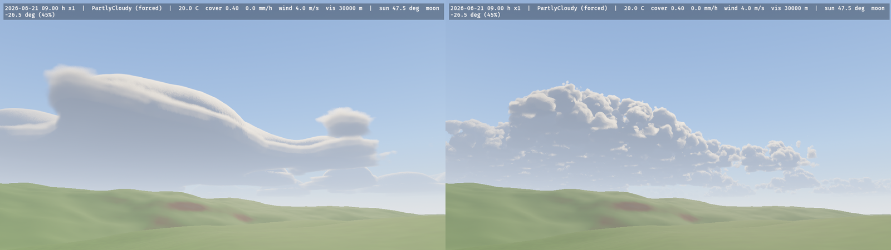

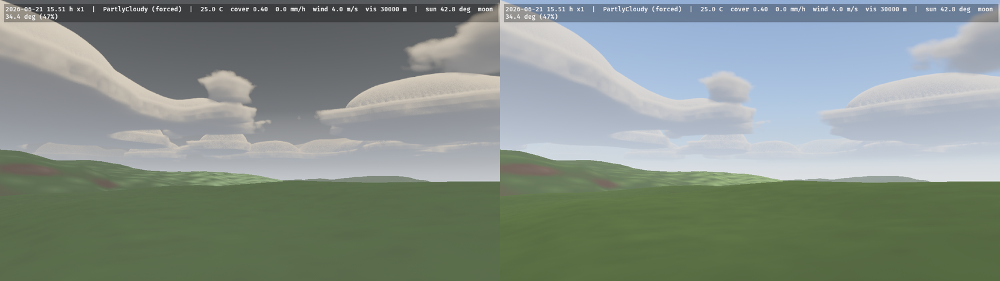

#### Clouds in reflections and sky light

Every reflection and the sky light of every PBR surface come from the camera's environment map. `CloudPlugin` puts the clouds in it: it marches them into a cube around the followed camera (the size of its atmosphere cube, 128² per face by default), composes that cube with Bevy's clear-sky cube exactly as the screen composite composes the sky (toward the ground, Bevy's ground lit by the light the dome lets through), and hands it to the camera's `GeneratedEnvironmentMapLight`, which Bevy filters into the glossy reflections and the diffuse irradiance. A pond under cumulus reflects the cumulus and the blue between them; under overcast, water is a grey mirror a little darker than the sky (it reflected a blue sky, and near grazing was brighter than the sky); and the overcast dome lights a top more than a wall and a wall more than an underside (1 : 0.67 : 0.37), so a metal box mirrors the bright sky on its top and the ground on its sides. The camera's `AmbientLight` then carries no cloud light. One texel of every k × k block of each face is re-marched a frame at half the screen march's steps (`CloudQuality::probe_edge`) and blended into its history; a camera without the crate's atmosphere, or that is not followed, keeps Bevy's sky and the uniform cloud ambient. The overcast dome comes out nearly flat (zenith 1.08 × the sky 5–10° up) where real overcast skies are graded 2:1 to 3:1: that is the cloud model's, on the screen too. `docs/research/sky-light.md`.


**Rainbows.** A shower opposite a low sun draws a rainbow in the sky composite (`RainbowSettings::strength`, default 5, `0` switches it off). The bow is a circle about the antisolar point, so it follows the sun and the camera: it needs the sun below 42° (at 20° the arc tops out at 22° of elevation, at sunset it is nearly a half circle) and a shower in the weather map in that direction, seen under the cloud base, with the sun reaching it (the cloud shadow map's mean beam, so full overcast draws none and a break between showers draws the whole bow). Its colours come from Airy's theory for the weather's Marshall–Palmer drops: red outside the primary and violet inside, a fainter secondary with the order reversed and Alexander's dark band between, a pale wide bow in a drizzle and a narrow vivid one after a heavy shower. The sun's own colour (through the atmosphere) tints it, so a sunset bow is red-gold. It is drawn on sky pixels only, so terrain and water in front of it hide it (the still sea's reflection of it is not drawn). `docs/research/rainbow.md`.

### Precipitation

Rain and snow follow `Weather::precipitation_mm_h` and `snow_fraction()`. A buffer of `ElementsQuality::precipitation_particles()` particles (20 k / 60 k / 150 k / 300 k) fills a 60 m cube around the camera: rain takes `min(1, R/20)` of it and snow `min(1, S/3)` (both scaled down together when they would exceed it). Each raindrop has its own diameter, drawn from the water-weighted Marshall–Palmer distribution, and falls at its own Atlas–Ulbrich speed (4.98 m/s on average at 10 mm/h, 9 m/s at most); flakes fall at 1 m/s with a sideways flutter. Both ride the wind field, wrap around the camera, and are respawned at the top when they hit the ground or a `PrecipitationBlocker`; rain near the camera leaves splash rings. The draw pass (`Core3dSystems::EarlyPostProcess`) renders streaks, flakes and rings as procedural quads, lit by the sun, moon and sky light and soft-faded against the depth prepass.

```rust
# use bevy::prelude::*;
# use bevy_elements::*;
fn build_a_shelter(mut commands: Commands) {
    // No rain or snow falls inside this 6 × 0.2 × 6 m roof, and its top collects the splashes.
    commands.spawn((
        PrecipitationBlocker { half_extents: Vec3::new(3.0, 0.1, 3.0) },
        Transform::from_xyz(8.0, 3.0, 4.0),
    ));
}
```

The nearest 256 blockers to the camera are tested; any oriented box works (`GlobalTransform` rotation and scale apply). The far field is the fog volume's: `FogPlugin` splits the visibility's extinction `3.912 / visibility` into the precipitation's own (rain `2.12×10⁻⁴ R^0.68` m⁻¹, snow `4.917×10⁻³ S` m⁻¹, from measured visibility–rate relations) rendered as wind-slanted shafts, and the remaining haze, so `Weather::visibility_m` stays the single authority on how far you see. The particles need `WindPlugin` and an `ElementsCamera`; `PrecipitationState` exposes the GPU buffers. Rain lands on the terrain's surface plus the water standing on it, or on the plane y = 0 without a terrain.

**A look for your camera.** The drops and flakes are physically sized, which reads well through a perspective camera at eye height. From far off (an orthographic, isometric or strategy camera) the same rain is short, wind-slanted dashes and the same snow a field of identical dots. `PrecipitationLook` restyles the draw without touching the simulation, the wetness, the splashes or the queries: `rain_fall_scale` and `rain_wind_scale` lengthen and straighten the streaks, `rain_tint` colours them and sets their opacity, `flake_size_spread` draws each flake at a log-normal size about its own, and `flake_min_half_width_px` sets the smallest flake. The default is the physical look; `PrecipitationLook::readable()` is the stylised one (fall ×4, wind ×0.5, a slightly bluer and fainter streak, σ 0.5 spread, 1.5 px flakes): under the isometric camera pitched 35° the `Rain` preset's streaks stand 15° from vertical instead of 63°. Under a game's own bright key light, raise `rain_tint` above 1 so the streaks stand out from the sunlit ground (the `isometric` example's game look uses `(2.4, 2.5, 2.8, 0.8)`). `docs/research/precipitation-look.md`; `ELEMENTS_PRECIPITATION=readable` in any example.

```rust
# use bevy::prelude::*;
# use bevy_elements::*;
fn strategy_view(mut commands: Commands) {
    commands.insert_resource(PrecipitationLook::readable());
}
```


### Lightning

Strikes are a Poisson process at `Weather::storminess / 60` per second of `Time<Virtual>`, uniform over an 8 km disc around the followed camera and deterministic from `Climate::seed`. Each one writes `LightningStrike { position, seed }`, spawns a bolt (a channel with side branches, then 1–3 restrikes 40–80 ms apart), lights the ground with a 1e8 lm `PointLight`, writes `LightningFlash` for the clouds, and writes `Thunder { position, distance_m, loudness }` `distance_m / 343` s of real time later. `StrikeLightning { at }` scripts a strike. The bolt's brightness is multiplied by the camera's exposure and clamped, so it saturates at night and fades by day. The strike process and messages run without a renderer.

## Terrain and ground

### Terrain

`Terrain` is a component: `Terrain::procedural(ProceduralTerrain::hills(seed))` (also `mountains`, `dunes`, `plains`, or your own relief, feature size, octaves and ridged mix), `Terrain::from_heightmap(image, height_range_m)` (a linearly read `R16Uint`, 16-bit normalised, float or 8-bit image) or `Terrain::flat(height)`, with `with_extent`, `with_resolution` and `external()`. It is centred on its `Transform` (default 2048 m, 1024² cells at High; the resolution is clamped to `ElementsQuality::terrain_max_resolution()` and to a power of two). One terrain exists at a time. The GPU generates `bedrock` and `sediment`, and keeps the layers hydrology and erosion write (`TerrainState`); `terrain_pack` rewrites a packed `terrain_cells` buffer that the materials, the wind solid mask and the precipitation kernel read, and the surface heights are copied back for `Environment::terrain_height(Vec2)`.

By default the crate draws the ground: a pool of 33 × 33-vertex patches selected by distance (CDLOD, Strugar 2009: one shared mesh, vertices morph onto the next coarser grid, no cracks, one draw per pass; about the eye of a perspective camera, about the focus of an orthographic one) with `TerrainMaterial`, which blends rock (slope above 40°), sand (sediment above 0.5 m), soil and grass from the slope and sediment per pixel, adds noise detail, and takes the cloud shadow map like the weathered materials do. The vertices sit on the height samples (the cell centres `Environment::terrain_height` interpolates), so at full detail the drawn ground is the bilinear at every vertex and within a quarter of a quad's twist of it between them (4.7 cm at the 90th percentile on the hills at 4 m cells); the drawn terrain spans the cell centres, half a cell inside the extent. With `Terrain::external()` you draw the ground yourself and give your mesh `ExtendedMaterial<StandardMaterial, GroundExtension>` (`GroundExtension::default()`): it adds cloud shadows by world position and darkens where water stands. Wind blows around the terrain and rain stops on it; with the `flora` feature `ElementsFloraPlugin` hands the height snapshot to `bevy_flora`. See [`docs/research/terrain.md`](docs/research/terrain.md) and [`docs/research/orthographic-lod.md`](docs/research/orthographic-lod.md).


**Ground textures.** Put `TerrainTextures` on the `Terrain` entity and the owned terrain's sand, soil and grass take PBR maps, handed over the way any material's are: per layer a `GroundLayerTextures` with a base colour and, optionally, a normal (tangent space, +Y up; DirectX maps set `flip_normal_map_y`), roughness (G channel), occlusion (R) and height (R) map, as a glTF material or a PBR library stores them (one glTF ARM or ORM image serves as both roughness and occlusion), and the tile's size in metres. The crate packs them itself, off the frame (an async task: 0.5 s for two layers of five 1024² maps on a desktop CPU; on wasm the task pool runs it on the main thread), into detail maps over its procedural layers: the base colour, roughness and occlusion become multipliers with mean 1 over the crate's calibrated colour and roughness (the weather still owns the roughness, and the ground's mean light does not move), and a missing normal, height or occlusion is derived from the base colour; `GroundLayerTextures::photograph()` also de-lights and makes tileable a photograph or a generated image. `with_colour(share)` lets the set's own mean colour replace the layer's, at every distance — for a stylised set whose colour is the point; a library's base colour is rarely a calibrated albedo (two CC0 libraries' grass and earth measured 2 and 6.5 times the crate's, and taken whole they bleach the hills to lime and beige), and a set that takes its colour runs its own pipeline, compiled once when it starts taking it. They are hex-tiled (Mikkelsen 2022: randomly offset taps in eight orientations, up to three per pixel, so a tile never repeats), blended between layers by their heights (grass blades stand out of the soil instead of a cross-fade, band-limited by the pixel's footprint so nothing sparkles at a distance), and from 12 m on the mips average to the layer's colour. Inserting, changing or removing the component re-textures the ground at runtime — the previous set renders until the new one is packed — so a set is a stylistic variant a game can swap. A layer left `None` stays procedural; without the component the ground renders exactly as before, at its old cost (the textured path is compiled only into a set's pipeline). The maps must keep their CPU data (the default when loading; `RenderAssetUsages::MAIN_WORLD` keeps them off the GPU, since only the packed array is drawn). The examples wear golem-generated soil and grass photographs from `assets/ground/golem/` (`ELEMENTS_GROUND_TEXTURES=0` leaves them off, `ELEMENTS_GROUND_SWAP=S` toggles them every S seconds, `ELEMENTS_GROUND_COLOUR=c` sets every layer's colour share). The sand waits for wind ripples. See [`docs/research/terrain-textures.md`](docs/research/terrain-textures.md) and [`docs/research/ground-textures.md`](docs/research/ground-textures.md).

```rust
# use bevy::prelude::*;
# use bevy_elements::*;
fn textured_hills(mut commands: Commands, assets: Res<AssetServer>) {
    let arm = assets.load("textures/meadow_arm.png"); // glTF: occlusion R, roughness G
    let grass = GroundLayerTextures::new(assets.load("textures/meadow_color.png"), 2.0)
        .with_normal(assets.load("textures/meadow_normal_gl.png"))
        .with_roughness(arm.clone())
        .with_occlusion(arm)
        .with_height(assets.load("textures/meadow_height.png"));
    commands.spawn((
        Terrain::procedural(ProceduralTerrain::hills(7)),
        TerrainTextures { grass: Some(grass), ..default() },
    ));
}
```


**The rock.** The massif, a cliff and the scree at its foot, before and after the terrain's rock material: its beds, its palette, its two joint families, its fragments and its grain.

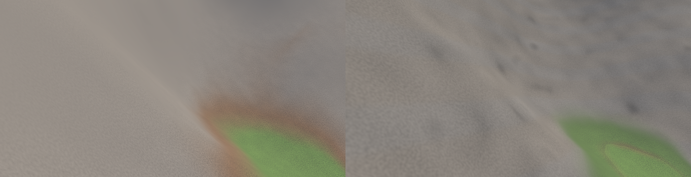

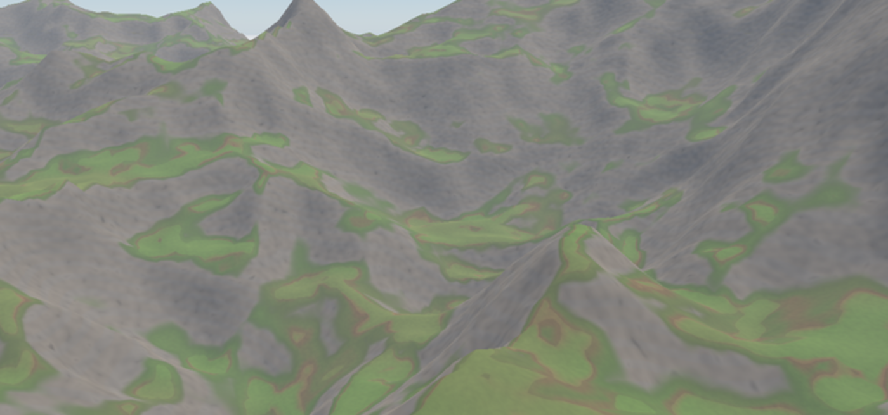


**Grading the ground.** `TerrainLook { tint, saturation }` grades the owned terrain's bare ground (rock, soil, grass, sand, scree, textured or not) and the scattered rocks lying on it, the way a game grades its own materials per palette: the saturation first, around the colour's own linear Rec. 709 luminance (0 grey, 1 unchanged, above 1 oversaturated), then the tint multiplies it, so a cooling tint survives a desaturation. It applies before the ground cover, so snow and standing water keep their colours and wet grass still beads the rain. The default renders the ground as without it (within a float's rounding, below one 8-bit level), at no measured cost, and a change is a uniform write — no pipeline is specialised or compiled — so a palette blend may write it every frame (`terrain_tour`: `ELEMENTS_TINT=0.55,0.62,0.85 ELEMENTS_SATURATION=0.6`, `ELEMENTS_GRADE_GLIDE=8`). A `TerrainRender::External` ground and a game's own `WeatheredMaterial`s are the game's to grade. `docs/research/terrain-look.md`.

```rust
# use bevy::prelude::*;
# use bevy_elements::TerrainLook;
fn night_palette(mut look: ResMut<TerrainLook>) {
    *look = TerrainLook { tint: Vec3::new(0.55, 0.62, 0.85), saturation: 0.6, ..default() };
}
```

`TerrainLook::detail` scales the ground's grain and bump (1 is the crate's own, 0 none; the route grain follows) and `TerrainLook::finest_m` tells the band limit how wide one screen pixel is on the ground, so a fixed orthographic zoom whose pixels are wider than the crate's derived footprint can drop the octaves it cannot resolve instead of drawing them as speckle. Both are uniform writes, like the tint.

**Saving the ground.** `TerrainSetup` is a `Terrain` as plain data (a procedural preset, level ground, or a height map named by path) and `SurfaceSetup` is the nine settings resources of hydrology, erosion, snow, wetness, water, waves, rocks, dust and trails as one value. With the `serde` feature both read and write any serde format, absent fields take their defaults and an unknown field is an error. `validate()` names the field that broke its range, `SurfaceSetup::apply_to_world` writes only the settings that differ (an unchanged file reloaded does not rebuild the rocks), and `TerrainSetup::terrain` loads a height map as the terrain needs it (linear, one channel). A `Terrain` is built once when it spawns, so a changed terrain setup means spawning a new entity.

```rust
# use bevy::prelude::*;
# use bevy_elements::{SurfaceSetup, TerrainSetup};
fn load_level(world: &mut World) {
    let mut surface = SurfaceSetup::default();
    surface.snow.drift = false;
    surface.rocks.seed = 7;
    if let Err(e) = surface.apply_to_world(world) {
        error!("bad surface setup: {e}");
    }
    let terrain = TerrainSetup::default().terrain(world.resource::<AssetServer>());
    if let Ok(terrain) = terrain {
        world.spawn(terrain);
    }
}
```

#### Sculpting the live terrain

Send a `SculptTerrain` message to edit the running terrain: a brush at a metre-frame XZ with a radius, a `hardness` (the fraction of the radius at full effect; the weight then falls as a smoothstep, so the rim leaves no crease) and a kind: `Raise`, `Lower`, `Smooth`, `Flatten { height_m, blend }` or `Noise { amplitude_m, feature_m, seed }`. The stroke edits bedrock on the GPU (sediment stays), one stroke is applied per frame in order, and the drawn ground, the rocks, the cover and `Environment::terrain_height` follow it the next frame. Nothing outside the radius changes. `SculptTerrain::validate()` names a field that breaks its bound; an invalid stroke is dropped with a warning.

```rust
# use bevy::prelude::*;
# use bevy_elements::{SculptKind, SculptTerrain};
fn dig_a_pit(mut strokes: MessageWriter<SculptTerrain>) {
    strokes.write(SculptTerrain::new(Vec2::new(40.0, -12.0), 6.0, SculptKind::Lower { amount_m: 1.5 }));
}
```

To keep a sculpted ground, ask `Environment::terrain_snapshot()` for the last readback and store its heights; `TerrainSnapshot::terrain(&mut images)` builds a `Terrain` that redraws them (spawn it at `snapshot.centre_m()` times `ElementsUnits::units_per_metre`). The surface comes back to within f32 rounding, all of it as bedrock: the sediment layer is not restored. The snapshot is at the readback's resolution, which is 2x coarser than the simulation above 1024² cells.

```rust
# use bevy::prelude::*;
# use bevy_elements::*;
fn save_and_restore(env: Environment, mut images: ResMut<Assets<Image>>, mut commands: Commands) {
    if let Some(saved) = env.terrain_snapshot() {
        commands.spawn((saved.terrain(&mut images), Transform::from_translation(saved.centre_m())));
    }
}
```

To undo a stroke in place (any kind, including the ones with no `inverse`), take `Environment::terrain_snapshot()` before it and later send `RestoreTerrain::new(snapshot, region_m)`: every cell whose centre lies in the metre-frame `Rect` gets the snapshot's bedrock and sediment back, in order with the strokes, and nothing else (water, cover, trails) is touched. A snapshot read from another grid is dropped with a warning.

```rust
# use bevy::prelude::*;
# use bevy_elements::*;
fn undo(env: Environment, mut restores: MessageWriter<RestoreTerrain>, before: Res<Saved>) {
    restores.write(RestoreTerrain::new(before.0.clone(), Rect::new(20.0, -30.0, 70.0, 10.0)));
}
# #[derive(Resource)] struct Saved(TerrainSnapshot);
```

To start from a preset instead of the GPU's output, `ProceduralTerrain::sample_surface(size, cell_m)` evaluates the generator on the CPU, with no app and no `TerrainPlugin`: row-major heights in metres, deterministic per seed, within the sampling tolerance of the kernel's output and not bit for bit. A tool can bake `ProceduralTerrain::hills(7)` into a height file this way; sediment is not part of it.

### Ground cover

`GroundCoverPlugin` keeps two maps on the `Terrain`'s grid, stepped on game time (the `WorldClock`) at most 20 times a second after hydrology's substeps. **Snow** is a depth and a water equivalent per cell: it accumulates at the cell's own rain–snow split (the lapse rate makes ridges snowier than valleys), keeps less on slopes between 35° and 55° and none under a `PrecipitationBlocker` (the roof's shelter follows the slanted fall of the rain or snow), settles from 100 toward 300 kg/m³ with a 3-day time constant, drifts downwind above 5 m/s (a flux that grows with the cube of the excess, deposited where the wind slows in the lee), is smoothed over a few cells, and melts at 4 mm of water per °C per day, every millimetre arriving in the `water` layer. **Wetness** follows rain and evaporation; the terrain and ground materials shade snow, wet darkening and a porous sheen, and puddles with ripples. On the terrain the grass is a canopy whose wax beads the rain: a wet meadow deepens its green by `bevy_flora`'s wet-leaf rule (saturation × 1.25, brightness kept) and does not gloss, and only the soil, sand, rock and scree between darken and shine. Rain rings on a live terrain only where water stands at least `WetnessSettings::puddle_min_m` deep (`docs/research/wet-ground.md`).

```rust
# use bevy::prelude::*;
# use bevy_elements::*;
fn deep_wet_snow(mut commands: Commands) {
    commands.insert_resource(SnowSettings {
        degree_day_factor: 6.0,
        shed_slope_deg: [30.0, 45.0],
        ..default()
    });
    commands.insert_resource(WetnessSettings {
        puddle_min_m: 0.004,
        ..default()
    });
}
```

`Environment::snow_depth(Vec2)` and `wetness(Vec2)` answer from the last readback like `water_depth`. `SurfaceWeathering` (and so `ElementsGlobals` and `WeatheredMaterial`) follows the mean of the maps within 50 m of the camera once a terrain has been read back; before that, and without a terrain, it is the point model at the reference elevation.

 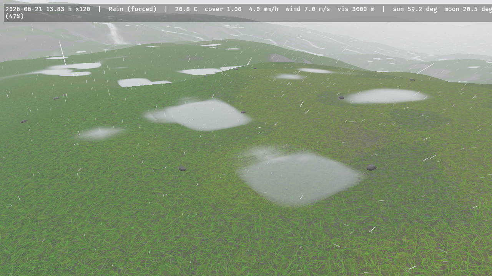

### Rocks

`RocksPlugin` scatters boulders and stones over the `Terrain` as meshes, so the ground has silhouettes and cast shadows and not only a painted texture (`docs/research/rock-scatter.md`). Where rocks lie comes from the terrain readback: a **talus** of angular blocks in the scree's band of slope (16°–40°) below a cliff, in heaps a few blocks across; **rounded rocks** over the meadow, sparse on the flat, more on steep hillsides and in rocky patches a few hundred metres across; nothing on the rock above 40° and nothing on sand. How many and how big follows Golombek's exponential rock-abundance law: rocks of diameter `D` or more cover `k·exp(−(1.79 + 0.152/k)·D)` of the ground, `k` the total cover, so a boulder is rare and a stone common. The shapes are jointed blocks — a few joint planes, the edges sharp on a talus and worn round on a meadow — squashed to the axis ratios measured on talus (the short axis a third to a half of the long one), lying on their largest face, a quarter to a third buried. Each **facet** — the piece of rock between two of the shape's own joint planes — wears one rock of the cliff's palette, and the colour changes over the joint's own narrow width and nowhere else, so a boulder's faces are different rocks and their boundaries are the breaks, as the cliff's fragments are (`docs/research/stone-material.md`); the shape's brightness stays the palette's, so a scatter does not change the ground's colour.

Each rock sits on the surface the CDLOD patches actually draw (the readback on the covering patch's lattice, morphed by the camera's distance like the vertex shader does), so a distant rock does not float over a coarse patch. A rock of diameter `D` is drawn to `ElementsQuality::rock_range() · D` metres (100 m per metre at High) and shrinks away over the last fifth of that, so it vanishes at the same size on screen whatever its size and does not pop; a near and a far mesh (1280 and 320 triangles) switch at `22·D`, and a stone wears the same palette rocks in both, so the switch is never a change of colour. Under an **orthographic** camera the same screen size is a threshold on the rock's diameter instead of a distance from the eye — distance says nothing about a rock's size under that projection — and the ring, the fade and the mesh choice are measured from the terrain's own LOD centre (the camera's `ElementsFocus`), so an isometric game draws the talus in its view (`docs/research/orthographic-rocks.md`). They are drawn with `WeatheredMaterial` and a stone grain (`WeatheredExtension::with_grain`), so they take snow on their tops, wetness and cloud shadows.

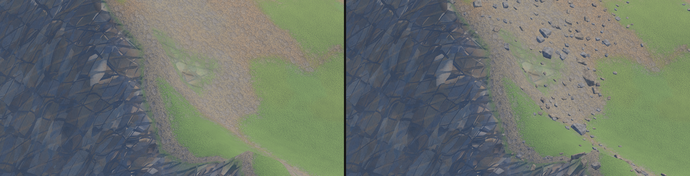

```rust
# use bevy::prelude::*;
# use bevy_elements::*;
fn rockier(mut commands: Commands) {
    commands.insert_resource(RockSettings {
        // A boulder field on the meadow's rocky patches instead of the default 5 %.
        meadow_cover: 0.15,
        ..default()
    });
}

// Rocks are plain entities: give them colliders when they appear (`app.add_observer(on_rock)`).
fn on_rock(add: On<Add<ScatteredRock>>, rocks: Query<&ScatteredRock>) {
    if let Ok(rock) = rocks.get(add.entity) {
        let _ = (rock.diameter_m, rock.height_m);
    }
}
```

`ElementsPlugins` includes it; `ElementsPlugins.build().disable::<RocksPlugin>()` leaves it out, and `RockSettings { range_scale: 0.0, .. }` draws none.

`RockSettings::allowed` keeps the scatter to a region of the host's own: `Some(vec![Rect::new(0.0, 0.0, 120.0, 120.0)])` (world X and Z in metres) keeps the rocks inside it and none outside, in the places the unrestricted scatter put them, and `Some(vec![])` keeps none. A town's streets and plazas are left out by giving the field and the forest as rectangles.

A host that keeps its own scatter dresses its stones with the crate's, without `RocksPlugin`: `stone_mesh(shape, StoneDetail::Near)` is the mesh the plugin draws (12 shapes, `STONE_SHAPES`; the index wraps) with the palette tone of each joint facet in its vertex colours, which multiply a `StandardMaterial`'s `base_color`; `stone_facet_tones(shape)` and `stone_palette()` give the tones themselves. Scale the mesh by the stone's length (its long axis is one unit).


### Dust storms

`DustPlugin` moves the terrain's loose sand with the wind. Where the surface wind (the weather's 10 m wind, sped up over crests by Paris et al.'s Venturi term and sheltered behind rises by their 15° shadow rule) exceeds 8 m/s, the sand flux relaxes toward `q = k u² (u − u_t)` over a 10 m saturation length, and the bed changes by the flux's divergence, so sand is conserved exactly and cannot go negative; hydrology's thermal kernels then avalanche it at 34°. It runs at most 20 times a second, only while the wind can exceed the threshold, and advances the bed by the virtual time × `WorldClock::time_scale` (the plan's coefficient is 167× the physical flux, so the sand evolves in game time, `DustSettings` and `docs/research/dust.md` Deviation 1). A forced `WeatherPreset::DustStorm` also fills 40 % of the precipitation particle buffer with tan sprites and tints the ground fog.

```rust
# use bevy::prelude::*;
# use bevy_elements::*;
fn a_dust_storm(mut commands: Commands, mut director: ResMut<WeatherDirector>) {
    commands.spawn(Terrain::procedural(ProceduralTerrain::dunes(7)));
    director.force(WeatherPreset::DustStorm, std::time::Duration::ZERO);
}
```


The stripped upwind edge of the sand sheet, 10 s and 70 s into the `dust_storm` example (`ELEMENTS_FRAMES=600` and `4200`): the bare ground band is the sand the wind has carried downwind.

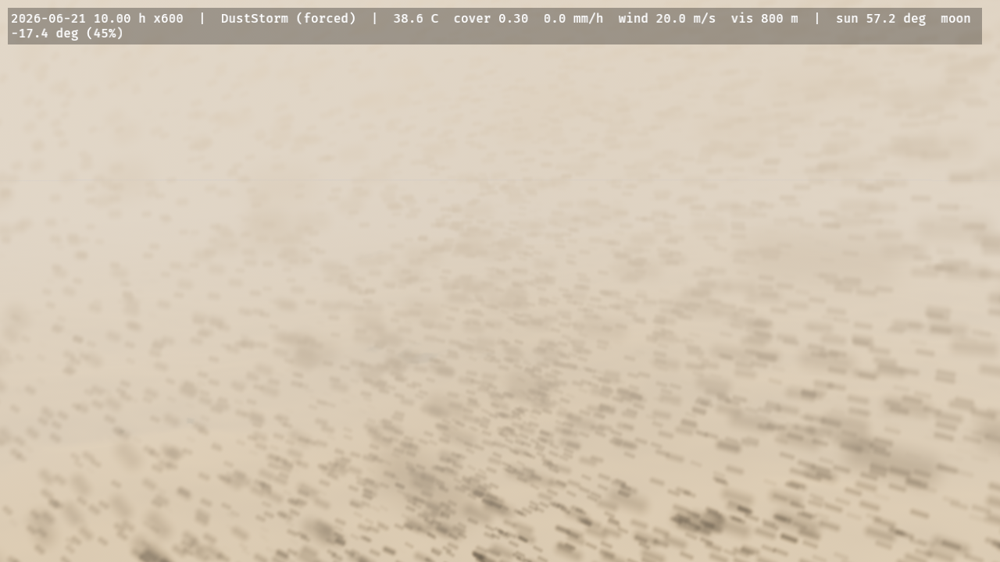 

### Paths and roads

`PathsPlugin` lays the routes a game draws across its terrain. A `Path` is a polyline of world XZ points, a half width, a `PathKind` and a rut depth:

```rust
# use bevy::prelude::*;
# use bevy_elements::*;
fn village_roads(mut commands: Commands) {
    commands.insert_resource(PathNetwork::new([
        // A gravel road with the wheels' ruts.
        Path::new(
            [Vec3::new(-120.0, 0.0, -40.0), Vec3::new(-20.0, 0.0, -10.0), Vec3::new(90.0, 0.0, -30.0)],
            2.5,
            PathKind::Gravel,
        )
        .with_ruts(0.03),
        // A trodden footpath to the well.
        Path::new(
            [Vec3::new(-20.0, 0.0, -10.0), Vec3::new(-4.0, 0.0, 8.0), Vec3::new(12.0, 0.0, 14.0)],
            0.35,
            PathKind::Earth,
        ),
    ]));
}
```

The crate rasterises the network once — off the frame, on `AsyncComputeTaskPool` — into an **8-bit coverage distance field** over the terrain's extent, at four texels across the narrowest route (0.175 m for a footpath, a metre for a road) and sampled bilinearly, so a 70 cm path's edge is smooth at any zoom rather than stepping at the texel grid (Green 2007; RTR4 §15.4.3). The terrain's own material reads it at every fragment: the turf gives way to bare, compacted ground with the route's grain (a per-texel speckle the mask carries at its own resolution, plus noise up close), a dish cross-section a few centimetres deep whose verge stands proud and catches a grazing sun, snow cleared where traffic runs (90 % off a lane, road or track; a snow track keeps a packed 65 %), and each wheel line's rut as a dark, compacted, smoother groove. A route is the **ground it crosses, worn**: trodden sand on a dune, the snow's own colour in snow, the route's earth or stone only on turf and soil. The whole block is compiled only into a terrain whose `PathNetwork` has routes (`PATHS`), so a terrain without paths pays nothing — measured within ±2 % of the same scene with no network. See [`docs/research/paths.md`](docs/research/paths.md); the `trails` example takes `ELEMENTS_PATHS=lane|track|road|stone|packed|all`.


**Asking about them.** `Environment::surface_at(xz)` answers a `PathSurface` — the nearest route's
`kind`, the `coverage` (1 inside, 0 past its edge, the shader's own curve), the route's
`half_width_m`, its `rut_depth_m` and how deep in a wheel line the point is as `rut` (0-1) — which a
game maps to its footstep and tyre sounds, a movement speed, dust or a print's depth, as shipping
engines do with *collision materials* and Unreal's *physical materials*. `nearest_path(xz)` adds the
signed distance to the route's **edge** and the nearest point of its centre line, so a prop placed
3 m clear measures what it means; `on_path(xz)` is the cheap predicate. Unlike the snapshot queries
these are **exact and current** — the network is the game's own CPU data — and 1000 queries over a
village's 40 routes cost 1.04 ms (`docs/research/path-query.md`).

```rust
# use bevy::prelude::*;
# use bevy_elements::*;
fn footstep(env: Environment, at: Vec2) {
    match env.surface_at(at) {
        Some(surface) if surface.coverage > 0.5 => {
            let _sound = (surface.kind, surface.rut); // gravel crunch, earth thud, grit in a rut
            let _speed = match surface.kind { PathKind::Gravel => 1.1, _ => 0.9 };
        }
        _ => { /* the meadow */ }
    }
}
```

### Trails

`TrailsPlugin` presses footprints, ruts and tracks into the ground. Put an `Imprint { half_extents, load_n }` on anything that touches the ground (a foot, a hoof, a wheel, a body lying down): while its translation (the sole) is within 0.1 m of the undisturbed surface it sinks as deep as the ground gives under its load (Bekker–Wong pressure–sinkage with Wong's constants; in snow no deeper than the snow compacts to 500 kg/m³, CRREL 90-9; never deeper than a 0.30 m loose layer), and pushes up a rim of what it displaced but could not compress (a tenth of the volume in snow, all of it in dry sand). A 77.5 kg walker on a 10 × 26 cm sole leaves 24 cm in 30 cm of fresh powder, 3.4 cm in dry sand, half a centimetre in dry soil and the full 30 cm in mud. Between frames an imprint carves the whole path it swept, so a fast wheel leaves an unbroken rut. The weather takes the trails back: new snow fills a trench by exactly what the cover map gained, melt and settling clamp it to the snow, the snow drift and the sand flux smooth it as diffusion, and dry sand slumps to 34°, wet sand to 10° and mud to 63°.

The field is a window of centimetre texels (Low 512² × 8 cm, Medium 1024² × 6 cm, High 1024² × 5 cm, Ultra 2048² × 3 cm; `TrailSettings::texel_m` trades detail for reach, 8 cm covering 82 m for an isometric camera; `TrailSettings::min_depth_m` skips prints shallower than it, 0.01 keeping them to soaked soil, sand and snow) that follows the `ElementsFocus`, else the camera, simulated in four compute kernels and drawn per pixel, never as geometry, by the terrain material, `GroundExtension` and every `WeatheredMaterial` built `with_trails()`: parallax occlusion mapping with one sample per texel and a bisection on a cubic B-spline of the field, the lighting at the visible point, a soft self-shadow toward the sun or moon and an occlusion term on the trench floor. Compacted snow on a print's floor is smoother and bluer, a print through thin snow shows the ground, a trench through grass shows the soil (on the terrain), and the floors of ruts in saturated ground hold water. `TrailState` publishes the field and its window's centre for a ground shader of your own (`bevy_elements::trails::surface`).

**On a game's own ground.** A game that owns its ground (its own heightfield and mesh, no crate `Terrain`) inserts a `TrailGround`: a closure from world XZ to the ground's world height, the shape of `bevy_flora`'s `FloraGround`, so one closure feeds both, and whether it is sand. The trails then run on it with no terrain spawned: snow and wetness are `SurfaceWeathering`'s (new snow in its pack fills the prints, melt takes them, they last through the night in between), and the ground's `WeatheredMaterial` built `with_trails()` draws them, on faces up to 60° from horizontal and in forward rendering. Keep `with_trails()` off a roof or floor above a path: the field is a map by world XZ. `Environment::trail_depth(xz)` answers how deep the ground is pressed there (the deepest point within 10 cm at High, up to one readback interval old; `None` outside the window): where something walked, and whether it has snowed since. `SurfaceWeathering::with_snowpack(depth, density, wetness)` starts a scene under snow. `docs/research/trails-game-ground.md`, `tests/gpu_trail_ground.rs`.

```rust
# use bevy::prelude::*;
# use bevy_elements::*;
fn game_ground(mut commands: Commands, mut materials: ResMut<Assets<WeatheredMaterial>>) {
    // The game's own ground: its height function, and its material drawing the prints.
    commands.insert_resource(TrailGround::new(|xz: Vec2| 0.5 * (0.1 * xz.x).sin()));
    let _ground = materials.add(WeatheredMaterial {
        base: StandardMaterial { base_color: Color::srgb(0.3, 0.34, 0.22), ..default() },
        extension: WeatheredExtension::default().with_trails(),
    });
}

fn tracker(env: Environment) {
    if env.trail_depth(Vec2::new(12.0, -3.0)).is_some_and(|d| d > 0.02) {
        // Something walked here since the last snow.
    }
}
```


```rust
# use bevy::prelude::*;
# use bevy_elements::*;
fn a_boot(mut commands: Commands) {
    // A sole of 10 × 26 cm under a 77.5 kg walker on one foot; move it with the animation and
    // lift it more than 0.1 m off the ground to stop pressing.
    commands.spawn((Imprint::new(Vec2::new(0.05, 0.13), 760.0), Transform::default()));
}
```


Dry sand at evening (the prints slump to rounded dishes with a raised rim) and mud after rain (the ruts show the soil through the grass):

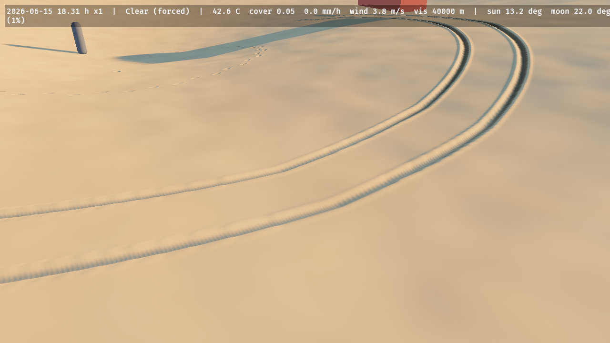 

## Rivers, lakes and waves

### Hydrology and erosion

`HydrologyPlugin` simulates water on the `Terrain`'s grid with Mei et al.'s virtual pipes, the pipe's cross-section taken from the local depth (so waves travel at 0.9 √(g d), not at a constant speed) and Manning friction (`HydrologySettings::manning_n`, 0.035). Time runs in fixed 20 ms substeps scheduled from *real* time (`HydrologySettings::time_scale`, independent of the `WorldClock`), at most `ElementsQuality::hydrology_substeps()` a frame (2 / 4 / 4 / 16), on a grid of at most `terrain_max_resolution()` cells per side (256 / 512 / 512 / 2048). The boundary is an open free overfall or a closed wall. Rain is the weather's, split into rain and snow per cell at that cell's lapse-rate temperature, delivered in quanta of at least 5 µm so it is never lost to f32 rounding, and shaded by `PrecipitationBlocker`s. `WaterSource` and `WaterSink` pour or drain a rate over the cells within a radius.

```rust
# use bevy::prelude::*;
# use bevy_elements::*;
fn pour_a_river(mut commands: Commands, mut bake: MessageWriter<ErodeTerrain>) {
    // 50 m³/s over the cells within 5 m of this point; the weather's rain falls everywhere.
    commands.spawn((
        WaterSource { rate_m3_s: 50.0, radius_m: 5.0 },
        Transform::from_xyz(-200.0, 4.0, 0.0),
    ));
    // Ten simulated minutes of erosion under 20 mm/h, at the quality's full substep rate.
    // `TerrainBaked` follows when it is done.
    bake.write(ErodeTerrain { duration_s: 600.0, rain_mm_h: 20.0 });
}
```

`ErosionSettings` carries Mei's capacity law `K_c · max(sin α, min_tilt) · |v|`, dissolve and deposit (sediment first, then bedrock; sediment moves with the water through the same pipe fluxes, so solids are conserved to rounding) and thermal erosion every 4th substep (35° talus, bedrock above 45°). **Bare bedrock erodes at the capacity rate**: the `flood` valley's 50 m³/s river carves its bedrock by up to 7.9 m in 120 s of simulated time and arrives at a marker 100 m away after 63 s instead of 36 s, so set `ErosionSettings::enabled = false` for a flood that should not change the ground (the `flood` example does). `HydrologyStats` counts substeps and simulated time, for code that waits on them.

### Water

`WaterPlugin` (part of `ElementsPlugins`) draws the water the hydrology simulates; `WaterSettings` (insert it first to override) holds the look. A patch of the terrain's level-of-detail selection that has at least 3 mm of water somewhere in it is drawn twice, by two entities with one `WaterExtension` and two `WaterMaterial`s: the **absorb** pass multiplies what is under the water by `(1 − F) · exp(−σ t)` per colour channel (σ = `absorption`, default `(0.45, 0.06, 0.03)` m⁻¹: red goes first, so a metre of water turns the bed blue-green, which one blend cannot do), where `t` is the thickness from the depth prepass corrected for the refracted ray; the **surface** pass adds the Fresnel reflection of the sky (`F₀ = 0.02`) and sun, the body colour of silt, and foam where the flow is fast or the water is thin, the ripples flow-mapped from the simulated velocity (Vlachos 2010, two phases).

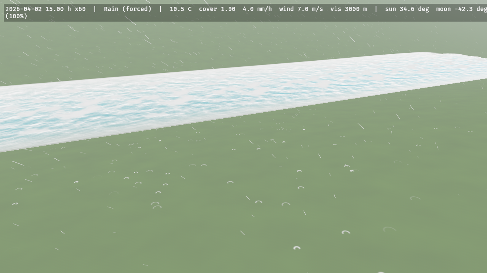 

**A still sea.** Insert `StillWater { level }` (world units, in the frame of `Environment::terrain_height`) and the same plugin draws water over every place the terrain's surface is below that level, with no hydrology behind it: the absorb and surface passes, the shore fade and the contact foam are the ones above, and a simulated surface above the level composites over it. `Environment::water_depth` answers the same depth (the higher of the simulated water and `level − ground`), so a game's wading rules read what is drawn. The sea does not stop at the terrain grid's edge: it continues 100 km past it at the edge's depth, to the horizon. Changing the level writes one uniform; removing the resource removes the sea. `ELEMENTS_STILL=<level>` sets it in the `terrain_tour` example. A `WaterContact` pressing the sea sends out rings and wakes like it does on simulated water. Not yet: a sea that continues past the terrain grid's edge, and a hydrology that idles while only a still level is set (issue #44).

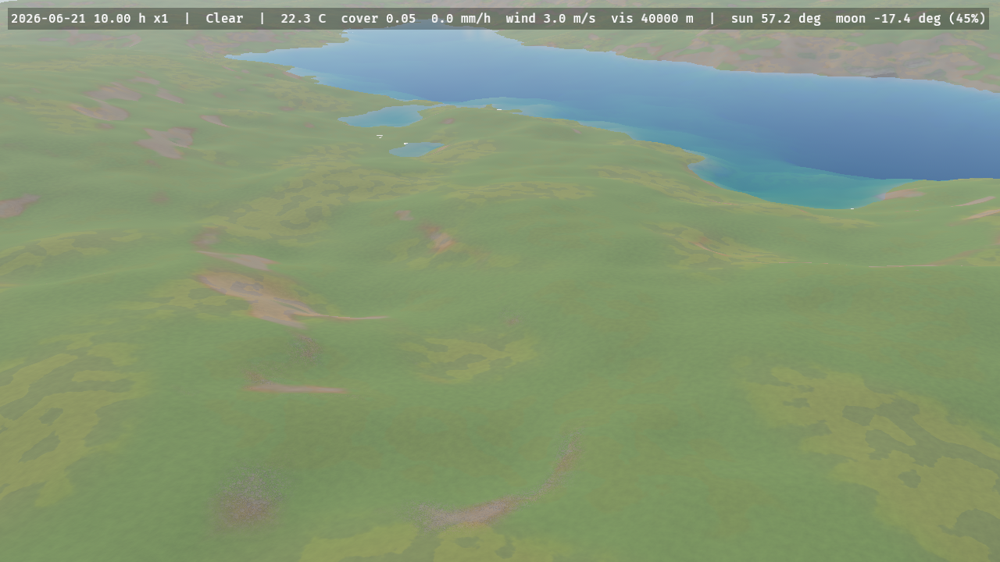

### Waves

`WavesPlugin` makes the hydrology's water answer what moves through it. Put a `WaterContact { half_extents }` (an ellipsoid along the entity's local axes, any rotation) on a hull, a float, a wader's legs or a falling stone: where it cuts the surface it presses down with the pressure head of its occupied column (its draft for a shallow hull, less for a deep narrow leg whose lower part the waves do not reach), plus Bernoulli's impact head `v²/2g` while it crosses the surface going down. At rest the water stays flat around it; moving, it leaves a wake bounded by Kelvin's 19.47°; bobbing or dropped in, it sends out rings in which the short waves outrun the long ones. Waves reflect off the shores, slow in the shallows, are carried by the current, break where they grow steeper than water holds (amplitude 7 % of the wavelength) and leave foam that fades over a few seconds.

The field is three camera-following windows a factor of four apart (High: 512² of 5, 20 and 80 cm, out to 410 m), each a linear capillary-gravity wave field stepped by Tessendorf's iWave scheme with a 13 × 13 kernel fitted at start-up to Airy's dispersion over its band (within 1.5 %), forced by the bodies' head split into the bands like a Laplacian pyramid. The water's surface and absorb passes add its slopes to the flow-mapped ripples and draw its breaking foam; `WaveState` publishes it for a water shader of your own. `WaveSettings::damping_per_s` sets how long a wake lasts.

```rust
# use bevy::prelude::*;
# use bevy_elements::*;
fn a_float(mut commands: Commands) {
    // A 25 cm ball; move its transform and the water answers.
    commands.spawn((WaterContact::sphere(0.25), Transform::from_xyz(0.0, 5.7, 0.0)));
}
```


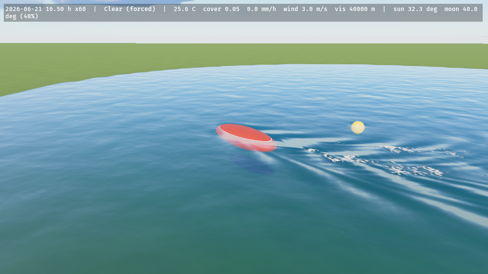 

## Surfaces, materials and voxel snow

### Weathered materials

`WeatheredMaterial` is `ExtendedMaterial<StandardMaterial, WeatheredExtension>`: give any mesh one and it follows the weather. `WeatheredPlugin` writes `ElementsGlobals` every frame (wetness, snow cover and snow depth from `SurfaceWeathering`, the rain intensity `min(1, R_liquid/20)`, the cloud shadow map, ripple and streak phases, the world units, the trail window) into one 128-byte storage buffer all weathered materials bind (binding 101, fragment stage only: it leaves the fragment stage two of the eight storage buffers WebGPU guarantees). A wet surface loses up to half its albedo in proportion to its porosity (Lagarde's gloss-based estimate: rough surfaces soak, plastic, tile and metal do not); a porous surface gains Lagarde's limited sheen (roughness × (1 − 0.4 · wetness · porosity), 0.54 for a soaked rough wall) and a smooth or metal one a water film at 0.1, as does a porous one drenched past saturation (a rain streak); rain on a wall adds darker streaks that run down it; faces turn white under snow with the curve `snow · smoothstep(0.85 − 0.6 snow, +0.2, n.y)` that `bevy_flora` uses, snow albedo `SNOW_ALBEDO` and roughness `SNOW_ROUGHNESS`, so trees and buildings read as one snow. `WeatheredExtension::exposure` is 1 under open sky and 0 sheltered (no wetness, streaks or snow, only cloud shadow): it does not follow a `PrecipitationBlocker` by itself, set it from your own test. `WeatheredExtension::default().with_trails()` also draws the trails pressed into it (below). `docs/research/wet-ground.md`.

```rust
# use bevy::prelude::*;
# use bevy_elements::*;
fn spawn(mut commands: Commands, mut meshes: ResMut<Assets<Mesh>>, mut materials: ResMut<Assets<WeatheredMaterial>>) {
    let house = materials.add(WeatheredMaterial {
        base: StandardMaterial { base_color: Color::srgb(0.55, 0.26, 0.2), perceptual_roughness: 0.9, ..default() },
        extension: WeatheredExtension::default(),
    });
    commands.spawn((Mesh3d(meshes.add(Cuboid::new(9.0, 5.0, 7.0))), MeshMaterial3d(house)));
}
```

The shading is a public WESL import for your own shaders, `bevy_elements::surface_cover` (`weather_surface`, `mesh_snow_cover`, `rain_streak`, `ripple_offset`, `overcast_relief`, `ElementsGlobals`): bind `ELEMENTS_GLOBALS_BUFFER` read-only at any free storage slot of your own material (`#[storage(N, read_only)]`), import `ElementsGlobals`, and read the wetness, snow cover, rain intensity, wind and the cloud shadow map's placement (`CloudShadows::map` is the map). `WeatheredPlugin` (in `ElementsPlugins`) keeps the buffer current. The forward and deferred passes are covered; the depth and normal prepass stays Bevy's, so SSAO reads the dry normal. Order-independent transparency, meshlets and forward decals are not weathered.

### Snow on voxel volumes

With the feature `isomesh` (`bevy_elements = { version = "0.7", features = ["isomesh"] }`, `bevy_isomesh` and `isomesh` 0.0.11), `ElementsPlugins` also adds `VoxelPlugin`. The snow maps are heightfields, so a `VoxelVolume` gets one of its own: put `VoxelGround { resolution }` on the volume's entity and the crate scans the top of every column (the first sign change from the top, then bisection to a millimetre), spawns the crate's `Terrain` (`TerrainRender::External`) over the volume's XZ extent with those heights, and wraps the volume's field in a `SnowyField`. Hydrology, snow, wetness, wind and rain then run on it unchanged.

`SnowyField` is `min(base(p), max(p.y − (top + snow), (top − c) − p.y))`: the union of your field with a slab from one voxel `c` below the column top to the snow surface, so the mesh grows a cap while everything at least a voxel under the top, a tunnel under the hill, keeps the sign of your field exactly and never gets snow. The snow depth is the last cover readback, held per column: a column's depth is swapped only when it has moved more than half a voxel from the one the mesh was made from, the new field is installed with `replace_field`, and only the chunks the changed columns can reach are marked `NeedsRemesh`, so the seams between chunks stay closed. Edits to the volume are seen: order the system that calls `replace_field` and marks the chunks `.before(VoxelGroundSystems)`, and the tops under the marked chunks are rescanned and written to the terrain before the chunks are meshed, in the same frame.

```rust,no_run
# use bevy::prelude::*;
# #[cfg(feature = "isomesh")]
# mod voxel {
# use bevy::prelude::*;
# use bevy_elements::*;
# use bevy_isomesh::{NeedsRemesh, VoxelChunk, VoxelVolume};
# use isomesh::chunk::{ChunkId, ChunkLayout};
fn setup(mut commands: Commands, mut grounds: ResMut<Assets<GroundMaterial>>) {
    // 64 m of 0.5 m voxels: one terrain cell is one voxel wide.
    let Ok(layout) = ChunkLayout::new(16, 0.5, [-32.0, -8.0, -32.0]) else {
        return;
    };
    let volume = commands
        .spawn((
            VoxelVolume::new(layout, isomesh::fields::Sphere { center: [0.0; 3], radius: 6.0 }),
            VoxelGround::new(UVec2::splat(128)),
        ))
        .id();
    commands.spawn((VoxelChunk { id: ChunkId::new([4, 1, 4]), volume }, NeedsRemesh));
    // The material of the volume's chunk meshes stops snow and wetness a voxel under the column top.
    let _ground = grounds.add(GroundMaterial {
        base: StandardMaterial::default(),
        extension: GroundExtension::default().with_column_gate_m(0.5),
    });
}
# }
# fn main() {}
```

`ErosionSettings::enabled` is ignored for voxel ground (one warning is logged when it is on): erosion would rewrite only the heightfield under the volume, whose field is the truth. Water still flows, snow melts into it, and `ErodeTerrain` bakes run without erosion. `VoxelGround` owns the crate's single terrain, so spawn no other `Terrain` and no second `VoxelGround`; the grid is frozen to the chunk entities present at the first scan, the voxel size must be a power of two (isomesh's seam rule), and the chunk entities need identity transforms. The ground material of the chunk meshes needs `GroundExtension::with_column_gate_m(c)`, or the walls of a tunnel are shaded white wherever the map above them has snow. Limits (`docs/research/voxel-snow.md`): the maps are heightfields, so a ledge below the highest crossing gets no snow and the floor of a shaft open to the sky does; a roof thinner than a voxel is thickened to one under the slab; a carve leaves the snow depth that was on the carved surface until the snow's own dynamics sort it out; wasm meshes on the main thread, so keep `MeshBudget::max_in_flight` low there.


`voxel_snow` after 25 game hours of forced snow, the sky cleared: a cap of snow over the hill and over the mouths of the two tunnels, and none inside them.

**Snow on many volumes, without a terrain.** `VoxelGround` makes one volume the ground. For walls, rocks and ruins over a game's own ground, put `VoxelSnow` on as many volumes as you like: each gets the same slab over its column tops (one column per voxel), with no terrain spawned and no hydrology. A column's depth is the ground-cover map's at its world position where a crate `Terrain` with `GroundCoverPlugin` lies under it (so a wall under a `PrecipitationBlocker` roof stays bare and the walls melt with the ground), and elsewhere `SurfaceWeathering`'s snowpack on exposed flat ground; either way times the shed-slope exposure of the column's top. The chunk entities are children of the volume, and the volume may be moved, turned about the vertical and scaled uniformly; a tilted volume gets no snow. Shade the slab with a material that whitens what faces up, such as `WeatheredMaterial`. Both `isomesh` crates stay at 0.0.11: bevy_isomesh 0.0.10 is built on Bevy 0.19 (`docs/research/voxel-volumes.md`).


## Gameplay queries

```rust
use bevy::prelude::*;
use bevy_elements::*;

fn seek_shelter(env: Environment) {
    let weather = env.weather();
    if weather.precipitation_mm_h > 2.0 || (!env.is_daylight() && env.temperature_c() < 0.0) {
        // ...
    }
    let gust_at_head = env.wind_at(Vec3::new(10.0, 1.8, -4.0));
    let _ = (gust_at_head, env.snapshot_age());
}
```

`wind_at` answers from the GPU field as of the last readback (4 Hz by default, `ElementsReadback`) and falls back to the prevailing wind outside it or before the first readback; `snapshot_age` says how old the answer is. The queries work in an app with no window (a headless server rendering only to an image): there each frame waits for its own GPU work, since nothing presents to pace it, so a readback still lands one frame after it is requested.

`terrain_height(Vec2)` is the ground's bilinear at a world XZ (`None` off the terrain); `terrain_drawn_height(Vec2)` is the surface the full-detail patches actually draw, interpolated over the mesh's triangles (split along `(1, 0)-(0, 1)`), which equals the bilinear at every cell centre and differs inside a quad by at most a quarter of its twist. Seat a figure on a crease (a pad's edge, a ramp) with the second; `TerrainGrid::drawn_height` is the same on a layer you hold.

`terrain_normal(Vec2)` is the unit upward normal of the ground at a world XZ and `terrain_slope_deg(Vec2)` its slope in degrees, both from the gradient the trail kernel and `sinkage_at` use (central differences over a cell either side of the last readback, bilinear between cells): align a prop or a footstep, or test a slope, without re-deriving the step from `terrain_height`. `None` off the terrain and before the first readback.

`water_depth(Vec2)` is the water above the ground at a world XZ: `None` until the first readback or off the terrain, `Some(0.0)` on dry ground. `water_velocity(Vec2)` is the depth-weighted flow velocity (half resolution). Both are bilinear samples of the last readback.

`snow_depth(Vec2)` is the snow on the ground in metres and `wetness(Vec2)` how wet it is (0 dry, 1 a full 2 mm film); like the water queries they are `None` before the first readback or off the terrain.

`ground_look_at(Vec2)` answers what the terrain's ground cover is at a point in the shader's own terms (`GroundLook`): `wet` (the wetness map), `puddle` (the mask of the simulated water depth), `snow` (its cover) and `drawn_wet`, `min(max(wet, puddle), 1.4)`, the wetness the surface model wears on bare ground. A decal faded with `drawn_wet` agrees with the ground; grass and the rut-floor puddle of a trodden trail are not in it. `None` off the cover maps, without ground cover and before the first readback.

`sinkage_at(Vec2, half_extents, load_n)` is how deep, m, a contact of those half extents (m) under that load (N) would press into the terrain's ground there now: the trail kernel's own Bekker–Wong sinkage on the last readback (snow capped by CRREL's compaction limit, sand, soil to mud by wetness, 0 on rock). A game that draws a print only where it is at least 1 cm deep asks this and keeps no copy of the physics. `None` off the map, without ground cover and before the first readback; a `TrailGround` a game supplies is not read.

`trail_depth(Vec2)` is how far the ground is pressed below its undisturbed surface by `Imprint`s, m: the deepest point within 10 cm at High, `Some(0.0)` on untouched ground or a rim, `None` outside the trail window or before the first readback. It works on the crate's terrain and on a game's own ground (`TrailGround`).

`cloud_shadow_at(Vec3)` is the direct transmittance of the clouds toward the sun (the moon at night) at a world position, 0 in a thick cloud's shadow to 1 in the open, from the cloud shadow map sampled every 31.25 m over 8 km around the camera (1 outside it); `illuminance_at(Vec3)` is the horizontal illuminance there in lux, the clear-sky sun and moon light times `0.25 + 0.75 · T`. Only the clouds shadow them, not terrain or meshes. `cloud_shadow_at` is `None` before the first readback; `illuminance_at` then uses the cover-only estimate.

**A game lights its own night.** The crate meters its exposure on the scene's *illuminance* and
not on the frame's content, so a game's own light does not move the camera's exposure (Patry
2021's "illuminance-based exposure system… takes albedo out of the equation altogether"). What
a game needs is the other side of that: what power its light must have to read. The crate
answers it, in the camera's own terms:

```rust
use bevy::prelude::*;
use bevy_elements::*;

fn torch(env: Environment, mut lights: Query<&mut SpotLight>) {
    for mut light in &mut lights {
        // The scene-linear value the ground should read at: 0.18 is 18 % grey, the middle of
        // the picture, and the crate's metering holds it there at every hour.
        let luminance = env.luminance_for_display(0.18);
        // The lumens that put a surface of that albedo at that luminance, `distance` metres
        // away. The same number works for a `PointLight` and a `SpotLight`.
        light.intensity = env.light_intensity(luminance, 2.0, 0.14);
        // The night's own colour, so the light and the sky are one night.
        let c = env.night_light_colour();
        light.color = Color::linear_rgb(c.x, c.y, c.z);
    }
}
```

`exposure()` is the camera's exposure factor (`2^(−EV₁₀₀) / 1.2`, the same number Bevy's
`Exposure::exposure()` returns), and `display_value(luminance)` is the scene-linear value a
luminance has under it — the tonemapper's input, since Bevy applies the exposure inside the
PBR shader. `luminance_for_display(display)` is the inverse, `light_intensity(luminance,
distance, albedo)` gives a light's power in **lumens** (Bevy's `PointLight::intensity` and
`SpotLight::intensity` are luminous power, not candela), and `light_illuminance(intensity,
distance)` is the falloff on its own. The same numbers are in the `light` module and in the
`ElementsExposure` resource, for a system that does not hold an `Environment`.

The power a light needs scales *inversely* with the exposure: the same lamp wants 62 253 lm at
noon and 2.8 lm at midnight, for the same picture. A game that hard-codes a lamp's lumens is
wrong by five orders of magnitude between the two; a game that asks the crate is never wrong.
See `docs/research/game-lights.md`.

**Saving the weather and the snowpack.** The weather's save state is `WorldClock`, `Climate`, `GeoLocation` and `WeatherDirector` (the scheduler's chain position, a forced preset and the blend in progress); `Weather` is recomputed from them each frame. The ground's is `SurfaceWeathering` (the snowpack and the wetness), and the record of recent days is `ClimateHistory`. With the `serde` feature all six serialize; insert the saved copies before the next `ElementsSystems::Weather` run and the weather, the snow and the record continue exactly as saved, where a fresh director would restart the chain at `Clear`, a fresh `SurfaceWeathering` at bare, dry ground and a fresh record with no days. A snowpack or a record loaded onto a clock more than an hour from the one it was saved at neither melts, grows nor records across the gap. The ground-cover maps on a terrain are not saved: they are re-seeded from the loaded snowpack, times each cell's slope and shelter exposure, so roofs keep the ground under them bare; drifts re-form as it snows. The other GPU layers (water, terrain) are not part of it. `tests/save.rs` shows the round trip; `weathered_town` writes and loads a save with `ELEMENTS_SAVE` and `ELEMENTS_LOAD`.

**A forecast.** `WeatherDirector::forecast(&climate, &location, &clock, hours)` returns the preset the scheduler will choose for each of the next `hours` game hours, by running the same seeded chain forward without changing anything: the weather then comes as forecast (with the same climate and location), whatever is forced meanwhile, since the chain keeps stepping underneath a force. A morning board can say that a storm comes this afternoon. `SurfaceWeathering` compares with `==` (its private snowpack state included), so a save that holds it can derive `PartialEq`.

## Plays well with

- **`bevy_flora`** 0.46 (feature `flora`): add `ElementsFloraPlugin` next to `FloraPlugin`. It writes `FloraWind` (direction, strength = 10 m speed / 20 m/s, turbulence, gust strength, and every `WindGust` as a `GustFront`: speed and width in metres, which `FloraUnits` scales to the world, the origin in world units), `FloraSeason` (autumn, leaf fall, blossom, snow = `SurfaceWeathering::snow_cover`) and `FloraWetness`. Trees and their sway stay `bevy_flora`'s. A game on a git revision of `bevy_flora` patches it (`[patch.crates-io]`) so both crates use one copy.
- **`isomesh` / `bevy_isomesh`** (feature `isomesh`): add `IsomeshPlugin` next to `ElementsPlugins` and put `VoxelGround` on a `VoxelVolume` for snow on voxel ground (above). Meshing, chunks and the volume stay `bevy_isomesh`'s.
- **`bevy_carnage`, `bevy_light_grid`** (Bevy 0.19): no dependency either way. Glue in the game copies plain data across, e.g. `SurfaceWeathering::wetness` into a blood-drying rate, or `Environment::sun()` into a light grid's sky term.

## Performance

GPU time per frame on an RTX 3090 (Vulkan), the minimum over Bevy's diagnostic history so it is the full-clock cost (`examples/bench_elements.rs`; a lightly loaded GPU idles at 210–450 MHz and reads 5–10× slower).

| Quality | Wind grid | Jacobi iterations | Wind | Ground-fog density | Total |
|---|---|---|---|---|---|
| Low | 32 × 8 × 32 | 10 | 0.087 ms | 0.037 ms | 0.124 ms |
| Medium | 48 × 12 × 48 | 10 | 0.119 ms | 0.037 ms | 0.156 ms |
| High | 64 × 16 × 64 | 12 | 0.233 ms | 0.037 ms | 0.270 ms |
| Ultra | 96 × 24 × 96 | 40 | 1.704 ms | 0.037 ms | 1.741 ms |

The budget for wind + fog at High is 0.3 ms. Ultra keeps 40 Jacobi iterations and the plan's grid; it is for large budgets. The fog column predates precipitation: with the shaft term (a second two-octave fBm and a weather-map sample per texel) the density kernel reads 0.058 ms at High (the kernel does not depend on the quality; measured at High only).

Precipitation at High (150 000 particles), 3840 × 2160, the worst case of 25 mm/h (every rain particle active) with 14 m/s wind, minimum over the diagnostic history with the GPU at 1800 MHz:

| Blockers | `elements_precip_sim` | `elements_precip_draw` | Fog kernel increase | Total |
|---|---|---|---|---|
| none | 0.028 ms | 0.126 ms | 0.021 ms | 0.175 ms |
| 256 (the most uploaded) | 0.227 ms | 0.126 ms | 0.021 ms | 0.374 ms |

The budget is 0.4 ms. The simulation tests every uploaded blocker for every particle, so its cost is the blocker count times the particle count. `PrecipitationLook::readable()` costs nothing measurable: `elements_precip_draw` in a `Thunderstorm` read 0.123 and 0.115 ms against 0.122 and 0.126 ms at the defaults (two runs each, the GPU at 1695–1755 MHz).

Clouds at 1920 × 1080, PartlyCloudy (the scene the clouds note fixes for the bench), minimum over the diagnostic history with the GPU at 1800 MHz; the 128³ + 32³ noise volumes are generated once at startup (0.201 ms):

| Quality | March resolution | Primary steps | Weather map | Shadow map | March | Resolve | Composite | Total |
|---|---|---|---|---|---|---|---|---|
| Low | 1/4 | 32 | 0.085 ms | 0.081 ms | 0.040 ms | 0.067 ms | 0.035 ms | 0.307 ms |
| Medium | 1/4 | 48 | 0.086 ms | 0.066 ms | 0.041 ms | 0.067 ms | 0.034 ms | 0.293 ms |
| High | 1/2 | 64 | 0.085 ms | 0.069 ms | 0.095 ms | 0.068 ms | 0.035 ms | 0.351 ms |
| Ultra | 1/2 | 96 | 0.085 ms | 0.067 ms | 0.125 ms | 0.068 ms | 0.034 ms | 0.378 ms |

The budget is 1.0 ms at High. The weather map, shadow map, resolve and composite passes cost about 0.27 ms at every quality, so the qualities differ only in the march, and Low and Medium (both a quarter of the resolution) within the measurement's noise. The sky probe (`elements_clouds_sky_probe`, the clouds in the environment map) does not depend on the screen: 0.047 ms at Low, **0.062 ms** at High and 0.155 ms at Ultra for Bevy's default 128² cube (3840 × 2160, PartlyCloudy, the GPU at 1680–1770 MHz).

Terrain with 1024² cells over 2048 m (`hills(42)`; measured before High took Medium's 512² simulation size, below), 3840 × 2160, the camera 30 m above the ground looking 20° above the horizon (about half the frame is ground), minimum over the diagnostic history with the GPU at 1800–1950 MHz: the generator and first pack (`elements_terrain`: generate, pack, flow pack, leaf bounds and readback kernels, once at spawn, then again only when hydrology or erosion changes a layer) 0.34 ms; the terrain drawn: Bevy's `main_opaque_pass_3d` 0.088 ms (mean 0.146) against 0.016 ms (0.025) for the flat test scene, and the depth prepass 0.005 ms (0.002 ms for the flat scene). The selection picks at most 133 patches at High over 1500 random cameras, and the pool update writes nothing for a patch that kept its slot and bounds.

Ground textures (`TerrainTextures`), 3840 × 2160, the eye-level meadow (`hills`, `ELEMENTS_EYE=0,0,0 ELEMENTS_LOOK=12,-3,8 ELEMENTS_AGL=1.7`, ground filling the frame below the horizon), the opaque pass's mean with base and change interleaved in the same clock state (P5; at 4K the history's minimum reads zero): without a set 6.8–7.4 ms against the base's 7.1–7.3 (the textured path is compiled only into a set's pipeline), with the examples' soil and grass set 8.8–9.4 ms, **+26 %**. Anisotropic filtering, the set's size and the number of taps fetched did not move it; the shader's peak register count did (`docs/research/ground-textures.md`, Deviation 19).

Wet ground (the porous sheen, the film albedo, the canopy, the rock's cavity occlusion), the same view and the mountain foot (`mountains`, `ELEMENTS_LOOK=60,0,60`), 3840 × 2160, the opaque pass over the early prepass of the same run (the ratio cancels the clock state; base and change interleaved): dry ground 55.2–55.6 against the base's 55.5–57.4, **unchanged**; soaked under `Rain` (`ELEMENTS_GROW_HOURS=3`) the meadow 57.2–58.7 against 54.7–55.3, **+5 %**, and the mountain 56.4–57.1 against 55.6–55.8, **+2 %**: the wet path's arithmetic, paid only where the ground is wet (`docs/research/wet-ground.md`, Cost).

Hydrology and erosion (`elements_hydrology`: every substep's two kernels, the thermal kernels on every 4th, and the readback kernels on a readback tick), minimum over the diagnostic history after 240 warm-up frames, a 2 km procedural terrain with a 50 m³/s `WaterSource`, the quality's full substeps per frame; the GPU held 1800–1950 MHz (P2) with the clocks logged in the same shell:

| Quality | Grid | Substeps per frame | `elements_hydrology` | Terrain pack passes (`elements_terrain`) |
|---|---|---|---|---|
| Low | 256² | 2 | 0.033 ms | 0.022 ms |
| Medium | 512² | 4 | 0.255 ms | 0.042 ms |
| High | 512² | 4 | 0.258 ms | 0.043 ms |
| Ultra | 2048² | 16 | 14.75 ms | 0.478 ms |

The plan's budget for hydrology and erosion at High is 0.6 ms for 1024² at 8 substeps, which measures **1.86 ms** (0.23 ms per substep, 80 % of the card's memory bandwidth, as `docs/research/hydrology.md` predicted), so High takes Medium's values (512², 4 substeps; `ElementsQuality::terrain_max_resolution` and `hydrology_substeps`) and Ultra keeps the research resolution and 16 substeps (14.75 ms; it is for large budgets). A 600 s bake at High is 7500 frames: 125 s at 60 fps.

Water (`WaterPlugin`), `ELEMENTS_TERRAIN=lake ELEMENTS_QUALITY=ultra` (a 256 m plain with a 100 m round basin filled by a 200 m³/s source, the camera 45 m up so the lake covers about a third of the frame), minimum over the diagnostic history after the lake is full, the GPU in P2 at 1800–1950 MHz with the clocks logged in the same shell: Bevy's `main_transparent_pass_3d`, which holds both water passes, costs **0.394 ms** at 1920 × 1080 (mean 0.409; 0.002 ms with `ELEMENTS_WATER=off`) and 1.196 ms at 3840 × 2160; the plan has no water budget and the note's informational target (0.3 ms for a half-screen view at 1080p) is missed by about 1.3× at an estimated 43 % coverage (`docs/research/water-rendering.md`, Validation 14). The `water_normals` kernel runs once at spawn (10 dispatches, 512² down to 1 texel).
Ground cover (`elements_snow`: source, drift flux and apply and two diffusion passes per step; `elements_wetness`: the wetness update, the render pack and, on a readback tick, the readback kernel; both at most 20 times a second), a Blizzard so the drift runs, minimum over the diagnostic history, 3840 × 2160, the GPU at 1800–1950 MHz with the clocks logged in the same shell:

| Quality | Grid | `elements_snow` per step | `elements_wetness` per step | Per frame at the 20 Hz cap (60 fps) |
|---|---|---|---|---|
| High | 512² | 0.084 ms | 0.042 ms | 0.042 ms |
| Ultra | 2048² | 1.366 ms | 0.514 ms | 0.63 ms |

The per-frame target (≤ 0.3 ms at High) holds up to 1024² (0.47 ms a step, 0.16 ms a frame). `elements_shelter`, the mask that keeps snow and rain from the ground under `PrecipitationBlocker`s, runs only when the blockers or the wind change: 0.025 ms at 512² with no blocker, 1.67 ms at 2048². See [`snow-cover.md`](docs/research/snow-cover.md) and [`wetness.md`](docs/research/wetness.md) for the model and the validation numbers.
Aeolian transport (`elements_aeolian_*`, at 3840 × 2160 with the GPU at 1800–1950 MHz, minimum over the diagnostic history, `ELEMENTS_TERRAIN=dunes` in a forced `DustStorm`): at High's 512² grid one step costs **0.236 ms** (capacity 0.023, flux scan 0.113, bed move 0.013, two avalanche passes 0.087), 0.079 ms per 60 Hz frame at the 20 steps a second cap; at Ultra's 2048² 1.997 ms per step, 0.666 ms per frame. The plan has no budget for dust; the note's target was ≤ 0.3 ms per frame at 1024², which interpolates to about 0.19 ms.

Trails (`elements_trails`: stamp, merge, block occupancy and relax over the window, every frame; `bench_elements` with `ELEMENTS_TERRAIN=hills ELEMENTS_IMPRINTS=16`, 1920 × 1080, the GPU at 1500–1935 MHz, minimum over the diagnostic history): **0.119 ms** at High's 1024² × 5 cm window with 16 wheels pressing, against the note's 0.15 ms; on a game's own ground (`ELEMENTS_TERRAIN=game`, no map lookups) 0.112–0.116 ms. The readback for `trail_depth` (`elements_trails_readback`) costs 0.025 ms on its 4 Hz ticks. The parallax in the terrain material skips any pixel whose ray meets no trail (the published block occupancy): `main_opaque_pass_3d` read 0.054–0.058 ms with `ELEMENTS_TRAILS=off` and 0.057–0.058 ms on, the trails a sliver of the frame; with the camera 6 m above the 16 wheels' rings, ruts filling much of the lower half of the frame on a game's plane in `WeatheredMaterial::with_trails()`, 0.413 ms against 0.226–0.236 ms off (P2, 1755–1800 MHz). See [`trails.md`](docs/research/trails.md) and [`trails-game-ground.md`](docs/research/trails-game-ground.md).

Waves (`elements_waves_force`: the bodies' head and the per-texel forcing, depth and current; `elements_waves_step`: one 1/60 s substep of all three cascades; `elements_waves_publish`: slopes and foam into the field; `bench_elements` with `ELEMENTS_TERRAIN=lake ELEMENTS_CONTACTS=8`, the camera over the filling lake, 1920 × 1080, the GPU at 1740–1800 MHz, minimum over the diagnostic history): High (3 × 512²) 0.037 + 0.217 + 0.033 = **0.29 ms** a frame with currents everywhere (each tile texel then fetched upstream, four loads), 0.23 ms on still water; Medium the same; Low (3 × 256²) 0.15 ms. Dry texels cost only their depth, so a window over land is nearly free. The water's shading of the field is within the run-to-run spread of `main_transparent_pass_3d`. This is above the note's 0.15 ms: a third cascade was the price of holding Airy's dispersion over 15 cm to 10 m waves (`waves.md` Deviation 1, 10).

Voxel snow is CPU work on the main world (the column-top scans and the chunk remesh), not a GPU pass, so it reports through the ignored `voxel_cost` release test rather than `bench_elements` (`docs/research/voxel-snow.md`): the initial scan of 16 384 columns (the `voxel_snow` example's 128 × 128) is 11.7 ms once at spawn; a user edit's column rescan 0.125 ms and one crest chunk's Marching Cubes 0.428 ms, both under the frame budget the note gives them (2 ms); the two depth-swap frames of a 60 game-hour run cost no more than the frame budget (2.9 ms of the 33 ms target); the median frame over 3 600 frames is 2.86 ms.

## Platforms

Native (Vulkan, Metal, DX12) and wasm WebGPU. WebGL2 is unsupported: the simulation needs compute. Simulation state lives in storage buffers and published fields in write-only `rgba16float` storage textures: the wind kernels share one layout of seven storage buffers and one storage texture, the fog kernel one storage texture, inside WebGPU's default limits of 8 and 4 per stage (devices limited to the `downlevel` 4 storage buffers are not supported; the hydrology substep kernels bind exactly 8). The cloud kernels bind at most one storage texture and two storage buffers each, the precipitation kernel four storage buffers; the precipitation draw reads its particles in the vertex stage, which needs `DownlevelFlags::VERTEX_STORAGE` (every Vulkan, Metal, DX12 and WebGPU device has it). GPU timestamps for the bench exist on Vulkan and DX12 only.

## What it deliberately does not do

- Trees, foliage, leaf colour and snow on branches: `bevy_flora` owns them.
- Isosurface and voxel meshing: `isomesh` owns it.
- Oceans and FFT waves.
- Bit-deterministic GPU simulation. Astronomy, the weather scheduler and lightning are deterministic and seeded; GPU results are not.
- A Purkinje shift or other low-light colour change: exposure keeps night dark, but colour handling is left to the tonemapper.
- Twigs, fallen branches, leaf litter and other organic debris on the ground: they are foliage, and `bevy_flora` owns it. This crate scatters the rock.

## Compatibility

| bevy_elements | bevy | notes |
|---|---|---|
| 0.1 – 0.5 | 0.20 | 0.5's `isomesh` feature needs `isomesh`/`bevy_isomesh` 0.0.11; the `flora` feature `bevy_flora` 0.46 (0.30 before) |
| 0.6 | 0.20 | as 0.5 |

## Research

Every system was studied in the home-still paper library first. The note for each one, in [`docs/research/`](docs/research), names the papers, the equations adopted, every deviation from the plan with its source, and the numbers the tests assert.

- [Bevy 0.20 render APIs](docs/research/bevy-0.20-render.md) — the verified paths and signatures this crate builds on.
- [What the home-still corpus holds](docs/research/corpus.md) — the reading list per domain.
- [Celestial](docs/research/celestial.md) — Meeus, Reda & Andreas (SPA), Krisciunas & Schaefer, Jensen et al., Ballesteros, USNO Circular 171, Larson et al. (tone reproduction).
- [Twilight and the night sky](docs/research/twilight.md) — Hulburt 1953, Haber et al. 2005, Hillaire 2020, Patry 2021: the sun lighting the sky below the horizon, the night glow behind the atmosphere, the glow-capped exposure.
- [Climate and weather](docs/research/climate-weather.md) — Richardson 1981, ISO 2533, Jennings et al. 2018.
- [Wind](docs/research/wind.md) — Stam 1999, Harris 2004, Bridson et al. 2007, Kim et al. 2008, WMO.
- [Lightning](docs/research/lightning.md) — Reed & Wyvill 1994, Kim & Lin 2004, Poelman et al. 2021, Rakov, Tatarchuk 2006.
- [Fog](docs/research/fog.md) — Wronski 2014, Hillaire 2015, Wenzel 2006, Real-Time Rendering.
- [Terrain](docs/research/terrain.md) — Strugar 2009 (CDLOD), Andersson 2007, Musgrave et al. 1989, Galin et al. 2019, Mei et al. 2007.
- [Paths and roads](docs/research/paths.md) — Pouyat et al. 2020 (the trail impacts: bared soil, compaction, vegetation loss), Andersson 2007 (mask-based terrain compositing), Green 2007 via RTR4 §15.4.3 (coverage distance fields), Sumner et al. 1999, Tatarchuk 2006.
- [Terrain level of detail under an orthographic camera](docs/research/orthographic-lod.md) — Strugar 2009, Asirvatham & Hoppe 2005 (clipmaps centred on the viewer), Luebke et al. 2003 and Lindstrom et al. 1996 (screen-space error), the Unreal and Unity terrain docs (a vertex on every height sample).
- [Precipitation](docs/research/precipitation.md) — Marshall–Palmer drops, Garg & Nayar, Langer et al., Wang & Wade, Kanazawa & Uchida, Rasmussen et al., Tatarchuk.
- [Rainbows](docs/research/rainbow.md) — Sadeghi et al. 2012 (primary and secondary bows, Airy and Lorenz–Mie), Airy 1838 and van de Hulst 1957, Marshall & Palmer 1948, Wyman et al. 2013.
- [Clouds](docs/research/clouds.md) — Schneider 2015 and 2017 (Horizon Zero Dawn, Nubis), Hillaire 2016 and 2020, Högfeldt 2016, Patry 2021, Real-Time Rendering, Kasten & Czeplak 1980.
- [Wetness, puddles and weathered materials](docs/research/wetness.md) — Lagarde 2013 (wet surfaces, rain), Jensen et al. 1999, Tatarchuk 2006, FAO-56; with [snow cover](docs/research/snow-cover.md) for the mesh curve.
- [Hydrology](docs/research/hydrology.md) — Mei et al. 2007, Jákó 2011, Chentanez & Müller 2010, Kass & Miller 1990, Bates et al. 2010 / Cozzolino et al. 2020 (local-inertia pipes), FAO-56.
- [Dust and aeolian transport](docs/research/dust.md) — Paris et al. 2019 (Desertscape simulation), Kok et al. 2012 (the physics of wind-blown sand and dust), Bagnold, Fryberger & Dean, Hersen et al.
- [Erosion](docs/research/erosion.md) — Mei et al. 2007, Jákó 2011, Musgrave et al. 1989, Krištof et al. 2009, Jain et al. 2024, Galin et al. 2019.
- [Water rendering](docs/research/water-rendering.md) — Vlachos 2010 (Portal 2 water flow), Chentanez & Müller 2010, Mei et al. 2007, Jákó & Tóth 2011, Pope & Fry 1997, Real-Time Rendering.
- [Voxel snow](docs/research/voxel-snow.md) — the column-top terrain `VoxelGround` feeds the snow maps, the snow slab of `SnowyField` over isomesh's signed distance fields, per-column sample-and-hold swaps and the chunks they dirty; Festenberg & Gumhold 2011, Lorensen & Cline 1987, Tereshin et al. 2021.
- [A focus and orthographic cameras](docs/research/view-anchor.md) — Marschner & Shirley (orthographic rays), Real-Time Rendering, Puig-Centelles et al. 2009 and 2011 (the rain container around what the observer sees), Losasso & Hoppe 2004, Tatarchuk 2006.
- [A game keeps its own look and lights](docs/research/integration.md) — Patry 2021 (art direction over a physical sky), Schneider & Vos 2015, Tatarchuk 2006; the camera's dressing flags, `CelestialSettings`, the public globals buffer.
- [The snowpack in a save, and a snow season](docs/research/snow-season.md) — Jennings et al. 2018 (the rain–snow threshold varies from −0.4 to 2.4 °C), Patry 2021; `SnowSeason`, `Weather::snow_possible`, the restored pack and the seeded cover maps.
- [A record of recent days](docs/research/climate-history.md) — the ETCCDI's daily indices (frost, icing and wet days; Zhang et al. 2011), Thurner et al. 2017, Richardson 1981 (the daily weather record); `ClimateHistory`, `Environment::recent_days` and `recent_climate`, issue #31.
- [Sky light and reflections under cloud](docs/research/sky-light.md) — Hillaire 2016 (clouds in every view, the environment map included), Lagarde & de Rousiers 2014 (the distant light probe, refreshed with the weather), Unreal's real-time sky light capture, Bauer 2019 (RDR2), Karis 2013 (split sum), Kittler & Darula 2014 (the graded overcast); the clouds' sky probe.
- [A game's look for rain and snow](docs/research/precipitation-look.md) — Tatarchuk 2006 (artist-set rain direction and speed, random particle size), Lagarde 2012 (Remember Me: rain stronger than physics where it would vanish), Wang & Wade 2004, Garg & Nayar 2007, Tiira et al. 2016 (snowflake size distributions); `PrecipitationLook`, and the scheduler's forecast.
- [Trails on a game's own ground](docs/research/trails-game-ground.md) — Barré-Brisebois 2014 (Batman: Arkham Origins: "we don't have terrain", snow surfaces a game marks), Tran 2018 (a world-space trail map projected onto the ground material), Hanák 2021 (RotTR's sliding window, TLOU2's parallax prints on any mesh), Tatarchuk 2006; `TrailGround`, `with_trails()`, `trail_depth`.

## Examples

Run with `cargo run --release --example <name>`. Every example takes `ELEMENTS_FRAMES=N` (exit after N frames), `ELEMENTS_SHOT=/path.png` (screenshot on the last frame), `ELEMENTS_UNITS=3.2808` (a world in feet: `ElementsUnits`, with the camera and its planes scaled), `ELEMENTS_PRECIPITATION=readable` (`PrecipitationLook::readable()`) and `ELEMENTS_GROUND_TEXTURES=0` (the procedural ground alone, without the golem set in `assets/ground/`; `ELEMENTS_GROUND_SWAP=S` toggles the set every S seconds and `ELEMENTS_GROUND_COLOUR=c` sets its colour share; a binary run directly finds the assets with `BEVY_ASSET_ROOT=<the repository>`). Keys: WASD + Q/E to fly (Shift ×5), right mouse to look, `[`/`]` time scale, `T` +1 hour, `1`–`0` force a preset, `R` release.

| Example | Shows |
|---|---|
| `quickstart` | The quick start: rolling hills under a sun and a sky |
| `terrain_tour` | The terrain presets; `ELEMENTS_PRESET=mountains`, `ELEMENTS_HOUR`, `ELEMENTS_EYE` / `ELEMENTS_LOOK` / `ELEMENTS_AGL`, `ELEMENTS_UNDERLAY=1` (a red plane under the terrain shows cracks), `ELEMENTS_FLY=8` (the camera glides forward at 8 m/s, held above the ground, for a moving capture), `ELEMENTS_ORTHO=18` (an isometric orthographic camera showing 18 m of ground, 457 m back from a focus on the ground at `ELEMENTS_LOOK`; `ELEMENTS_PITCH`, `ELEMENTS_HEADING`, `ELEMENTS_WALK=1.4` walks the focus), `ELEMENTS_PINS=1` (posts on `terrain_height` every 2 m with 10 cm red feet: a foot that sinks or floats shows the drawn ground off the query) |
| `external_ground` | A plain plane of your own shaded by `GroundExtension` over an `external()` terrain |
| `day_night` | A solstice day at 45° N in two minutes; the camera follows the sun while it is up and the moon after; `ELEMENTS_HOUR=19.5` holds an hour and frames the body, `ELEMENTS_START=19` starts the running day at that hour, `ELEMENTS_DATE=2026-07-14` sets the date (a moon-phase sweep), `ELEMENTS_PRESET` holds a weather preset (default `Clear`) |
| `weather_tour` | Every preset for 20 s; `ELEMENTS_PRESET=Fog` holds one, `ELEMENTS_HOUR` holds an hour, `ELEMENTS_PITCH` / `ELEMENTS_HEADING` aim the camera (degrees), `ELEMENTS_GROW_HOURS=6` integrates 6 game hours of the held preset before the first frame (accumulated snow, wet ground) |
| `cloud_shadow_probes` | A grid of markers coloured by `cloud_shadow_at` (yellow open, blue shadowed) over the cloud shadows on the ground; `ELEMENTS_PRESET`, `ELEMENTS_HOUR`, `ELEMENTS_HEIGHT`, `ELEMENTS_PITCH`, `ELEMENTS_HEADING`, `ELEMENTS_SPACING` |
| `storm` | A forced thunderstorm printing every strike and thunder; `ELEMENTS_HOUR=12` holds an hour, `ELEMENTS_STRIKE=1500` scripts a strike that far ahead on the last frame (for screenshots), `ELEMENTS_STRIKE_LEAD=3` that many frames earlier |
| `rain` | Rain over a shelter with a blocker roof; `ELEMENTS_PRESET=Thunderstorm`, `ELEMENTS_HOUR=23` |
| `snowfall` | The `Snow` preset (or `ELEMENTS_PRESET=Blizzard`); `ELEMENTS_HOUR` holds an hour, `ELEMENTS_GROW_HOURS` grows the snow before the first frame |
| `weathered_town` | Buildings in `WeatheredMaterial` cycling Rain then Snow, a pavilion with a `PrecipitationBlocker` roof over a sheltered (`exposure` 0) box; `ELEMENTS_PRESET`, `ELEMENTS_HOUR`, `ELEMENTS_SCALE` (clock speed, default 300), the clock keeps running because wetness and snow only build with game time; `ELEMENTS_CALENDAR=november` (the scheduler's cool-temperate November from 1 November with a `SnowSeason` from 14 November; `ELEMENTS_SNOW_SEASON=off` drops it), `ELEMENTS_EV100` (a fixed exposure for time-lapse stills), and with `--features serde` `ELEMENTS_SAVE=path` (a save on the last frame) and `ELEMENTS_LOAD=path` |
| `isometric` | A town under an orthographic camera 1500 m back and 30° down that follows a walker (`ElementsFocus::Entity`), cycling Rain, Thunderstorm, Snow and PartlyCloudy; the town's ground is the game's own (`TrailGround`, `with_trails()`, 8 cm trail texels) and the walker's feet press prints into it; `ELEMENTS_PRESET`, `ELEMENTS_HOUR`, `ELEMENTS_SCALE` (clock speed, default 30), `ELEMENTS_ZOOM` (view height, m, default 40), `ELEMENTS_PITCH` (degrees below the horizon, default 30), `ELEMENTS_SNOWPACK=0.15` (start under that much snow, m), `ELEMENTS_TRAIL_TEXEL=0.05` (the trail window's texel, m), `ELEMENTS_PRECIPITATION=readable` (with `ELEMENTS_LOOK=game` the streaks are also brightened against the game's key light), `ELEMENTS_LOOK=game` (the game's own key light, ambient and clear colour under `ElementsCamera::bare()` and `CelestialSettings` off, the crate's weather on top) |
| `flora_wind` | `bevy_flora` trees in this crate's wind, season and rain (`--features flora`) |
| `flood` | A V-shaped valley, a 50 m³/s `WaterSource` and rain (`ELEMENTS_PRESET=Clear` for another sky), drawn by `WaterPlugin`; prints `Environment::water_depth` at a marker 100 m downstream every second; `G`/`H` double and halve the simulation speed |
| `lake` | A 60 m³/s `WaterSource` fills a round basin and a system closes the tap when it is full: the water as a lake; `G`/`H` double and halve the simulation speed |
| `erosion_bake` | Mountains and `ErodeTerrain { duration_s: 600.0, rain_mm_h: 20.0 }`: `B` starts the bake, `ELEMENTS_BAKE=1` starts it at once (`ELEMENTS_BAKE_S`, `ELEMENTS_BAKE_MM_H`); for a before and after shot use `ELEMENTS_FRAMES=120` and `ELEMENTS_BAKE=1 ELEMENTS_FRAMES=7700` |
| `ground_cover` | Snow and wet ground with puddles on the hills or mountains: `ELEMENTS_COVER=snow` (default: ten game minutes a second, the snow stops after `ELEMENTS_SNOW_FRAMES`) or `rain` (an `ErodeTerrain` bake fills the hollows while the Rain preset wets the ground); `ELEMENTS_TERRAIN=mountains`, `ELEMENTS_PRESET`, `ELEMENTS_AGL`, `ELEMENTS_QUALITY`; prints the snow, wetness and water under the camera every second |
| `dust_storm` | `Climate::desert()`, `ProceduralTerrain::dunes(7)` and a forced `DustStorm`: tan haze, dust sprites, and the wind stripping the sand sheet's upwind edge downwind; prints the migration the note predicts; `ELEMENTS_HOUR`, `ELEMENTS_EYE` / `ELEMENTS_LOOK`; with `ELEMENTS_FRAMES` frames run at a fixed 1/60 s, so `600` and `4200` are two shots 60 s apart |
| `voxel_snow` | A `bevy_isomesh` hill carved by a gyroid labyrinth with two tunnels through it, `VoxelGround` on its volume and forced Snow at 3 600 game seconds a second (`--features isomesh`): a cap of snow grows on the hill, remeshed each time the depth moves by half a voxel, and the tunnels stay dark; prints the crest's snow depth every second; `ELEMENTS_HOUR`, `ELEMENTS_EYE` / `ELEMENTS_LOOK`, `ELEMENTS_TIME_SCALE`, and `ELEMENTS_SNOW_FRAMES` stops the snow and clears the sky after that many frames |
| `voxel_walls` | Three crenellated walls, each its own `bevy_isomesh` volume with `VoxelSnow`, on a plain mesh ground with no terrain, one turned on a plinth; forced Snow at 3 600 game seconds a second grows a slab on every walk and merlon, the meshes painted per vertex (snow where the wall's own field is air) (`--features isomesh`); `ELEMENTS_HOUR` (default 10), `ELEMENTS_EYE` / `ELEMENTS_LOOK`, `ELEMENTS_TIME_SCALE`, `ELEMENTS_SNOW_FRAMES` |
| `trails` | A walker (two feet, 760 N) and a four-wheeled vehicle (3 400 N a wheel, 4 m/s round a 14 m loop) pressing tracks into `ELEMENTS_GROUND=snow` (default: January, the hills under forced snow; `ELEMENTS_GROW_HOURS=24` grows it before the first frame, then the sky clears), `sand` (the dunes, June, dry) or `mud` (June, the hills after rain: `ELEMENTS_GROW_HOURS=6`); `ELEMENTS_TERRAIN=mesh` puts them on a game's own hilly mesh in `WeatheredMaterial` with a `TrailGround` and no crate terrain; `ELEMENTS_PRESET=Snow` with `ELEMENTS_SCALE=120` watches new snow soften the tracks; `ELEMENTS_HOUR` (default 10.5), `ELEMENTS_EYE` / `ELEMENTS_LOOK` |
| `waves` | A pond (the `lake` basin, filled at start) with a hull circling at 2 m/s, a bobbing float, a pebble dropped every 4 s and a wader's two legs in the shallows, each a `WaterContact`; `ELEMENTS_BODIES=hull,float,pebble,wader` picks them, `ELEMENTS_FOLLOW=right,up,behind` rides with the hull (`ELEMENTS_FOLLOW_BODY=wader` with the legs), `ELEMENTS_EYE` / `ELEMENTS_LOOK`, `ELEMENTS_HOUR` (default 16.5), `ELEMENTS_QUALITY`, `ELEMENTS_PRESET`, `ELEMENTS_WAVES=off` |
| `bench_elements` | Per-pass GPU time; `ELEMENTS_QUALITY`, `ELEMENTS_RESOLUTION`, `ELEMENTS_PRESET`, `ELEMENTS_BLOCKERS`, `ELEMENTS_TERRAIN=hills\|mountains\|dunes\|lake\|game\|none` (`game`: a game's own snowed plane in `WeatheredMaterial` drawing trails), `ELEMENTS_WATER=off`, `ELEMENTS_IMPRINTS=16` (wheels pressing round the camera every frame), `ELEMENTS_TRAILS=off`, `ELEMENTS_CONTACTS=8` (bodies crossing the `lake`, the camera over the water), `ELEMENTS_WAVES=off` |

## License

MIT OR Apache-2.0, at your option.
