# Gallery

Every before-and-after capture the crate ships, grouped by the system it shows. The prose for each system, its settings and its measured cost are in [`guide/`](guide/README.md); the command that regenerates each image is in [`media/README.md`](media/README.md).

## The weather over one afternoon

`WeatherPreset::ALL` in turn on 20 April 2026, from the `weather_tour` example. Each frame's own status line gives the state at the capture; the ones below read it back.

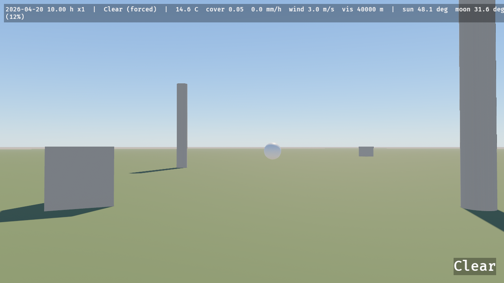
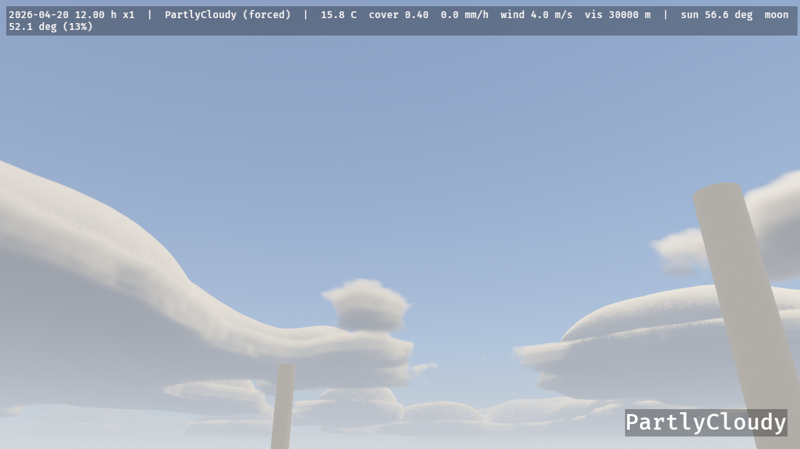
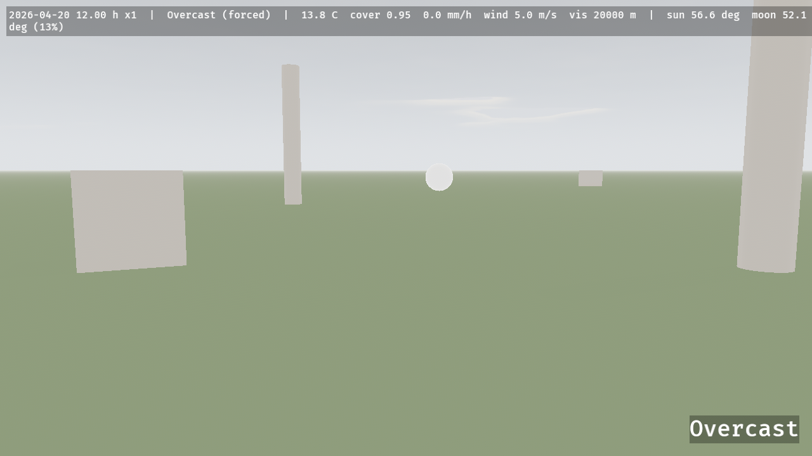
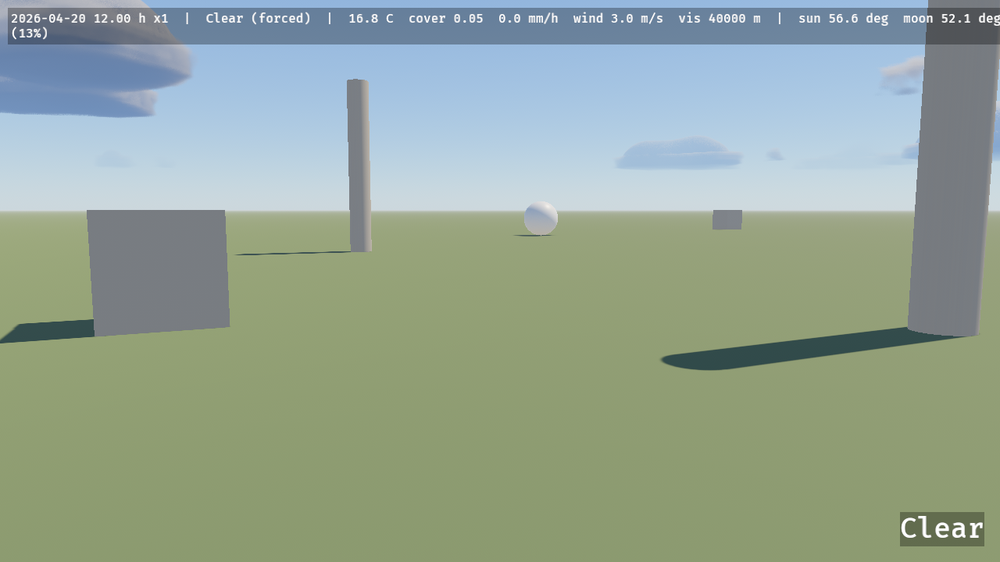

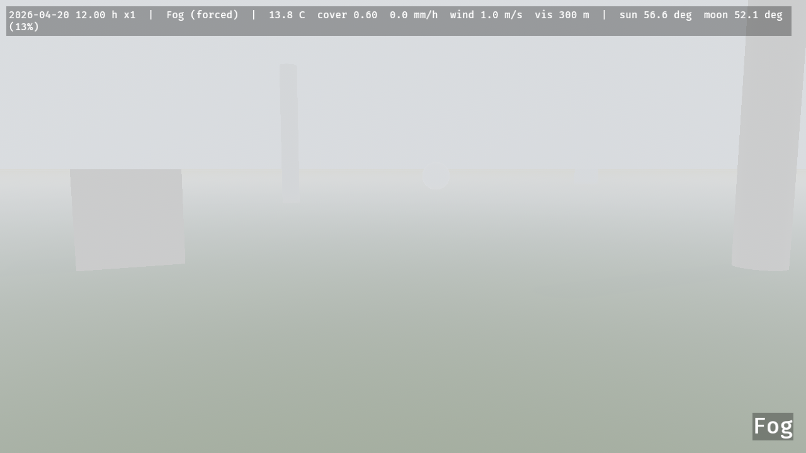
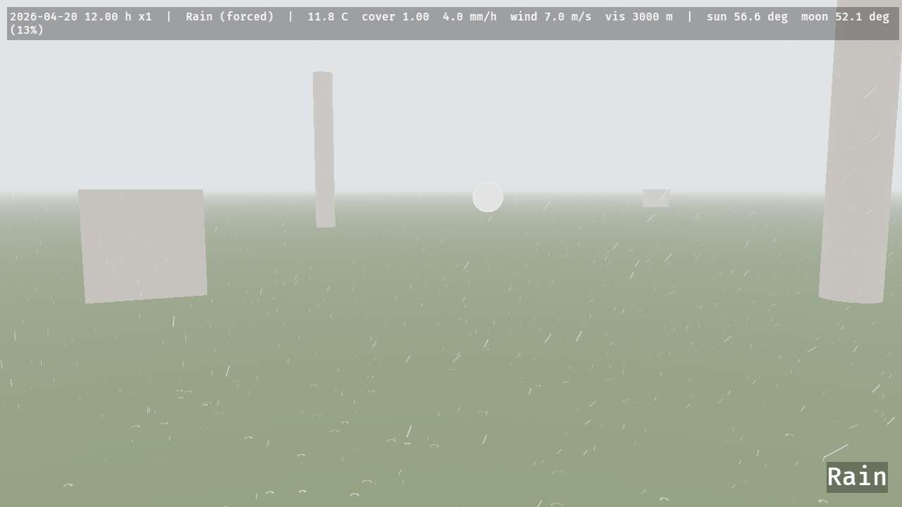
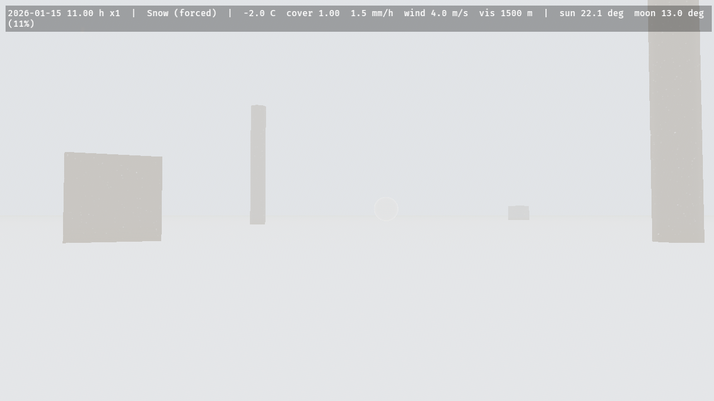
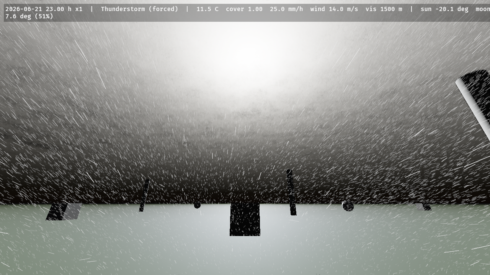

## Dawn, dusk and night

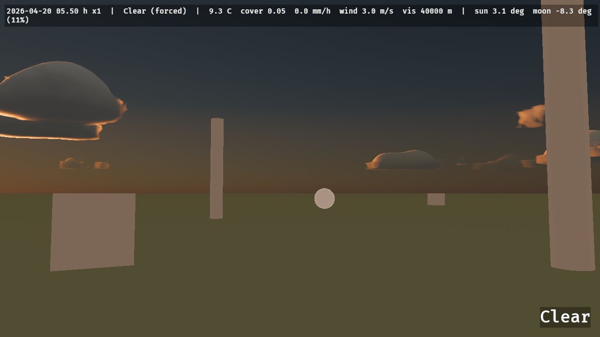
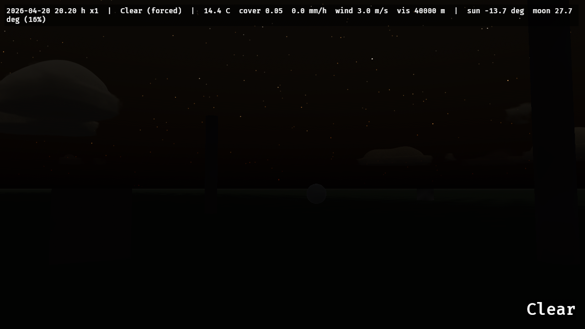
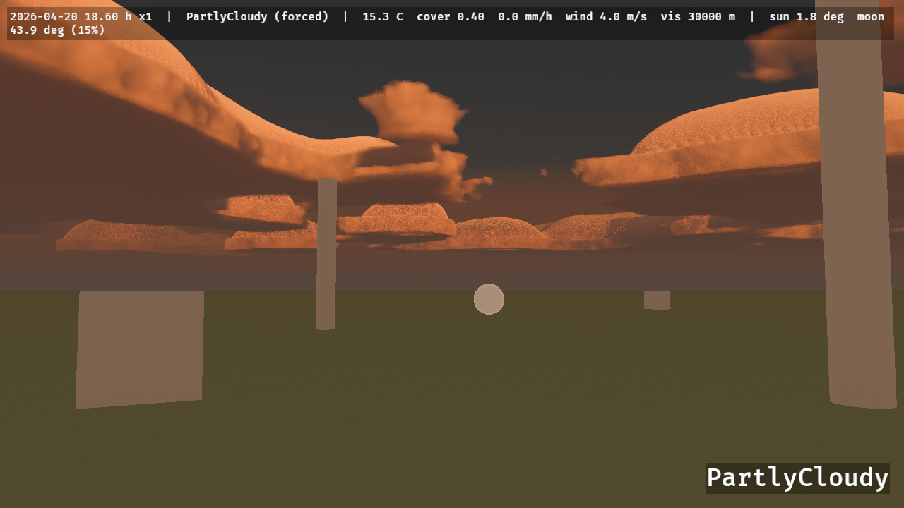

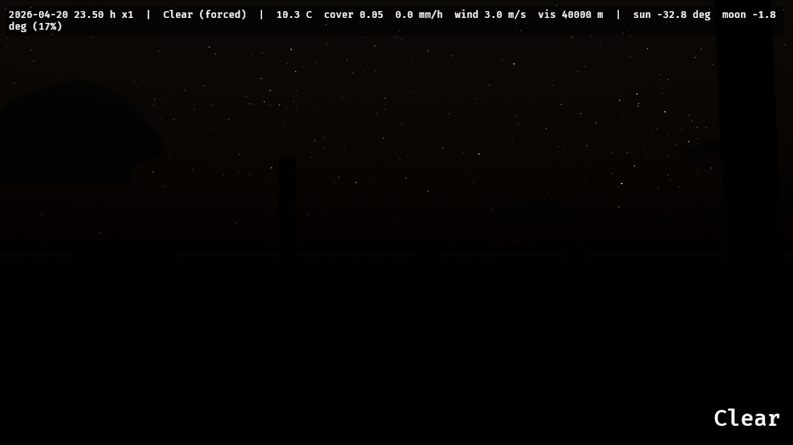
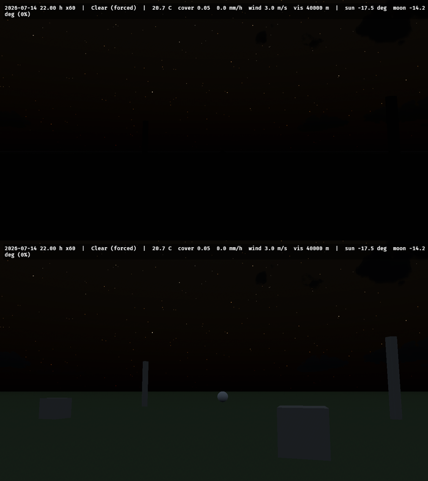

## The rock, before and after its material

The massif, a cliff and the scree at its foot, before and after the terrain's rock material: its beds, its palette, its two joint families, its fragments and its grain.

The ground's colour, at a plain and on the hills, and the rock's facets close up:

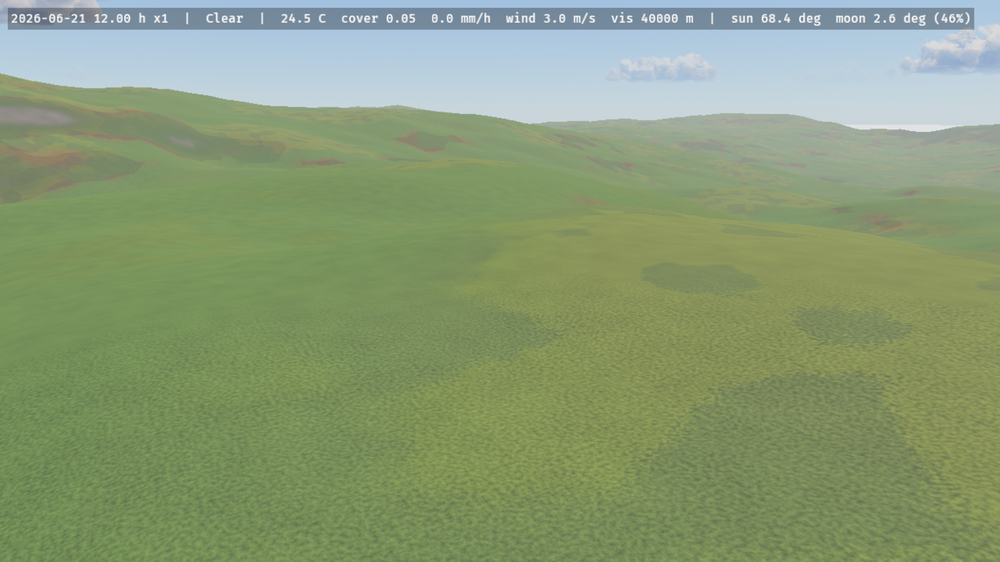 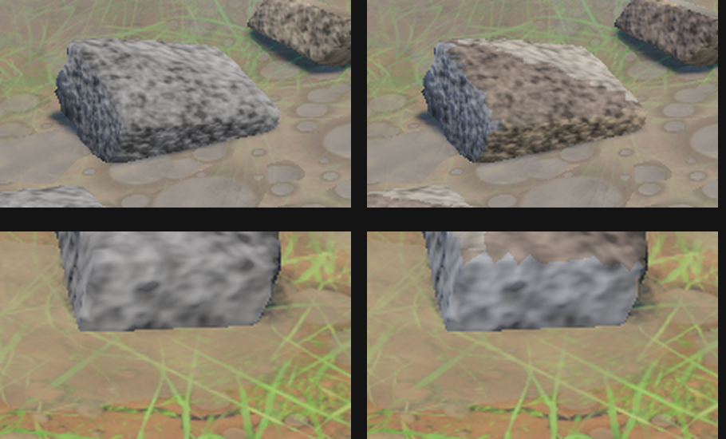

## Water

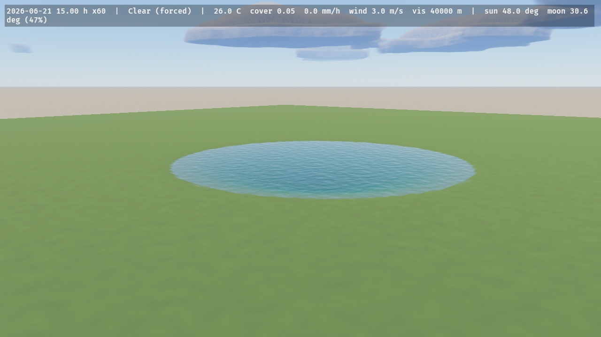 

## Trees, in the crate's wind, season and rain

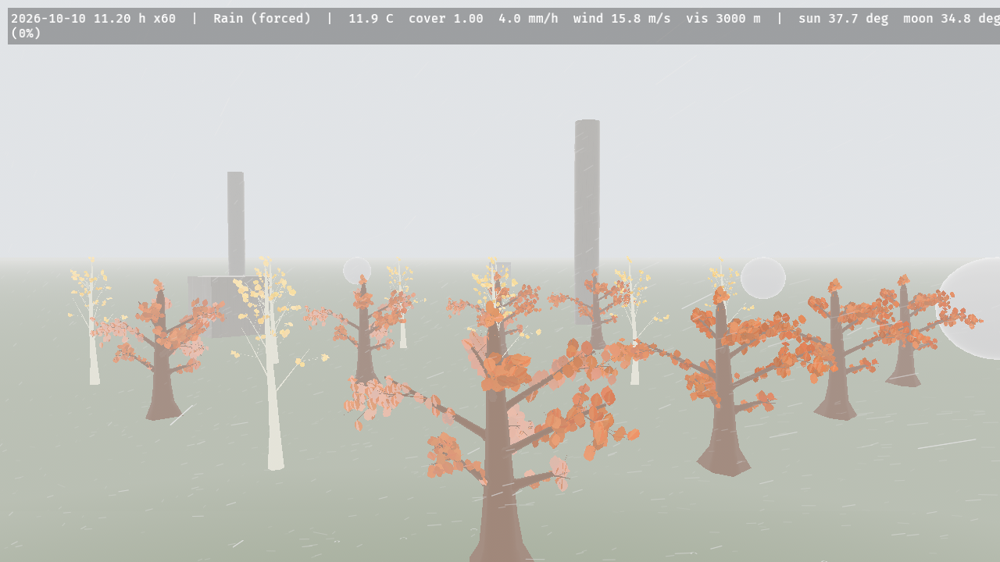
