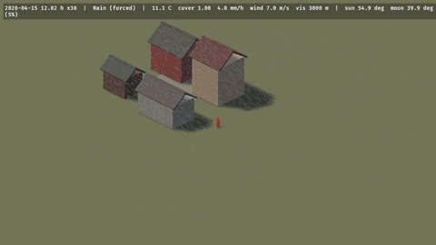
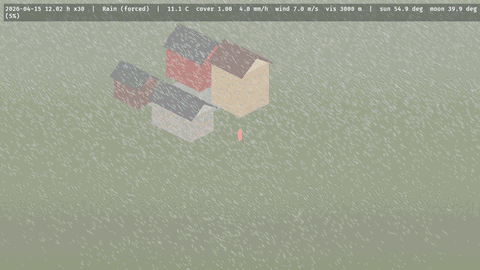

# Putting it in a scene

How a scene joins the crate: frame order, the camera it follows, a focus for camera-relative systems, orthographic views and world units.

## Frame order

Everything runs in `Update` in the chained sets `ElementsSystems::{Clock, Weather, Celestial, Simulation, Readback}`. Systems that write `WorldClock`, `WeatherDirector` or settings run `.before(ElementsSystems::Clock)`; systems that read `Environment` run `.after(ElementsSystems::Readback)`.

## The camera

`ElementsCamera` marks the camera the environment follows. Adding it inserts, where absent: `AtmosphereSettings`, `AtmosphereEnvironmentMapLight`, `DepthPrepass`, `VolumetricFog`, `DistanceFog`, and a zero per-camera `AmbientLight` (sky light comes from the atmosphere's environment map), and it spawns one Earth `Atmosphere` if there is none. It sets `Msaa::Off` (the depth prepass and the precipitation pass read the depth texture single-sampled). A camera that kept Bevy's default clear colour is cleared every frame to the night sky's own faint glow at its exposure (the space behind the atmosphere); one that set its own `ClearColorConfig` keeps it. With `auto_exposure` (the default) the camera's `Exposure` follows the sun, sky and moon: illuminance-metered like Ghost of Tsushima, mapped with Ward's contrast-based scale factor over Larson et al.'s rod-and-cone thresholds, so a moonlit scene stays dark instead of being exposed up to daylight; around sunset it is capped by the sky toward the sun, so the golden hour and the twilight glow keep their colour instead of turning white. `ElementsQuality` (`Low`, `Medium`, `High`, `Ultra`) sets every resolution and step count.

## Keeping your own look

Each part of that dressing is a flag on `ElementsCamera`, all on by default: `atmosphere` (Bevy's sky; without it the cloud layer is not drawn on the camera, but the cloud shadows still fall), `distance_fog`, `volumetric_fog`, `ambient` and `msaa_off`, besides `auto_exposure`. A flag that is off inserts nothing and leaves your own component alone (the crate stops driving your `DistanceFog` or `AmbientLight`); turning one off at runtime removes only what the crate inserted, so a game can toggle the physical sky in its options. `ElementsCamera::bare()` turns them all off (keep `msaa_off` on for the rain and snow, which the precipitation pass draws single-sampled). `CelestialSettings { lights, sky }` stops `CelestialPlugin` spawning and driving the sun and moon lights, and the moon disc and stars; `SunState` stays current either way, so the ground still dries in the sun. Mark your own key light `Sun`: the crate then never touches it, the rain and snow are lit by it (and by your camera's `AmbientLight`), and the cloud shadows fall along it. `docs/research/integration.md`; the `isometric` example with `ELEMENTS_LOOK=game`.

## A focus, and isometric cameras

The camera-relative domains (the rain and snow box, the wind window and its gusts, the ground fog, the strikes and the thunder distance, the cloud weather and shadow maps, the trails and waves windows, the surface weathering's mean) centre on the camera. Put `ElementsFocus` on the camera to centre them on something else: `ElementsFocus::Entity(player)` follows that entity's transform, `ElementsFocus::Point(p)` a point you move yourself. A third-person camera puts it on the character; an isometric or top-down game, whose camera stands far back from what it shows, on the player or on the point the camera looks at.

Orthographic cameras (`Projection::Orthographic`) work: the clouds are marched along the view's parallel rays, starting on the plane through the focus (so the camera's stand-off is not air and a camera high above a low deck is not inside it: looking down, the clouds show as their shadows), and the bolt keeps two pixels of core at every distance. For an orthographic followed camera the crate also adapts what Bevy measures from the camera's translation: the distance fog becomes linear from the nearest ground the view shows (`orthographic_fog_falloff`), the sun and moon shadows one cascade around the focus, the rain box grows to cover the view's footprint (up to 240 m across) and its drops are drawn without the distance fade (a drop is a twentieth of a pixel at a strategy zoom), the ground-fog volume is off (every orthographic ray would cross the whole layer at one slant), and the terrain's patches are selected and morphed about the focus (without one, about where the view's ray first meets the ground) in every view, so the ground on screen is drawn at full detail on the height map's own samples and a figure standing on `Environment::terrain_height` stands on what is drawn. A perspective camera is unchanged. `docs/research/view-anchor.md`, `docs/research/orthographic-lod.md`; the `isometric` example, and `terrain_tour`'s `ELEMENTS_ORTHO` and `ELEMENTS_PINS`.

## World units

The crate works in metres. A game whose world unit is something else inserts `ElementsUnits { units_per_metre: 3.2808 }` (feet; 100.0 for centimetres) and the weather is sized for its world: the rain box, the wind cells, fog, clouds and the sky's aerial perspective, lightning and its light, shadow cascades, the terrain and water. Positions the crate reads and gives back are world units (`Transform`s, `ElementsFocus::Point`, the `Environment` query positions and `terrain_height`, strike, thunder, flash and gust positions); lengths, depths and speeds stay SI (`Thunder::distance_m`, `Terrain` extents and heights, blocker, contact and imprint half extents under their transforms, `wind_at` in m/s). A scene built in feet renders as the same scene in metres (`docs/research/units.md`); `ELEMENTS_UNITS=3.2808` runs an example in feet, which reproduces it exactly where its world is the crate's (`terrain_tour`, `quickstart`), while an example's own props keep their metre sizes.

