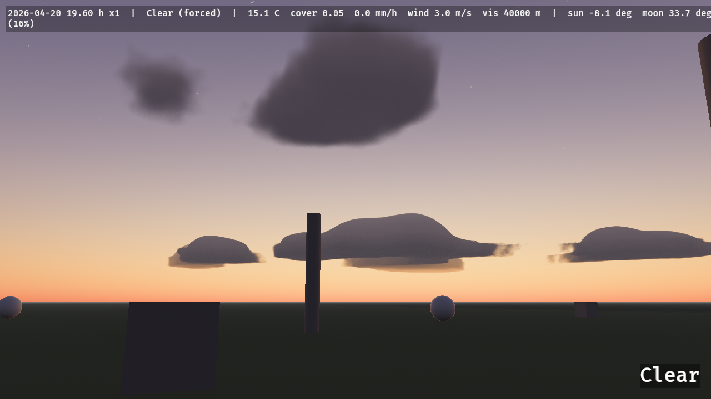
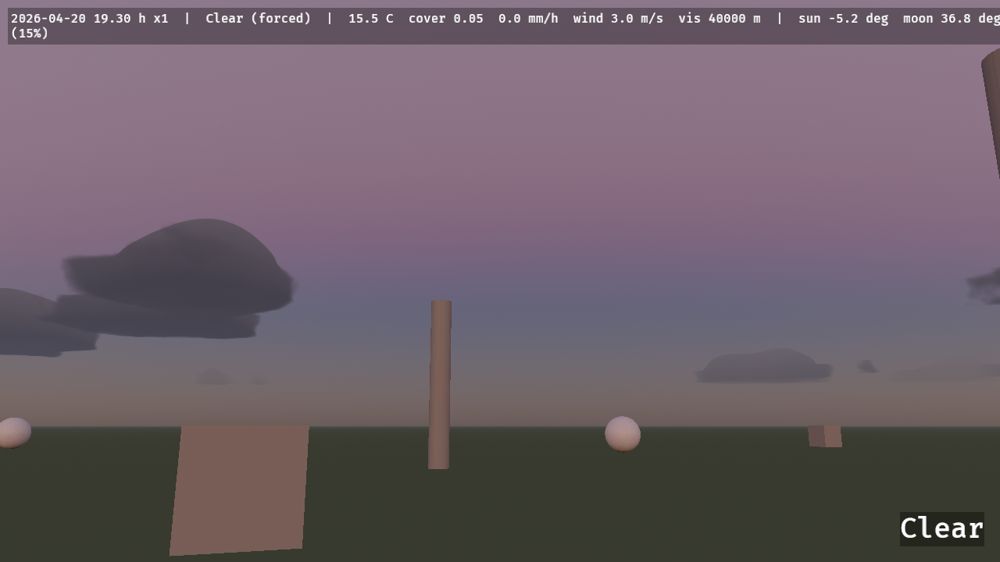
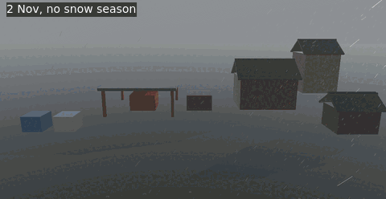
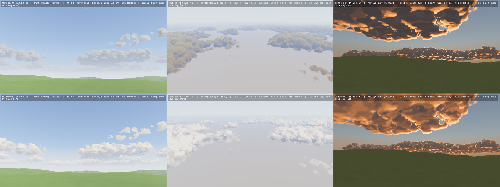
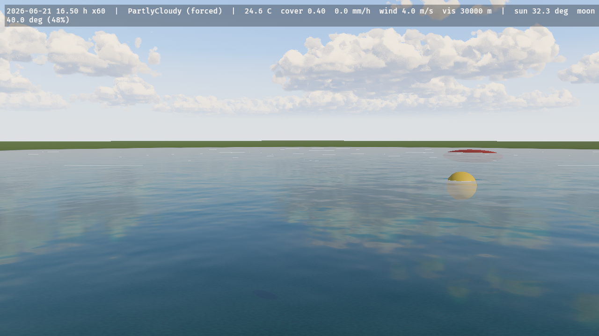
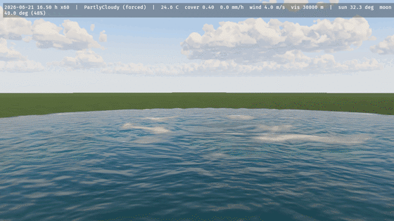
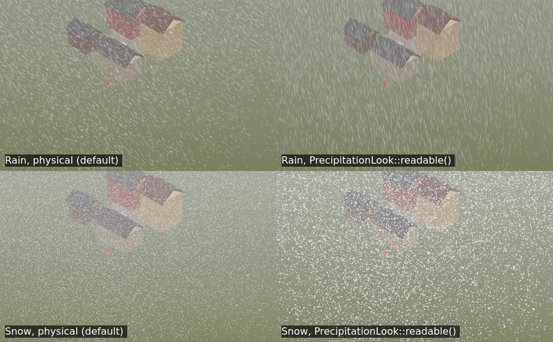
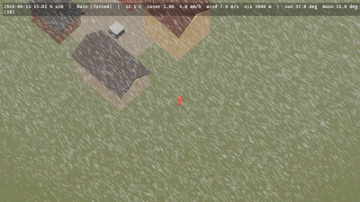

# Sky, weather and light

Celestial bodies, climate and the weather scheduler, the GPU wind field, fog, clouds, precipitation and lightning.

## What is in it

| Plugin | Module | What it does |
|---|---|---|
| `ClimatePlugin` | `climate` | `Climate` presets, seasons, a seeded hourly weather scheduler, `WeatherDirector` to force and release weather, `SurfaceWeathering` (wetness, snow cover), `ClimateHistory` (the last days' temperatures, humidity and precipitation) |
| `CelestialPlugin` | `celestial` | `WorldClock`, `GeoLocation`, Meeus-accuracy sun and moon (`astro`), sun and moon `DirectionalLight`s for Bevy's atmosphere, the bright-star sky, a shaded moon disc, exposure |
| `WindPlugin` | `wind` | A camera-centred stable-fluids wind field on the GPU, curl-noise turbulence, travelling gusts, a public WGSL import |
| `FogPlugin` | `fog` | Distance fog from the weather's visibility and a camera-following ground-fog volume written by compute |
| `CloudPlugin` | `clouds` | Volumetric clouds ray-marched in compute from a weather map that follows `Weather` (cover, type, precipitation), lit with the sun colour from Bevy's atmosphere and composited before tonemapping; a cloud shadow map (`CloudShadows`) that dims the sun and shades the ground; rainbows (`RainbowSettings`) where a shower stands opposite a low sun |
| `LightningPlugin` | `lightning` | Seeded Poisson strikes from `Weather::storminess`, Reed & Wyvill bolts as additive ribbons, a flash `PointLight`, `LightningFlash`, and `Thunder` delayed by distance / 343 s |
| `PrecipitationPlugin` | `precipitation` | Rain and snow as a GPU particle set in a 60 m box around the camera (Marshall–Palmer drop sizes and fall speeds, wind-field advection, `PrecipitationBlocker` roofs, ground splashes), drawn soft-faded against the depth prepass; the far-field shafts and haze are part of `FogPlugin`'s density kernel |
| `TerrainPlugin` | `terrain` | A heightfield `Terrain` (procedural presets, a height map or level ground) generated on the GPU into per-cell layers, drawn with a CDLOD patch pool and a slope/sediment layer-blending material — the rock wears its own material (a succession of bedded layers, each of its own colour, a palette of different rock, two families of joints, fractures, a grain and a relief of its own) and breaks into irregular fragments of many sizes — the pieces a rock mass is made of, each a flat facet with its own tone and a dark joint at its edge and the ground's turf, soil and sand wear theirs, with patches of bare earth at a scale of tens of metres and a palette of dry and fresh grass over the turf, so the ground is a meadow and not one green — and the scree at the rock's foot is a scatter of stones of many sizes with turf between them, not a band of mixed colour — or shaded on your own mesh with `GroundExtension`; `Environment::terrain_height`; the wind solid mask and precipitation use its height |
| `WeatheredPlugin` | `weathered` | `WeatheredMaterial` for any mesh: wet surfaces darken and gloss, rain streaks down walls, up-facing faces whiten under snow with `bevy_flora`'s curve, cloud shadows; one shared `ElementsGlobals` storage buffer, a per-material `exposure` for shelter |
| `HydrologyPlugin` | `hydrology` | Flooding, rivers and lakes as one shallow-water field on the terrain grid (Mei et al. 2007 virtual pipes with a depth-dependent pipe area and Manning friction), `WaterSource` and `WaterSink`, rain split into rain and snow per cell, hydraulic erosion with flux-form sediment transport, thermal erosion, `ErodeTerrain` bakes, and `Environment::water_depth` / `water_velocity` |
| `WaterPlugin` | `hydrology` | Draws the hydrology's water over the terrain (`WaterSettings`): a second CDLOD patch pool displaced to bedrock + sediment + water, a per-channel Beer–Lambert *absorb* pass (`AlphaMode::Multiply`, thickness from the depth prepass with Snell's refraction) and a *surface* pass (`AlphaMode::Add`: Fresnel reflection of the sky and sun, silt body colour, foam), flow-mapped ripples (Vlachos 2010, two phases) from the simulated velocity, and the sun's path through the water to the bed; the pool also draws for `TerrainRender::External` |
| `GroundCoverPlugin` | `cover` | Snow and wetness maps on the terrain grid: snow accumulates at each cell's own rain–snow split and shelter, densifies, drifts with the wind, smooths and melts into hydrology's water (degree-day, Hock 2003), wetness follows rain and evaporation; the terrain and ground materials shade snow, wet darkening and gloss, and puddles with ripples; `SurfaceWeathering` becomes the map's mean around the camera; `Environment::snow_depth` and `wetness` |
| `RocksPlugin` | `rocks` | Boulders and stones on the terrain as meshes, with silhouettes and cast shadows: sized by Golombek's exponential rock-abundance law, angular talus blocks below cliffs (in heaps), rounded rocks in patches over the meadow and more on steep hillsides, none on sand or on the cliffs; each seated on the surface the CDLOD patches draw and drawn to a distance in proportion to its size, shrinking away at the end of its range; `WeatheredMaterial` with a stone grain, so the rocks take snow, rain and cloud shadows; `RockSettings`, `ScatteredRock` (for a game's colliders) and `RockStats` |
| `DustPlugin` | `dust` | Wind-blown sand on the terrain's `sediment` layer: a capacity `k u² (u − u_t)` from the 10 m wind with Venturi speed-up and 15° lee shadow (Paris et al. 2019), a line scan that relaxes the flux over the saturation length and moves the bed by the flux divergence (conserving sand exactly), then hydrology's thermal kernels avalanche it at 34°; runs only while the wind can exceed 8 m/s. `Weather::dust` also fills 40 % of the precipitation particle buffer with tan sprites (`kind = 2`) and tints the ground fog |
| `TrailsPlugin` | `trails` | Footprints, ruts and tracks: `Imprint` components press a centimetre field that follows the focus to their Bekker–Wong sinkage (CRREL's compaction limit in snow) with a rim of the displaced material, sweeping the path between frames; new snow fills it, wind smooths it, sand and mud slump; on the crate's terrain or a game's own ground (`TrailGround`); the terrain and ground materials and `WeatheredMaterial::with_trails()` draw it per pixel with parallax occlusion mapping and a soft self-shadow; `Environment::trail_depth`; `TrailState` for custom shaders |
| `PathsPlugin` | `paths` | Roads and paths laid across the terrain: a `PathNetwork` of `Path`s — a polyline, a half width, a `PathKind` (earth, gravel, stone or a packed snow track) and a rut depth — rasterised once into an **8-bit coverage distance field** over the terrain (`rgba8unorm`, its alpha a per-texel grain), which the terrain material reads per fragment: the turf gives way to bare, compacted earth with its own grain and a dish cross-section whose verge catches a grazing sun, snow cleared where traffic runs, and the ruts pressed along the route's wheel lines; the block is compiled only into a terrain whose network has routes, so a terrain without paths pays nothing; `PathState` for custom shaders |
| `WavesPlugin` | `waves` | Ripples and wakes: `WaterContact` ellipsoids press the hydrology's water with the pressure head of their column and their entry's impact; a dispersive capillary-gravity wave field in three camera-following cascades (iWave with a kernel fitted to Airy's dispersion) reflects off the shores, slows in the shallows, follows the current, breaks into foam; drawn by the water's passes; `WaveState` for custom shaders |
| `VoxelPlugin` (feature `isomesh`) | `voxel` | Snow on `bevy_isomesh` voxel volumes: `VoxelGround` on a `VoxelVolume` scans the column tops into an external `Terrain` the snow, wetness and hydrology maps run on, and `SnowyField` adds the snow depth back as a slab over the tops, swapped per column when it moves half a voxel, remeshing only the chunks that changed; tunnels stay clear; erosion is off for voxel ground. `VoxelSnow` puts the same slab on any number of volumes over a game's own ground, with no terrain |
| `ElementsFloraPlugin` (feature `flora`) | `flora` | Drives `bevy_flora`'s wind, gusts, season and wetness, and `FloraGround` from the terrain's height snapshot |

`ElementsPlugins` adds every plugin above except `ElementsFloraPlugin`, and adds `VoxelPlugin` with the feature `isomesh`. Each is public on its own, so `ElementsPlugins.build().disable::<FogPlugin>()` works.

## Clock, sun, moon and stars


`WorldClock` holds the local date and hour and advances by `Time<Virtual>` × `time_scale`; `GeoLocation` places the observer. `SunState` has the sun's and moon's directions, true altitudes, the synodic phase and the lit fraction. The `astro` module exposes the ephemeris functions (Meeus ch. 7–48: sidereal time, nutation, the sun at 0.01°, the moon from a 51 + 34-term series, phase, refraction, the USNO total-illuminance factor), each tested against the book's worked examples and the SPA reference case. Stars are the 8404 Yale Bright Star Catalogue stars to V = 6.5, precessed to the date, coloured from B−V; the moon is a Lommel–Seeliger-shaded disc from NASA's LROC map. See [`src/celestial/PROVENANCE.md`](../../src/celestial/PROVENANCE.md).

 

## Climate, seasons and weather

`Climate` (`temperate`, `alpine`, `desert`, `tropical`, `tundra`) drives an hourly Markov scheduler over ten `WeatherPreset`s, seeded and frozen by a golden test, with temperature from annual and diurnal harmonics and a −6.5 °C/km lapse rate. `Weather` is the blended state every domain reads (cover, precipitation, temperature, humidity, wind, gustiness, visibility, storminess, dust). `WeatherDirector::force(preset, transition)` overrides it and `release(transition)` hands it back to the scheduler, which kept stepping meanwhile. `SeasonState` carries meteorological seasons and 0–1 autumn, leaf-fall and blossom curves; `SurfaceWeathering` the wetness, snow cover and snow depth of exposed ground. Messages: `WeatherChanged`, `SeasonChanged`.

**A snow season.** The rain–snow split follows the temperature alone (all snow at −1 °C, all rain at 2 °C), so a cold autumn night snows whatever a game's calendar says. `Climate::snow_season = Some(SnowSeason { first: (11, 14), last: (3, 31) })` gives the dates (local calendar, inclusive, wrapping the year) between which snow may fall: outside them the scheduler never picks Snow or Blizzard and all precipitation falls as rain (`Weather::snow_possible` is 0, and `Weather::snow_fraction` and the cover and hydrology kernels all scale by it), changing phase over the hour before the first day and after the last. A forced Snow or Blizzard still snows; snow already lying melts as usual. Inside the season nothing changes. `docs/research/snow-season.md`; `weathered_town` with `ELEMENTS_CALENDAR=november`.




**The last few days.** `ClimateHistory` records each local calendar day as the clock runs through it, from the `Weather` every system reads: the mean, minimum and maximum temperature (TG, TN, TX), the mean relative humidity, the precipitation total (RR, liquid-water equivalent, snow included), the snowfall, and how many of its hours were observed. `Environment::recent_days(n)` returns the completed days of the last `n` (today excluded; `ClimateHistory::today()` has it so far) and `recent_climate(n)` sums them up with climatology's daily indices: a **wet day** has at least 1 mm of precipitation (`WET_DAY_MM`), a **frost day** a minimum below 0 °C and an **icing day** a maximum below it (`FREEZING_C`; the ETCCDI's definitions), with the hour-weighted means, the extremes and the totals. A window of 0 is empty, a longer window than the record is the record, and a summary of no days is `None`. The record keeps 31 days (insert `ClimateHistory::with_capacity(n)` first for more); a clock step of up to a day is recorded with that frame's weather, a longer jump leaves the days between unrecorded, and a clock moved back forgets the days from its new date on. The weather of a past hour cannot be recomputed, so the record is part of a save (below). `docs/research/climate-history.md`.

```rust
# use bevy::prelude::*;
# use bevy_elements::*;
fn stores(env: Environment) {
    if let Some(week) = env.recent_climate(7) {
        let damp = week.wet_days >= 3 && week.mean_relative_humidity > 0.8;
        let _ = (damp, week.frost_days, week.mean_temperature_c);
    }
}
```

## Wind

`WindState` has the prevailing wind, the 10 m speed, the gust factor, the wind at the focus (`at_focus`; the camera without an `ElementsFocus`) and the simulated field: a `rgba16float` 3D texture, toroidally addressed, around the focus (64 × 16 × 64 cells of 4 m at High). Shaders sample it with the supported WGSL import:

```wgsl
import bevy_elements::wind::{WindFieldParams, elements_wind};
let v = elements_wind(wind_field, wind_sampler, wind_params, world_position);
```

bound to `WindState::field` and `WindState::field_params()`. `WindGust` is written when a gust band starts. `bevy_elements::noise` (gradient noise with analytic derivatives, fBm, Worley, curl) and `bevy_elements::grid` (bilinear taps into the crate's 2D grids) are also supported imports.

## Fog

`DistanceFog` follows `Weather::visibility_m` (Koschmieder, 2 % contrast, grey extinction) with a colour lit like the scene and, under a clear sky, the sky's own horizon colour toward the camera's heading (read back from the atmosphere, so distant ground meets the sky without a line at dusk; cloud, fog and dust keep the weather's own colour, `docs/research/fog-colour.md`); a 240 × 120 × 240 m ground-fog `FogVolume` around the camera thickens toward the ground and drifts with the wind. Bevy lights a `FogVolume` from the `DirectionalLight`s alone, which under cloud carry only the beam, so the volume fades out of the frame as the cloud thickens (its density is scaled by the beam's share of the scene's light and its intensity by the reciprocal): a blizzard is a whiteout from the sky and the distance fog, not a dark hole (measured: the noon zenith of a 200 m-visibility blizzard read `(46, 47, 50)` before and `(122, 124, 129)` after; `docs/research/fog.md` Deviation 7). `sky_air_extinction(σ_fog)` gives the excess of a fog extinction over clear air (`CLEAR_AIR_EXTINCTION`, the `Clear` preset's 40 km), which the cloud composite uses to fog the sky to the same colour as the ground (see [Clouds](#clouds)). Where a frame's ground ends before the horizon, the air the ray then travels is the sky's own column: the composite reads the sky cube at the horizon in the ray's azimuth and extrapolates to zero elevation, so the flat band below the horizon is the sky's colour rather than the fog hue (measured 24–38 DN of error at noon, dusk and night before, 2–3 DN after, and 6.9 DN at 20 h, where the cube's 0.7° texel cannot resolve the twilight gradient).

## Clouds

`CloudPlugin` ray-marches a spherical cloud shell in compute at a quarter or half of the screen resolution and accumulates it into a full-resolution history over 4 or 16 frames. Coverage, type and precipitation come from a 512² weather map over 32 km that follows `Weather` (`CloudWeatherMap`): it is thresholded so the covered fraction of the sky equals `Weather::cloud_cover`, it is stratus, cumulus or cumulonimbus by the weather (`CloudLayer` holds the base and top heights), and it drifts with the wind. Cumulus and cumulonimbus are carved out of the coverage by Nubis' envelope model: a flat base, a rounded top whose height follows the blob, convective cells that split a blob into separate thermals (closing into a deck as the cover reaches 1), and a value erosion of billowy Worley noise (turrets of 80–320 m on lobes of a kilometre) that gives cauliflower tops and crisp silhouettes; the detail fades to its mean where the march's step is too long to resolve it, and stratus decks are unchanged (`docs/research/cumulus-shape.md`). Light is energy-conserving single scattering with a two-lobe phase function plus the multiply scattered light as photon diffusion through the cloud between its lit face and the cloud behind (Jensen 2001's extrapolated boundaries, fitted to Monte Carlo transport in 96 slabs: within 0.57–1.12× on thick tops where Wrenninge's octaves gave a sixth, `docs/research/cloud-lighting.md`), so sunlit cumulus are white from the ground and from the air, their bases grey rather than black and lit orange from below at sunset; it is coloured by the sun's transmittance through Bevy's atmosphere and lit from inside by `LightningFlash`. The skylight that fills the shaded sides takes the colour of Bevy's own sky (the camera's atmosphere environment map over the upper hemisphere), so clouds after sunset turn violet in the purple light; a cloud too thick to march through hides the sun disc behind it. A 1024² transmittance map over 8 km (`CloudShadows`) shades the crate's surfaces per pixel (the terrain, the water, `WeatheredMaterial`, `GroundExtension`), and its mean over the 8 km (`CloudShadows::mean_transmittance`) is the share of the sun the `DirectionalLight`s carry, so a cloud's shadow over the camera darkens the ground around it, not the sky, the distant hills or the reflections. A plain `StandardMaterial` sees only that mean; give props a `WeatheredMaterial` for their own cloud shadow. Sky pixels carry the weather's air as well: the composite fogs them by `σ_air = σ_fog − 3.912/40 km`, taken from the camera's own `DistanceFog` with the clear-air floor removed (`fog::sky_air_extinction`), so the sky and the fogged ground converge on the same colour and a 200 m-visibility blizzard has no horizon line, while `Clear` is untouched (bit-exact). `CloudQuality::of(ElementsQuality)` gives the resolution, step counts and accumulation window.




## Clouds in reflections and sky light

Every reflection and the sky light of every PBR surface come from the camera's environment map. `CloudPlugin` puts the clouds in it: it marches them into a cube around the followed camera (the size of its atmosphere cube, 128² per face by default), composes that cube with Bevy's clear-sky cube exactly as the screen composite composes the sky (toward the ground, Bevy's ground lit by the light the dome lets through), and hands it to the camera's `GeneratedEnvironmentMapLight`, which Bevy filters into the glossy reflections and the diffuse irradiance. A pond under cumulus reflects the cumulus and the blue between them; under overcast, water is a grey mirror a little darker than the sky (it reflected a blue sky, and near grazing was brighter than the sky); and the overcast dome lights a top more than a wall and a wall more than an underside (1 : 0.67 : 0.37), so a metal box mirrors the bright sky on its top and the ground on its sides. The camera's `AmbientLight` then carries no cloud light. One texel of every k × k block of each face is re-marched a frame at half the screen march's steps (`CloudQuality::probe_edge`) and blended into its history; a camera without the crate's atmosphere, or that is not followed, keeps Bevy's sky and the uniform cloud ambient. The overcast dome comes out nearly flat (zenith 1.08 × the sky 5–10° up) where real overcast skies are graded 2:1 to 3:1: that is the cloud model's, on the screen too. `docs/research/sky-light.md`.





**Rainbows.** A shower opposite a low sun draws a rainbow in the sky composite (`RainbowSettings::strength`, default 5, `0` switches it off). The bow is a circle about the antisolar point, so it follows the sun and the camera: it needs the sun below 42° (at 20° the arc tops out at 22° of elevation, at sunset it is nearly a half circle) and a shower in the weather map in that direction, seen under the cloud base, with the sun reaching it (the cloud shadow map's mean beam, so full overcast draws none and a break between showers draws the whole bow). Its colours come from Airy's theory for the weather's Marshall–Palmer drops: red outside the primary and violet inside, a fainter secondary with the order reversed and Alexander's dark band between, a pale wide bow in a drizzle and a narrow vivid one after a heavy shower. The sun's own colour (through the atmosphere) tints it, so a sunset bow is red-gold. It is drawn on sky pixels only, so terrain and water in front of it hide it (the still sea's reflection of it is not drawn). `docs/research/rainbow.md`.

## Precipitation

Rain and snow follow `Weather::precipitation_mm_h` and `snow_fraction()`. A buffer of `ElementsQuality::precipitation_particles()` particles (20 k / 60 k / 150 k / 300 k) fills a 60 m cube around the camera: rain takes `min(1, R/20)` of it and snow `min(1, S/3)` (both scaled down together when they would exceed it). Each raindrop has its own diameter, drawn from the water-weighted Marshall–Palmer distribution, and falls at its own Atlas–Ulbrich speed (4.98 m/s on average at 10 mm/h, 9 m/s at most); flakes fall at 1 m/s with a sideways flutter. Both ride the wind field, wrap around the camera, and are respawned at the top when they hit the ground or a `PrecipitationBlocker`; rain near the camera leaves splash rings. The draw pass (`Core3dSystems::EarlyPostProcess`) renders streaks, flakes and rings as procedural quads, lit by the sun, moon and sky light and soft-faded against the depth prepass.

```rust
# use bevy::prelude::*;
# use bevy_elements::*;
fn build_a_shelter(mut commands: Commands) {
    // No rain or snow falls inside this 6 × 0.2 × 6 m roof, and its top collects the splashes.
    commands.spawn((
        PrecipitationBlocker { half_extents: Vec3::new(3.0, 0.1, 3.0) },
        Transform::from_xyz(8.0, 3.0, 4.0),
    ));
}
```

The nearest 256 blockers to the camera are tested; any oriented box works (`GlobalTransform` rotation and scale apply). The far field is the fog volume's: `FogPlugin` splits the visibility's extinction `3.912 / visibility` into the precipitation's own (rain `2.12×10⁻⁴ R^0.68` m⁻¹, snow `4.917×10⁻³ S` m⁻¹, from measured visibility–rate relations) rendered as wind-slanted shafts, and the remaining haze, so `Weather::visibility_m` stays the single authority on how far you see. The particles need `WindPlugin` and an `ElementsCamera`; `PrecipitationState` exposes the GPU buffers. Rain lands on the terrain's surface plus the water standing on it, or on the plane y = 0 without a terrain.

**A look for your camera.** The drops and flakes are physically sized, which reads well through a perspective camera at eye height. From far off (an orthographic, isometric or strategy camera) the same rain is short, wind-slanted dashes and the same snow a field of identical dots. `PrecipitationLook` restyles the draw without touching the simulation, the wetness, the splashes or the queries: `rain_fall_scale` and `rain_wind_scale` lengthen and straighten the streaks, `rain_tint` colours them and sets their opacity, `flake_size_spread` draws each flake at a log-normal size about its own, and `flake_min_half_width_px` sets the smallest flake. The default is the physical look; `PrecipitationLook::readable()` is the stylised one (fall ×4, wind ×0.5, a slightly bluer and fainter streak, σ 0.5 spread, 1.5 px flakes): under the isometric camera pitched 35° the `Rain` preset's streaks stand 15° from vertical instead of 63°. Under a game's own bright key light, raise `rain_tint` above 1 so the streaks stand out from the sunlit ground (the `isometric` example's game look uses `(2.4, 2.5, 2.8, 0.8)`). `docs/research/precipitation-look.md`; `ELEMENTS_PRECIPITATION=readable` in any example.

```rust
# use bevy::prelude::*;
# use bevy_elements::*;
fn strategy_view(mut commands: Commands) {
    commands.insert_resource(PrecipitationLook::readable());
}
```





## Lightning

Strikes are a Poisson process at `Weather::storminess / 60` per second of `Time<Virtual>`, uniform over an 8 km disc around the followed camera and deterministic from `Climate::seed`. Each one writes `LightningStrike { position, seed }`, spawns a bolt (a channel with side branches, then 1–3 restrikes 40–80 ms apart), lights the ground with a 1e8 lm `PointLight`, writes `LightningFlash` for the clouds, and writes `Thunder { position, distance_m, loudness }` `distance_m / 343` s of real time later. `StrikeLightning { at }` scripts a strike. The bolt's brightness is multiplied by the camera's exposure and clamped, so it saturates at night and fades by day. The strike process and messages run without a renderer.
