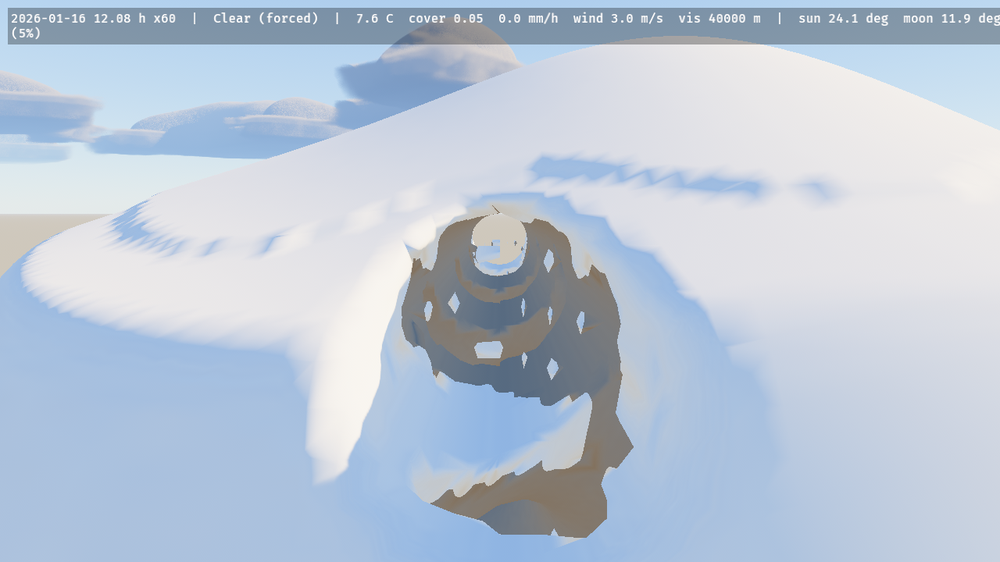
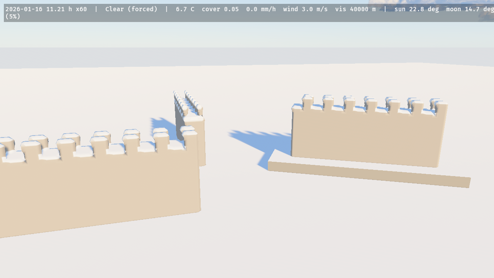

# Surfaces, materials and voxel snow

Weathering for any mesh, and snow on `bevy_isomesh` voxel volumes.

## Weathered materials

`WeatheredMaterial` is `ExtendedMaterial<StandardMaterial, WeatheredExtension>`: give any mesh one and it follows the weather. `WeatheredPlugin` writes `ElementsGlobals` every frame (wetness, snow cover and snow depth from `SurfaceWeathering`, the rain intensity `min(1, R_liquid/20)`, the cloud shadow map, ripple and streak phases, the world units, the trail window) into one 128-byte storage buffer all weathered materials bind (binding 101, fragment stage only: it leaves the fragment stage two of the eight storage buffers WebGPU guarantees). A wet surface loses up to half its albedo in proportion to its porosity (Lagarde's gloss-based estimate: rough surfaces soak, plastic, tile and metal do not); a porous surface gains Lagarde's limited sheen (roughness × (1 − 0.4 · wetness · porosity), 0.54 for a soaked rough wall) and a smooth or metal one a water film at 0.1, as does a porous one drenched past saturation (a rain streak); rain on a wall adds darker streaks that run down it; faces turn white under snow with the curve `snow · smoothstep(0.85 − 0.6 snow, +0.2, n.y)` that `bevy_flora` uses, snow albedo `SNOW_ALBEDO` and roughness `SNOW_ROUGHNESS`, so trees and buildings read as one snow. `WeatheredExtension::exposure` is 1 under open sky and 0 sheltered (no wetness, streaks or snow, only cloud shadow): it does not follow a `PrecipitationBlocker` by itself, set it from your own test. `WeatheredExtension::default().with_trails()` also draws the trails pressed into it (below). `docs/research/wet-ground.md`.

```rust
# use bevy::prelude::*;
# use bevy_elements::*;
fn spawn(mut commands: Commands, mut meshes: ResMut<Assets<Mesh>>, mut materials: ResMut<Assets<WeatheredMaterial>>) {
    let house = materials.add(WeatheredMaterial {
        base: StandardMaterial { base_color: Color::srgb(0.55, 0.26, 0.2), perceptual_roughness: 0.9, ..default() },
        extension: WeatheredExtension::default(),
    });
    commands.spawn((Mesh3d(meshes.add(Cuboid::new(9.0, 5.0, 7.0))), MeshMaterial3d(house)));
}
```

The shading is a public WESL import for your own shaders, `bevy_elements::surface_cover` (`weather_surface`, `mesh_snow_cover`, `rain_streak`, `ripple_offset`, `overcast_relief`, `ElementsGlobals`): bind `ELEMENTS_GLOBALS_BUFFER` read-only at any free storage slot of your own material (`#[storage(N, read_only)]`), import `ElementsGlobals`, and read the wetness, snow cover, rain intensity, wind and the cloud shadow map's placement (`CloudShadows::map` is the map). `WeatheredPlugin` (in `ElementsPlugins`) keeps the buffer current. The forward and deferred passes are covered; the depth and normal prepass stays Bevy's, so SSAO reads the dry normal. Order-independent transparency, meshlets and forward decals are not weathered.

## Snow on voxel volumes

With the feature `isomesh` (`bevy_elements = { version = "0.7", features = ["isomesh"] }`, `bevy_isomesh` and `isomesh` 0.0.11), `ElementsPlugins` also adds `VoxelPlugin`. The snow maps are heightfields, so a `VoxelVolume` gets one of its own: put `VoxelGround { resolution }` on the volume's entity and the crate scans the top of every column (the first sign change from the top, then bisection to a millimetre), spawns the crate's `Terrain` (`TerrainRender::External`) over the volume's XZ extent with those heights, and wraps the volume's field in a `SnowyField`. Hydrology, snow, wetness, wind and rain then run on it unchanged.

`SnowyField` is `min(base(p), max(p.y − (top + snow), (top − c) − p.y))`: the union of your field with a slab from one voxel `c` below the column top to the snow surface, so the mesh grows a cap while everything at least a voxel under the top, a tunnel under the hill, keeps the sign of your field exactly and never gets snow. The snow depth is the last cover readback, held per column: a column's depth is swapped only when it has moved more than half a voxel from the one the mesh was made from, the new field is installed with `replace_field`, and only the chunks the changed columns can reach are marked `NeedsRemesh`, so the seams between chunks stay closed. Edits to the volume are seen: order the system that calls `replace_field` and marks the chunks `.before(VoxelGroundSystems)`, and the tops under the marked chunks are rescanned and written to the terrain before the chunks are meshed, in the same frame.

```rust,no_run
# use bevy::prelude::*;
# #[cfg(feature = "isomesh")]
# mod voxel {
# use bevy::prelude::*;
# use bevy_elements::*;
# use bevy_isomesh::{NeedsRemesh, VoxelChunk, VoxelVolume};
# use isomesh::chunk::{ChunkId, ChunkLayout};
fn setup(mut commands: Commands, mut grounds: ResMut<Assets<GroundMaterial>>) {
    // 64 m of 0.5 m voxels: one terrain cell is one voxel wide.
    let Ok(layout) = ChunkLayout::new(16, 0.5, [-32.0, -8.0, -32.0]) else {
        return;
    };
    let volume = commands
        .spawn((
            VoxelVolume::new(layout, isomesh::fields::Sphere { center: [0.0; 3], radius: 6.0 }),
            VoxelGround::new(UVec2::splat(128)),
        ))
        .id();
    commands.spawn((VoxelChunk { id: ChunkId::new([4, 1, 4]), volume }, NeedsRemesh));
    // The material of the volume's chunk meshes stops snow and wetness a voxel under the column top.
    let _ground = grounds.add(GroundMaterial {
        base: StandardMaterial::default(),
        extension: GroundExtension::default().with_column_gate_m(0.5),
    });
}
# }
# fn main() {}
```

`ErosionSettings::enabled` is ignored for voxel ground (one warning is logged when it is on): erosion would rewrite only the heightfield under the volume, whose field is the truth. Water still flows, snow melts into it, and `ErodeTerrain` bakes run without erosion. `VoxelGround` owns the crate's single terrain, so spawn no other `Terrain` and no second `VoxelGround`; the grid is frozen to the chunk entities present at the first scan, the voxel size must be a power of two (isomesh's seam rule), and the chunk entities need identity transforms. The ground material of the chunk meshes needs `GroundExtension::with_column_gate_m(c)`, or the walls of a tunnel are shaded white wherever the map above them has snow. Limits (`docs/research/voxel-snow.md`): the maps are heightfields, so a ledge below the highest crossing gets no snow and the floor of a shaft open to the sky does; a roof thinner than a voxel is thickened to one under the slab; a carve leaves the snow depth that was on the carved surface until the snow's own dynamics sort it out; wasm meshes on the main thread, so keep `MeshBudget::max_in_flight` low there.



`voxel_snow` after 25 game hours of forced snow, the sky cleared: a cap of snow over the hill and over the mouths of the two tunnels, and none inside them.

**Snow on many volumes, without a terrain.** `VoxelGround` makes one volume the ground. For walls, rocks and ruins over a game's own ground, put `VoxelSnow` on as many volumes as you like: each gets the same slab over its column tops (one column per voxel), with no terrain spawned and no hydrology. A column's depth is the ground-cover map's at its world position where a crate `Terrain` with `GroundCoverPlugin` lies under it (so a wall under a `PrecipitationBlocker` roof stays bare and the walls melt with the ground), and elsewhere `SurfaceWeathering`'s snowpack on exposed flat ground; either way times the shed-slope exposure of the column's top. The chunk entities are children of the volume, and the volume may be moved, turned about the vertical and scaled uniformly; a tilted volume gets no snow. Shade the slab with a material that whitens what faces up, such as `WeatheredMaterial`. Both `isomesh` crates stay at 0.0.11: bevy_isomesh 0.0.10 is built on Bevy 0.19 (`docs/research/voxel-volumes.md`).


