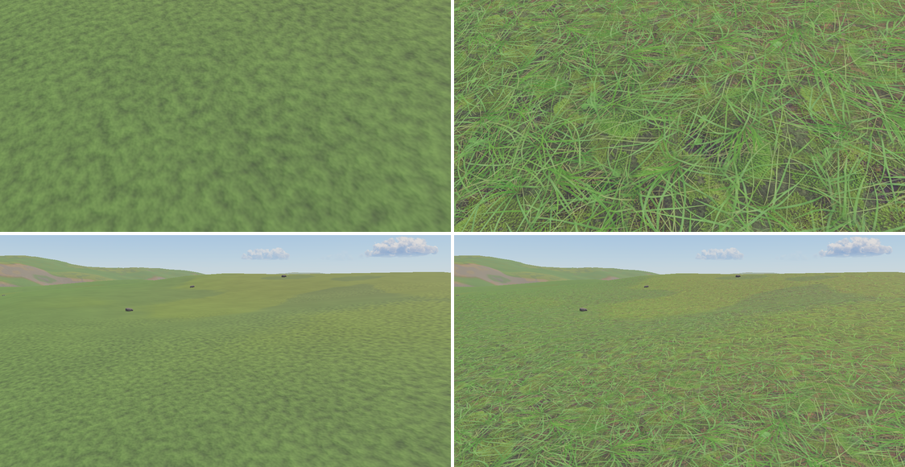
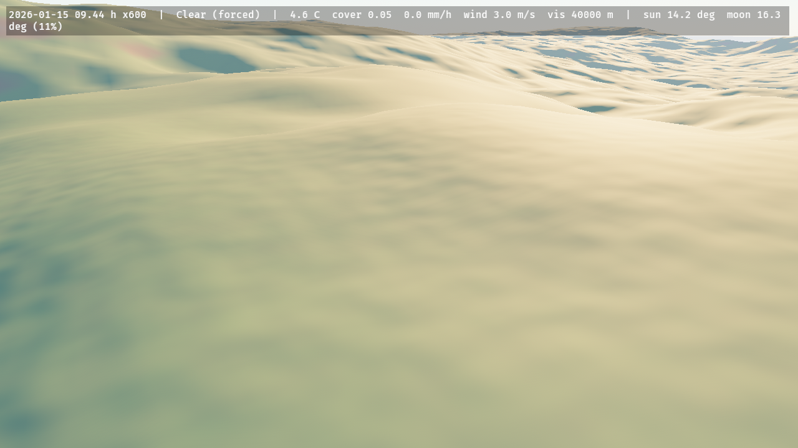
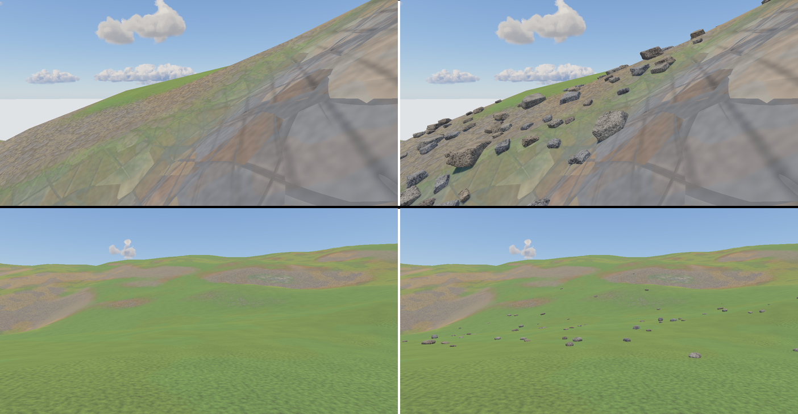
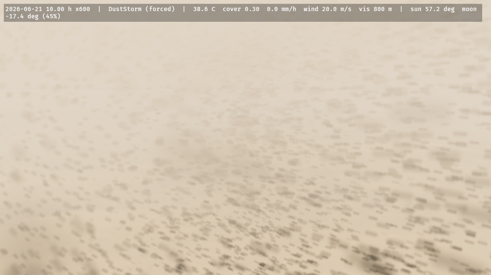
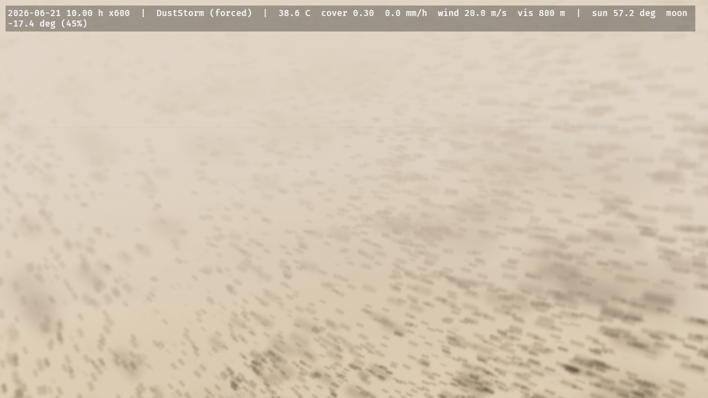
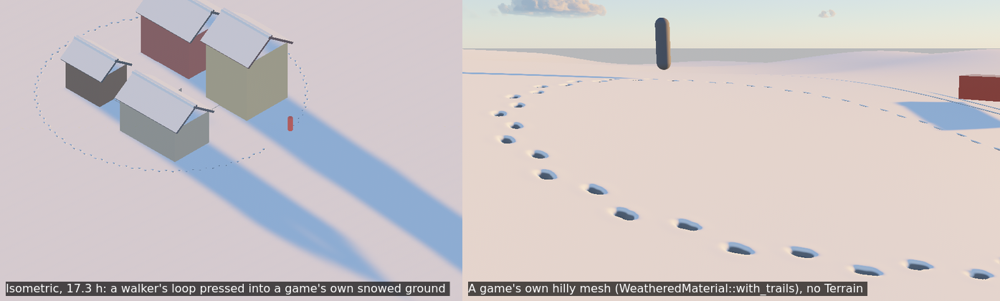
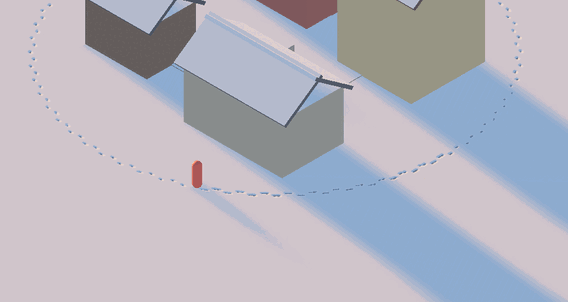
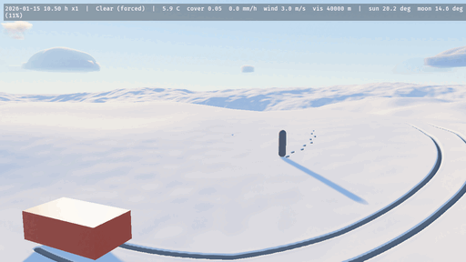

# Terrain and ground

The heightfield and its look, sculpting and saving it, snow and wetness cover, scattered rocks, dust, paths and trails.

## Terrain

`Terrain` is a component: `Terrain::procedural(ProceduralTerrain::hills(seed))` (also `mountains`, `dunes`, `plains`, or your own relief, feature size, octaves and ridged mix), `Terrain::from_heightmap(image, height_range_m)` (a linearly read `R16Uint`, 16-bit normalised, float or 8-bit image) or `Terrain::flat(height)`, with `with_extent`, `with_resolution` and `external()`. It is centred on its `Transform` (default 2048 m, 1024² cells at High; the resolution is clamped to `ElementsQuality::terrain_max_resolution()` and to a power of two). One terrain exists at a time. The GPU generates `bedrock` and `sediment`, and keeps the layers hydrology and erosion write (`TerrainState`); `terrain_pack` rewrites a packed `terrain_cells` buffer that the materials, the wind solid mask and the precipitation kernel read, and the surface heights are copied back for `Environment::terrain_height(Vec2)`.

By default the crate draws the ground: a pool of 33 × 33-vertex patches selected by distance (CDLOD, Strugar 2009: one shared mesh, vertices morph onto the next coarser grid, no cracks, one draw per pass; about the eye of a perspective camera, about the focus of an orthographic one) with `TerrainMaterial`, which blends rock (slope above 40°), sand (sediment above 0.5 m), soil and grass from the slope and sediment per pixel, adds noise detail, and takes the cloud shadow map like the weathered materials do. The vertices sit on the height samples (the cell centres `Environment::terrain_height` interpolates), so at full detail the drawn ground is the bilinear at every vertex and within a quarter of a quad's twist of it between them (4.7 cm at the 90th percentile on the hills at 4 m cells); the drawn terrain spans the cell centres, half a cell inside the extent. With `Terrain::external()` you draw the ground yourself and give your mesh `ExtendedMaterial<StandardMaterial, GroundExtension>` (`GroundExtension::default()`): it adds cloud shadows by world position and darkens where water stands. Wind blows around the terrain and rain stops on it; with the `flora` feature `ElementsFloraPlugin` hands the height snapshot to `bevy_flora`. See [`docs/research/terrain.md`](../research/terrain.md) and [`docs/research/orthographic-lod.md`](../research/orthographic-lod.md).


**Ground textures.** Put `TerrainTextures` on the `Terrain` entity and the owned terrain's sand, soil and grass take PBR maps, handed over the way any material's are: per layer a `GroundLayerTextures` with a base colour and, optionally, a normal (tangent space, +Y up; DirectX maps set `flip_normal_map_y`), roughness (G channel), occlusion (R) and height (R) map, as a glTF material or a PBR library stores them (one glTF ARM or ORM image serves as both roughness and occlusion), and the tile's size in metres. The crate packs them itself, off the frame (an async task: 0.5 s for two layers of five 1024² maps on a desktop CPU; on wasm the task pool runs it on the main thread), into detail maps over its procedural layers: the base colour, roughness and occlusion become multipliers with mean 1 over the crate's calibrated colour and roughness (the weather still owns the roughness, and the ground's mean light does not move), and a missing normal, height or occlusion is derived from the base colour; `GroundLayerTextures::photograph()` also de-lights and makes tileable a photograph or a generated image. `with_colour(share)` lets the set's own mean colour replace the layer's, at every distance — for a stylised set whose colour is the point; a library's base colour is rarely a calibrated albedo (two CC0 libraries' grass and earth measured 2 and 6.5 times the crate's, and taken whole they bleach the hills to lime and beige), and a set that takes its colour runs its own pipeline, compiled once when it starts taking it. They are hex-tiled (Mikkelsen 2022: randomly offset taps in eight orientations, up to three per pixel, so a tile never repeats), blended between layers by their heights (grass blades stand out of the soil instead of a cross-fade, band-limited by the pixel's footprint so nothing sparkles at a distance), and from 12 m on the mips average to the layer's colour. Inserting, changing or removing the component re-textures the ground at runtime — the previous set renders until the new one is packed — so a set is a stylistic variant a game can swap. A layer left `None` stays procedural; without the component the ground renders exactly as before, at its old cost (the textured path is compiled only into a set's pipeline). The maps must keep their CPU data (the default when loading; `RenderAssetUsages::MAIN_WORLD` keeps them off the GPU, since only the packed array is drawn). The examples wear golem-generated soil and grass photographs from `assets/ground/golem/` (`ELEMENTS_GROUND_TEXTURES=0` leaves them off, `ELEMENTS_GROUND_SWAP=S` toggles them every S seconds, `ELEMENTS_GROUND_COLOUR=c` sets every layer's colour share). The sand waits for wind ripples. See [`docs/research/terrain-textures.md`](../research/terrain-textures.md) and [`docs/research/ground-textures.md`](../research/ground-textures.md).

```rust
# use bevy::prelude::*;
# use bevy_elements::*;
fn textured_hills(mut commands: Commands, assets: Res<AssetServer>) {
    let arm = assets.load("textures/meadow_arm.png"); // glTF: occlusion R, roughness G
    let grass = GroundLayerTextures::new(assets.load("textures/meadow_color.png"), 2.0)
        .with_normal(assets.load("textures/meadow_normal_gl.png"))
        .with_roughness(arm.clone())
        .with_occlusion(arm)
        .with_height(assets.load("textures/meadow_height.png"));
    commands.spawn((
        Terrain::procedural(ProceduralTerrain::hills(7)),
        TerrainTextures { grass: Some(grass), ..default() },
    ));
}
```



**The rock.** The massif, a cliff and the scree at its foot, before and after the terrain's rock material: its beds, its palette, its two joint families, its fragments and its grain.


**Grading the ground.** `TerrainLook { tint, saturation }` grades the owned terrain's bare ground (rock, soil, grass, sand, scree, textured or not) and the scattered rocks lying on it, the way a game grades its own materials per palette: the saturation first, around the colour's own linear Rec. 709 luminance (0 grey, 1 unchanged, above 1 oversaturated), then the tint multiplies it, so a cooling tint survives a desaturation. It applies before the ground cover, so snow and standing water keep their colours and wet grass still beads the rain. The default renders the ground as without it (within a float's rounding, below one 8-bit level), at no measured cost, and a change is a uniform write — no pipeline is specialised or compiled — so a palette blend may write it every frame (`terrain_tour`: `ELEMENTS_TINT=0.55,0.62,0.85 ELEMENTS_SATURATION=0.6`, `ELEMENTS_GRADE_GLIDE=8`). A `TerrainRender::External` ground and a game's own `WeatheredMaterial`s are the game's to grade. `docs/research/terrain-look.md`.

```rust
# use bevy::prelude::*;
# use bevy_elements::TerrainLook;
fn night_palette(mut look: ResMut<TerrainLook>) {
    *look = TerrainLook { tint: Vec3::new(0.55, 0.62, 0.85), saturation: 0.6, ..default() };
}
```

`TerrainLook::detail` scales the ground's grain and bump (1 is the crate's own, 0 none; the route grain follows) and `TerrainLook::finest_m` tells the band limit how wide one screen pixel is on the ground, so a fixed orthographic zoom whose pixels are wider than the crate's derived footprint can drop the octaves it cannot resolve instead of drawing them as speckle. Both are uniform writes, like the tint.

**Saving the ground.** `TerrainSetup` is a `Terrain` as plain data (a procedural preset, level ground, or a height map named by path) and `SurfaceSetup` is the nine settings resources of hydrology, erosion, snow, wetness, water, waves, rocks, dust and trails as one value. With the `serde` feature both read and write any serde format, absent fields take their defaults and an unknown field is an error. `validate()` names the field that broke its range, `SurfaceSetup::apply_to_world` writes only the settings that differ (an unchanged file reloaded does not rebuild the rocks), and `TerrainSetup::terrain` loads a height map as the terrain needs it (linear, one channel). A `Terrain` is built once when it spawns, so a changed terrain setup means spawning a new entity.

```rust
# use bevy::prelude::*;
# use bevy_elements::{SurfaceSetup, TerrainSetup};
fn load_level(world: &mut World) {
    let mut surface = SurfaceSetup::default();
    surface.snow.drift = false;
    surface.rocks.seed = 7;
    if let Err(e) = surface.apply_to_world(world) {
        error!("bad surface setup: {e}");
    }
    let terrain = TerrainSetup::default().terrain(world.resource::<AssetServer>());
    if let Ok(terrain) = terrain {
        world.spawn(terrain);
    }
}
```

## Sculpting the live terrain

Send a `SculptTerrain` message to edit the running terrain: a brush at a metre-frame XZ with a radius, a `hardness` (the fraction of the radius at full effect; the weight then falls as a smoothstep, so the rim leaves no crease) and a kind: `Raise`, `Lower`, `Smooth`, `Flatten { height_m, blend }` or `Noise { amplitude_m, feature_m, seed }`. The stroke edits bedrock on the GPU (sediment stays), one stroke is applied per frame in order, and the drawn ground, the rocks, the cover and `Environment::terrain_height` follow it the next frame. Nothing outside the radius changes. `SculptTerrain::validate()` names a field that breaks its bound; an invalid stroke is dropped with a warning.

```rust
# use bevy::prelude::*;
# use bevy_elements::{SculptKind, SculptTerrain};
fn dig_a_pit(mut strokes: MessageWriter<SculptTerrain>) {
    strokes.write(SculptTerrain::new(Vec2::new(40.0, -12.0), 6.0, SculptKind::Lower { amount_m: 1.5 }));
}
```

To keep a sculpted ground, ask `Environment::terrain_snapshot()` for the last readback and store its heights; `TerrainSnapshot::terrain(&mut images)` builds a `Terrain` that redraws them (spawn it at `snapshot.centre_m()` times `ElementsUnits::units_per_metre`). The surface comes back to within f32 rounding, all of it as bedrock: the sediment layer is not restored. The snapshot is at the readback's resolution, which is 2x coarser than the simulation above 1024² cells.

```rust
# use bevy::prelude::*;
# use bevy_elements::*;
fn save_and_restore(env: Environment, mut images: ResMut<Assets<Image>>, mut commands: Commands) {
    if let Some(saved) = env.terrain_snapshot() {
        commands.spawn((saved.terrain(&mut images), Transform::from_translation(saved.centre_m())));
    }
}
```

To undo a stroke in place (any kind, including the ones with no `inverse`), take `Environment::terrain_snapshot()` before it and later send `RestoreTerrain::new(snapshot, region_m)`: every cell whose centre lies in the metre-frame `Rect` gets the snapshot's bedrock and sediment back, in order with the strokes, and nothing else (water, cover, trails) is touched. A snapshot read from another grid is dropped with a warning.

```rust
# use bevy::prelude::*;
# use bevy_elements::*;
fn undo(env: Environment, mut restores: MessageWriter<RestoreTerrain>, before: Res<Saved>) {
    restores.write(RestoreTerrain::new(before.0.clone(), Rect::new(20.0, -30.0, 70.0, 10.0)));
}
# #[derive(Resource)] struct Saved(TerrainSnapshot);
```

To start from a preset instead of the GPU's output, `ProceduralTerrain::sample_surface(size, cell_m)` evaluates the generator on the CPU, with no app and no `TerrainPlugin`: row-major heights in metres, deterministic per seed, within the sampling tolerance of the kernel's output and not bit for bit. A tool can bake `ProceduralTerrain::hills(7)` into a height file this way; sediment is not part of it.

## Ground cover

`GroundCoverPlugin` keeps two maps on the `Terrain`'s grid, stepped on game time (the `WorldClock`) at most 20 times a second after hydrology's substeps. **Snow** is a depth and a water equivalent per cell: it accumulates at the cell's own rain–snow split (the lapse rate makes ridges snowier than valleys), keeps less on slopes between 35° and 55° and none under a `PrecipitationBlocker` (the roof's shelter follows the slanted fall of the rain or snow), settles from 100 toward 300 kg/m³ with a 3-day time constant, drifts downwind above 5 m/s (a flux that grows with the cube of the excess, deposited where the wind slows in the lee), is smoothed over a few cells, and melts at 4 mm of water per °C per day, every millimetre arriving in the `water` layer. **Wetness** follows rain and evaporation; the terrain and ground materials shade snow, wet darkening and a porous sheen, and puddles with ripples. On the terrain the grass is a canopy whose wax beads the rain: a wet meadow deepens its green by `bevy_flora`'s wet-leaf rule (saturation × 1.25, brightness kept) and does not gloss, and only the soil, sand, rock and scree between darken and shine. Rain rings on a live terrain only where water stands at least `WetnessSettings::puddle_min_m` deep (`docs/research/wet-ground.md`).

```rust
# use bevy::prelude::*;
# use bevy_elements::*;
fn deep_wet_snow(mut commands: Commands) {
    commands.insert_resource(SnowSettings {
        degree_day_factor: 6.0,
        shed_slope_deg: [30.0, 45.0],
        ..default()
    });
    commands.insert_resource(WetnessSettings {
        puddle_min_m: 0.004,
        ..default()
    });
}
```

`Environment::snow_depth(Vec2)` and `wetness(Vec2)` answer from the last readback like `water_depth`. `SurfaceWeathering` (and so `ElementsGlobals` and `WeatheredMaterial`) follows the mean of the maps within 50 m of the camera once a terrain has been read back; before that, and without a terrain, it is the point model at the reference elevation.

 

## Rocks

`RocksPlugin` scatters boulders and stones over the `Terrain` as meshes, so the ground has silhouettes and cast shadows and not only a painted texture (`docs/research/rock-scatter.md`). Where rocks lie comes from the terrain readback: a **talus** of angular blocks in the scree's band of slope (16°–40°) below a cliff, in heaps a few blocks across; **rounded rocks** over the meadow, sparse on the flat, more on steep hillsides and in rocky patches a few hundred metres across; nothing on the rock above 40° and nothing on sand. How many and how big follows Golombek's exponential rock-abundance law: rocks of diameter `D` or more cover `k·exp(−(1.79 + 0.152/k)·D)` of the ground, `k` the total cover, so a boulder is rare and a stone common. The shapes are jointed blocks — a few joint planes, the edges sharp on a talus and worn round on a meadow — squashed to the axis ratios measured on talus (the short axis a third to a half of the long one), lying on their largest face, a quarter to a third buried. Each **facet** — the piece of rock between two of the shape's own joint planes — wears one rock of the cliff's palette, and the colour changes over the joint's own narrow width and nowhere else, so a boulder's faces are different rocks and their boundaries are the breaks, as the cliff's fragments are (`docs/research/stone-material.md`); the shape's brightness stays the palette's, so a scatter does not change the ground's colour.

Each rock sits on the surface the CDLOD patches actually draw (the readback on the covering patch's lattice, morphed by the camera's distance like the vertex shader does), so a distant rock does not float over a coarse patch. A rock of diameter `D` is drawn to `ElementsQuality::rock_range() · D` metres (100 m per metre at High) and shrinks away over the last fifth of that, so it vanishes at the same size on screen whatever its size and does not pop; a near and a far mesh (1280 and 320 triangles) switch at `22·D`, and a stone wears the same palette rocks in both, so the switch is never a change of colour. Under an **orthographic** camera the same screen size is a threshold on the rock's diameter instead of a distance from the eye — distance says nothing about a rock's size under that projection — and the ring, the fade and the mesh choice are measured from the terrain's own LOD centre (the camera's `ElementsFocus`), so an isometric game draws the talus in its view (`docs/research/orthographic-rocks.md`). They are drawn with `WeatheredMaterial` and a stone grain (`WeatheredExtension::with_grain`), so they take snow on their tops, wetness and cloud shadows.


```rust
# use bevy::prelude::*;
# use bevy_elements::*;
fn rockier(mut commands: Commands) {
    commands.insert_resource(RockSettings {
        // A boulder field on the meadow's rocky patches instead of the default 5 %.
        meadow_cover: 0.15,
        ..default()
    });
}

// Rocks are plain entities: give them colliders when they appear (`app.add_observer(on_rock)`).
fn on_rock(add: On<Add<ScatteredRock>>, rocks: Query<&ScatteredRock>) {
    if let Ok(rock) = rocks.get(add.entity) {
        let _ = (rock.diameter_m, rock.height_m);
    }
}
```

`ElementsPlugins` includes it; `ElementsPlugins.build().disable::<RocksPlugin>()` leaves it out, and `RockSettings { range_scale: 0.0, .. }` draws none.

`RockSettings::allowed` keeps the scatter to a region of the host's own: `Some(vec![Rect::new(0.0, 0.0, 120.0, 120.0)])` (world X and Z in metres) keeps the rocks inside it and none outside, in the places the unrestricted scatter put them, and `Some(vec![])` keeps none. A town's streets and plazas are left out by giving the field and the forest as rectangles.

A host that keeps its own scatter dresses its stones with the crate's, without `RocksPlugin`: `stone_mesh(shape, StoneDetail::Near)` is the mesh the plugin draws (12 shapes, `STONE_SHAPES`; the index wraps) with the palette tone of each joint facet in its vertex colours, which multiply a `StandardMaterial`'s `base_color`; `stone_facet_tones(shape)` and `stone_palette()` give the tones themselves. Scale the mesh by the stone's length (its long axis is one unit).



## Dust storms

`DustPlugin` moves the terrain's loose sand with the wind. Where the surface wind (the weather's 10 m wind, sped up over crests by Paris et al.'s Venturi term and sheltered behind rises by their 15° shadow rule) exceeds 8 m/s, the sand flux relaxes toward `q = k u² (u − u_t)` over a 10 m saturation length, and the bed changes by the flux's divergence, so sand is conserved exactly and cannot go negative; hydrology's thermal kernels then avalanche it at 34°. It runs at most 20 times a second, only while the wind can exceed the threshold, and advances the bed by the virtual time × `WorldClock::time_scale` (the plan's coefficient is 167× the physical flux, so the sand evolves in game time, `DustSettings` and `docs/research/dust.md` Deviation 1). A forced `WeatherPreset::DustStorm` also fills 40 % of the precipitation particle buffer with tan sprites and tints the ground fog.

```rust
# use bevy::prelude::*;
# use bevy_elements::*;
fn a_dust_storm(mut commands: Commands, mut director: ResMut<WeatherDirector>) {
    commands.spawn(Terrain::procedural(ProceduralTerrain::dunes(7)));
    director.force(WeatherPreset::DustStorm, std::time::Duration::ZERO);
}
```



The stripped upwind edge of the sand sheet, 10 s and 70 s into the `dust_storm` example (`ELEMENTS_FRAMES=600` and `4200`): the bare ground band is the sand the wind has carried downwind.

 

## Paths and roads

`PathsPlugin` lays the routes a game draws across its terrain. A `Path` is a polyline of world XZ points, a half width, a `PathKind` and a rut depth:

```rust
# use bevy::prelude::*;
# use bevy_elements::*;
fn village_roads(mut commands: Commands) {
    commands.insert_resource(PathNetwork::new([
        // A gravel road with the wheels' ruts.
        Path::new(
            [Vec3::new(-120.0, 0.0, -40.0), Vec3::new(-20.0, 0.0, -10.0), Vec3::new(90.0, 0.0, -30.0)],
            2.5,
            PathKind::Gravel,
        )
        .with_ruts(0.03),
        // A trodden footpath to the well.
        Path::new(
            [Vec3::new(-20.0, 0.0, -10.0), Vec3::new(-4.0, 0.0, 8.0), Vec3::new(12.0, 0.0, 14.0)],
            0.35,
            PathKind::Earth,
        ),
    ]));
}
```

The crate rasterises the network once — off the frame, on `AsyncComputeTaskPool` — into an **8-bit coverage distance field** over the terrain's extent, at four texels across the narrowest route (0.175 m for a footpath, a metre for a road) and sampled bilinearly, so a 70 cm path's edge is smooth at any zoom rather than stepping at the texel grid (Green 2007; RTR4 §15.4.3). The terrain's own material reads it at every fragment: the turf gives way to bare, compacted ground with the route's grain (a per-texel speckle the mask carries at its own resolution, plus noise up close), a dish cross-section a few centimetres deep whose verge stands proud and catches a grazing sun, snow cleared where traffic runs (90 % off a lane, road or track; a snow track keeps a packed 65 %), and each wheel line's rut as a dark, compacted, smoother groove. A route is the **ground it crosses, worn**: trodden sand on a dune, the snow's own colour in snow, the route's earth or stone only on turf and soil. The whole block is compiled only into a terrain whose `PathNetwork` has routes (`PATHS`), so a terrain without paths pays nothing — measured within ±2 % of the same scene with no network. See [`docs/research/paths.md`](../research/paths.md); the `trails` example takes `ELEMENTS_PATHS=lane|track|road|stone|packed|all`.


**Asking about them.** `Environment::surface_at(xz)` answers a `PathSurface` — the nearest route's
`kind`, the `coverage` (1 inside, 0 past its edge, the shader's own curve), the route's
`half_width_m`, its `rut_depth_m` and how deep in a wheel line the point is as `rut` (0-1) — which a
game maps to its footstep and tyre sounds, a movement speed, dust or a print's depth, as shipping
engines do with *collision materials* and Unreal's *physical materials*. `nearest_path(xz)` adds the
signed distance to the route's **edge** and the nearest point of its centre line, so a prop placed
3 m clear measures what it means; `on_path(xz)` is the cheap predicate. Unlike the snapshot queries
these are **exact and current** — the network is the game's own CPU data — and 1000 queries over a
village's 40 routes cost 1.04 ms (`docs/research/path-query.md`).

```rust
# use bevy::prelude::*;
# use bevy_elements::*;
fn footstep(env: Environment, at: Vec2) {
    match env.surface_at(at) {
        Some(surface) if surface.coverage > 0.5 => {
            let _sound = (surface.kind, surface.rut); // gravel crunch, earth thud, grit in a rut
            let _speed = match surface.kind { PathKind::Gravel => 1.1, _ => 0.9 };
        }
        _ => { /* the meadow */ }
    }
}
```

## Trails

`TrailsPlugin` presses footprints, ruts and tracks into the ground. Put an `Imprint { half_extents, load_n }` on anything that touches the ground (a foot, a hoof, a wheel, a body lying down): while its translation (the sole) is within 0.1 m of the undisturbed surface it sinks as deep as the ground gives under its load (Bekker–Wong pressure–sinkage with Wong's constants; in snow no deeper than the snow compacts to 500 kg/m³, CRREL 90-9; never deeper than a 0.30 m loose layer), and pushes up a rim of what it displaced but could not compress (a tenth of the volume in snow, all of it in dry sand). A 77.5 kg walker on a 10 × 26 cm sole leaves 24 cm in 30 cm of fresh powder, 3.4 cm in dry sand, half a centimetre in dry soil and the full 30 cm in mud. Between frames an imprint carves the whole path it swept, so a fast wheel leaves an unbroken rut. The weather takes the trails back: new snow fills a trench by exactly what the cover map gained, melt and settling clamp it to the snow, the snow drift and the sand flux smooth it as diffusion, and dry sand slumps to 34°, wet sand to 10° and mud to 63°.

The field is a window of centimetre texels (Low 512² × 8 cm, Medium 1024² × 6 cm, High 1024² × 5 cm, Ultra 2048² × 3 cm; `TrailSettings::texel_m` trades detail for reach, 8 cm covering 82 m for an isometric camera; `TrailSettings::min_depth_m` skips prints shallower than it, 0.01 keeping them to soaked soil, sand and snow) that follows the `ElementsFocus`, else the camera, simulated in four compute kernels and drawn per pixel, never as geometry, by the terrain material, `GroundExtension` and every `WeatheredMaterial` built `with_trails()`: parallax occlusion mapping with one sample per texel and a bisection on a cubic B-spline of the field, the lighting at the visible point, a soft self-shadow toward the sun or moon and an occlusion term on the trench floor. Compacted snow on a print's floor is smoother and bluer, a print through thin snow shows the ground, a trench through grass shows the soil (on the terrain), and the floors of ruts in saturated ground hold water. `TrailState` publishes the field and its window's centre for a ground shader of your own (`bevy_elements::trails::surface`).

**On a game's own ground.** A game that owns its ground (its own heightfield and mesh, no crate `Terrain`) inserts a `TrailGround`: a closure from world XZ to the ground's world height, the shape of `bevy_flora`'s `FloraGround`, so one closure feeds both, and whether it is sand. The trails then run on it with no terrain spawned: snow and wetness are `SurfaceWeathering`'s (new snow in its pack fills the prints, melt takes them, they last through the night in between), and the ground's `WeatheredMaterial` built `with_trails()` draws them, on faces up to 60° from horizontal and in forward rendering. Keep `with_trails()` off a roof or floor above a path: the field is a map by world XZ. `Environment::trail_depth(xz)` answers how deep the ground is pressed there (the deepest point within 10 cm at High, up to one readback interval old; `None` outside the window): where something walked, and whether it has snowed since. `SurfaceWeathering::with_snowpack(depth, density, wetness)` starts a scene under snow. `docs/research/trails-game-ground.md`, `tests/gpu_trail_ground.rs`.

```rust
# use bevy::prelude::*;
# use bevy_elements::*;
fn game_ground(mut commands: Commands, mut materials: ResMut<Assets<WeatheredMaterial>>) {
    // The game's own ground: its height function, and its material drawing the prints.
    commands.insert_resource(TrailGround::new(|xz: Vec2| 0.5 * (0.1 * xz.x).sin()));
    let _ground = materials.add(WeatheredMaterial {
        base: StandardMaterial { base_color: Color::srgb(0.3, 0.34, 0.22), ..default() },
        extension: WeatheredExtension::default().with_trails(),
    });
}

fn tracker(env: Environment) {
    if env.trail_depth(Vec2::new(12.0, -3.0)).is_some_and(|d| d > 0.02) {
        // Something walked here since the last snow.
    }
}
```





```rust
# use bevy::prelude::*;
# use bevy_elements::*;
fn a_boot(mut commands: Commands) {
    // A sole of 10 × 26 cm under a 77.5 kg walker on one foot; move it with the animation and
    // lift it more than 0.1 m off the ground to stop pressing.
    commands.spawn((Imprint::new(Vec2::new(0.05, 0.13), 760.0), Transform::default()));
}
```




Dry sand at evening (the prints slump to rounded dishes with a raised rim) and mud after rain (the ruts show the soil through the grass):

 
