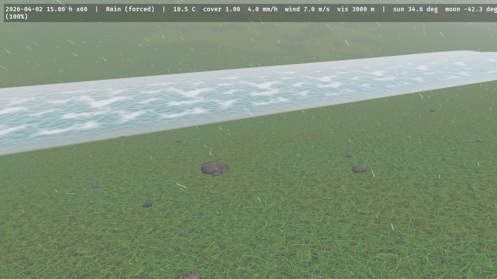
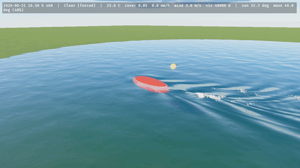
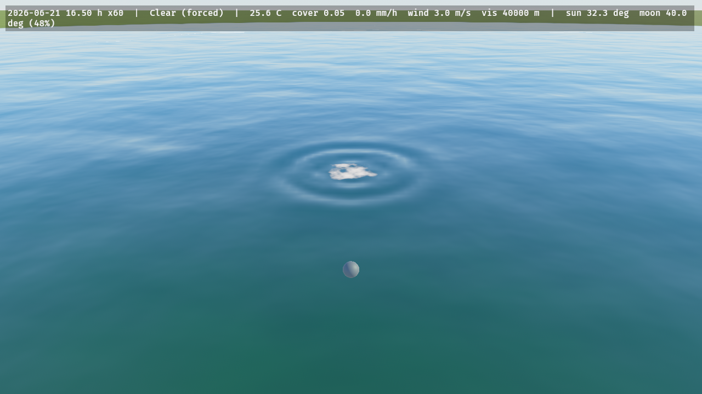

# Rivers, lakes and waves

Shallow-water hydrology with erosion, the water material, and the wave field bodies leave behind them.

## Hydrology and erosion

`HydrologyPlugin` simulates water on the `Terrain`'s grid with Mei et al.'s virtual pipes, the pipe's cross-section taken from the local depth (so waves travel at 0.9 √(g d), not at a constant speed) and Manning friction (`HydrologySettings::manning_n`, 0.035). Time runs in fixed 20 ms substeps scheduled from *real* time (`HydrologySettings::time_scale`, independent of the `WorldClock`), at most `ElementsQuality::hydrology_substeps()` a frame (2 / 4 / 4 / 16), on a grid of at most `terrain_max_resolution()` cells per side (256 / 512 / 512 / 2048). The boundary is an open free overfall or a closed wall. Rain is the weather's, split into rain and snow per cell at that cell's lapse-rate temperature, delivered in quanta of at least 5 µm so it is never lost to f32 rounding, and shaded by `PrecipitationBlocker`s. `WaterSource` and `WaterSink` pour or drain a rate over the cells within a radius.

```rust
# use bevy::prelude::*;
# use bevy_elements::*;
fn pour_a_river(mut commands: Commands, mut bake: MessageWriter<ErodeTerrain>) {
    // 50 m³/s over the cells within 5 m of this point; the weather's rain falls everywhere.
    commands.spawn((
        WaterSource { rate_m3_s: 50.0, radius_m: 5.0 },
        Transform::from_xyz(-200.0, 4.0, 0.0),
    ));
    // Ten simulated minutes of erosion under 20 mm/h, at the quality's full substep rate.
    // `TerrainBaked` follows when it is done.
    bake.write(ErodeTerrain { duration_s: 600.0, rain_mm_h: 20.0 });
}
```

`ErosionSettings` carries Mei's capacity law `K_c · max(sin α, min_tilt) · |v|`, dissolve and deposit (sediment first, then bedrock; sediment moves with the water through the same pipe fluxes, so solids are conserved to rounding) and thermal erosion every 4th substep (35° talus, bedrock above 45°). **Bare bedrock erodes at the capacity rate**: the `flood` valley's 50 m³/s river carves its bedrock by up to 7.9 m in 120 s of simulated time and arrives at a marker 100 m away after 63 s instead of 36 s, so set `ErosionSettings::enabled = false` for a flood that should not change the ground (the `flood` example does). `HydrologyStats` counts substeps and simulated time, for code that waits on them.

## Water

`WaterPlugin` (part of `ElementsPlugins`) draws the water the hydrology simulates; `WaterSettings` (insert it first to override) holds the look. A patch of the terrain's level-of-detail selection that has at least 3 mm of water somewhere in it is drawn twice, by two entities with one `WaterExtension` and two `WaterMaterial`s: the **absorb** pass multiplies what is under the water by `(1 − F) · exp(−σ t)` per colour channel (σ = `absorption`, default `(0.45, 0.06, 0.03)` m⁻¹: red goes first, so a metre of water turns the bed blue-green, which one blend cannot do), where `t` is the thickness from the depth prepass corrected for the refracted ray; the **surface** pass adds the Fresnel reflection of the sky (`F₀ = 0.02`) and sun, the body colour of silt, and foam where the flow is fast or the water is thin, the ripples flow-mapped from the simulated velocity (Vlachos 2010, two phases).

 

**A still sea.** Insert `StillWater { level }` (world units, in the frame of `Environment::terrain_height`) and the same plugin draws water over every place the terrain's surface is below that level, with no hydrology behind it: the absorb and surface passes, the shore fade and the contact foam are the ones above, and a simulated surface above the level composites over it. `Environment::water_depth` answers the same depth (the higher of the simulated water and `level − ground`), so a game's wading rules read what is drawn. The sea does not stop at the terrain grid's edge: it continues 100 km past it at the edge's depth, to the horizon. Changing the level writes one uniform; removing the resource removes the sea. `ELEMENTS_STILL=<level>` sets it in the `terrain_tour` example. A `WaterContact` pressing the sea sends out rings and wakes like it does on simulated water. Not yet: a sea that continues past the terrain grid's edge, and a hydrology that idles while only a still level is set (issue #44).


## Waves

`WavesPlugin` makes the hydrology's water answer what moves through it. Put a `WaterContact { half_extents }` (an ellipsoid along the entity's local axes, any rotation) on a hull, a float, a wader's legs or a falling stone: where it cuts the surface it presses down with the pressure head of its occupied column (its draft for a shallow hull, less for a deep narrow leg whose lower part the waves do not reach), plus Bernoulli's impact head `v²/2g` while it crosses the surface going down. At rest the water stays flat around it; moving, it leaves a wake bounded by Kelvin's 19.47°; bobbing or dropped in, it sends out rings in which the short waves outrun the long ones. Waves reflect off the shores, slow in the shallows, are carried by the current, break where they grow steeper than water holds (amplitude 7 % of the wavelength) and leave foam that fades over a few seconds.

The field is three camera-following windows a factor of four apart (High: 512² of 5, 20 and 80 cm, out to 410 m), each a linear capillary-gravity wave field stepped by Tessendorf's iWave scheme with a 13 × 13 kernel fitted at start-up to Airy's dispersion over its band (within 1.5 %), forced by the bodies' head split into the bands like a Laplacian pyramid. The water's surface and absorb passes add its slopes to the flow-mapped ripples and draw its breaking foam; `WaveState` publishes it for a water shader of your own. `WaveSettings::damping_per_s` sets how long a wake lasts.

```rust
# use bevy::prelude::*;
# use bevy_elements::*;
fn a_float(mut commands: Commands) {
    // A 25 cm ball; move its transform and the water answers.
    commands.spawn((WaterContact::sphere(0.25), Transform::from_xyz(0.0, 5.7, 0.0)));
}
```



 
